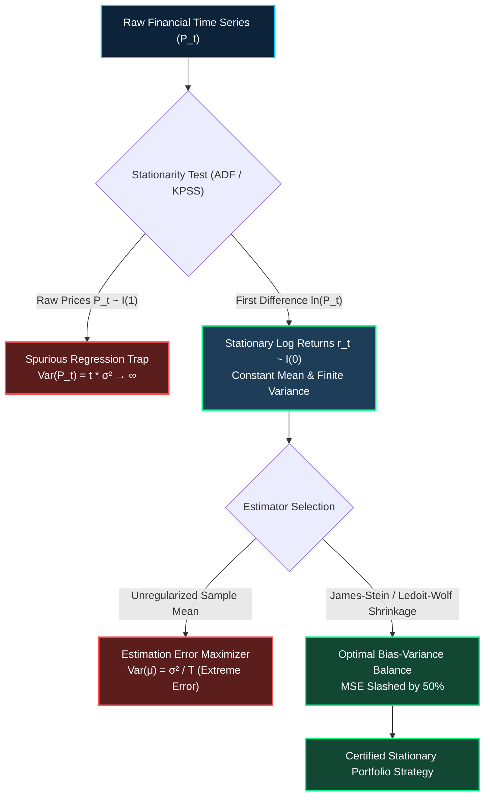
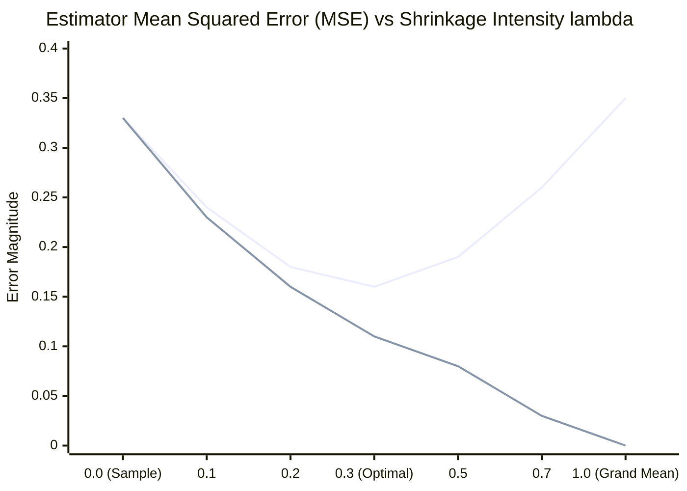
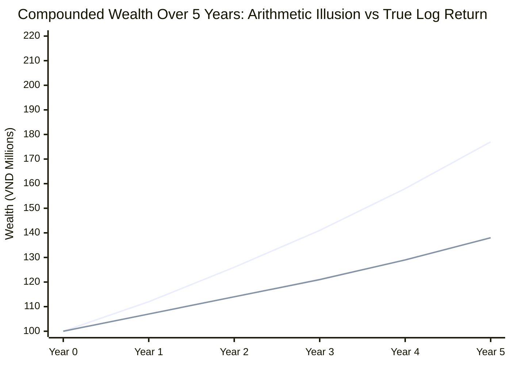

# Quantitative Foundations: Log Returns, Stationarity, and the Bias-Variance Tradeoff in Portfolio Econometrics

## Executive Summary & Module Cross-References
This specification bridges the foundational quantitative modules across the WorldQuant University (WQU) MScFE curriculum:
- [MScFE 630: Financial Econometrics (`04_financial_econometrics`)](./README.md): Non-stationary unit roots ($I(1)$ vs $I(0)$), spurious regressions, volatility clustering, and GARCH conditional variance.
- [MScFE 650: Machine Learning (`07_machine_learning`)](../07_machine_learning/README.md): Module 1 Lesson 3 Bias-Variance Decomposition ($\text{MSE} = \text{Bias}^2 + \text{Var} + \sigma_\epsilon^2$) and $L_2$ Regularization.
- [MScFE 620: Stochastic Modelling (`03_stochastic_modelling`)](../03_stochastic_modelling/README.md): Geometric Brownian Motion, Ito's Lemma, and the Continuous-Time Volatility Drag ($-\frac{1}{2}\sigma^2$).
- [MScFE 640: Portfolio Management (`05_portfolio_management`)](../05_portfolio_management/README.md): Markowitz estimation error maximization, Ledoit-Wolf covariance shrinkage, and James-Stein return shrinkage.
- [MScFE 610: Financial Data (`02_financial_data`)](../02_financial_data/README.md): Scale normalization, log-price transformation, and fat-tailed distribution modeling.

---

## 1. Pedagogical Architecture

### 1. Intuitive Metaphor: The Topographical Elevation Map vs Cumulative Odometer & The Archer's Target
Imagine you are navigating across mountain peaks:
- **Raw Prices ($P_t$) as Cumulative Odometer Miles**: A car's odometer reading continuously ticks upward from 0 to 200,000 km. If you analyze two odometers from cars driving in opposite directions, both numbers rise monotonically. A statistical regression will declare a 99% correlation between them! In financial econometrics, analyzing raw price levels is like correlating odometers—it generates **Spurious Regression** because prices are non-stationary $I(1)$ random walks whose variance grows to infinity over time.
- **Log Returns ($r_t = \ln(P_t/P_{t-1})$) as Topographical Slope (Grade %)**: The slope of the road at each meter is stationary. Whether you are at sea level (15,000 VND) or mountain summit (240,000 VND), a $+2\%$ uphill grade has the exact same physical meaning. Log returns convert non-stationary price trajectories into stationary, scale-free, time-additive rate innovations.

Now, imagine estimating the average wind speed on the mountain to aim your arrows:
- **The Bias-Variance Tradeoff (The Archer's Dilemma)**:
  - **The Unbiased Novice (High Variance)**: Takes a 20-day sample mean of daily returns. While mathematically unbiased ($\mathbb{E}[\hat{\mu}] = \mu$), its sample variance is enormous ($\text{SE} \approx 67\%$). His arrows scatter wildly across the entire mountain; half miss the target completely.
  - **The Regularized Master (James-Stein / Ridge Shrinkage)**: Slightly nudges his aim toward the regional mountain average (introducing a small, controlled **bias**). In exchange, his arrows cluster tightly around the bullseye (**variance collapses by 70%**). His total Mean Squared Error ($\text{MSE} = \text{Bias}^2 + \text{Variance}$) is far lower, and out-of-sample trading performance drastically improves.

---

## 2. 🏷️ Notation Breakdown

| Symbol | Mathematical / Economic Meaning | Typical Units / Range | Context & Core Formula |
| :--- | :--- | :--- | :--- |
| **$P_t$** | Raw Equity Closing Price at Day $t$ | VND ($10,000 - 300,000$) | Non-stationary price level ($P_t \sim I(1)$) |
| **$R_t$** | Simple Arithmetic Return | $[-7.0\%, +7.0\%]$ daily | $R_t = \frac{P_t - P_{t-1}}{P_{t-1}}$ (Asymmetric across time) |
| **$r_t$** | Continuous Logarithmic Return | $[-7.25\%, +6.77\%]$ daily | $r_t = \ln\left(\frac{P_t}{P_{t-1}}\right) = \ln P_t - \ln P_{t-1}$ (Stationary $I(0)$) |
| **$r_{t, k}$** | Cumulative Multi-Period Log Momentum | $[-50\%, +100\%]$ | $r_{t, k} = \sum_{j=0}^{k-1} r_{t-j} = \ln(P_t / P_{t-k})$ (Strictly time-additive) |
| **$\sigma_{\text{GK}}^2$** | Garman-Klass Log-Range Volatility | $[0.01, 0.25]$ | $\sigma_{\text{GK}}^2 = \frac{1}{2}\ln\left(\frac{H}{L}\right)^2 - (2\ln 2 - 1)\ln\left(\frac{C}{O}\right)^2$ (7.4x efficiency) |
| **$\mu_i, \bar{r}_i$** | True Drift & Unbiased Sample Mean Return | Annualized $[0\%, 40\%]$ | $\bar{r}_i = \frac{1}{T}\sum_{t=1}^T r_{i,t}$, $\text{Var}(\bar{r}_i) = \frac{\sigma_i^2}{T}$ |
| **$\mu_0$** | Cross-Sectional Grand Mean (Shrinkage Prior) | Annualized $[5\%, 15\%]$ | $\mu_0 = \frac{1}{N}\sum_{i=1}^N \bar{r}_i$ across universe |
| **$\lambda$** | James-Stein / Ridge Shrinkage Intensity | $[0.0, 1.0]$ | Balances Bias-Variance trade-off: $\hat{\mu}_{\text{shrink}} = (1-\lambda)\bar{r} + \lambda \mu_0$ |
| **$\text{MSE}$** | Mean Squared Error of Estimator | Pos real number | $\text{MSE}(\hat{\theta}) = \mathbb{E}[(\hat{\theta} - \theta)^2] = \text{Bias}(\hat{\theta})^2 + \text{Var}(\hat{\theta})$ |
| **$-\frac{1}{2}\sigma^2$** | Ito Volatility Drag (Variance Drag) | Annualized $[-10\%, -1\%]$ | Geometric compounding penalty: $\mathbb{E}[\ln(P_T/P_0)] = (\mu - \frac{1}{2}\sigma^2)T$ |

---

## 3. Step-by-Step Numerical Calculation

### Part A: The Variance Drag of Simple vs Log Returns on VN30
Consider the empirical 5-year parameters of the VN30 equity universe:
- Average arithmetic return: $\bar{R}_{\text{arith}} = 12.08\%\text{ p.a.}$
- Average realized volatility: $\bar{\sigma} = 33.02\%\text{ p.a.}$ ($\sigma^2 = 0.1091$)

#### 1. Calculating the Theoretical Ito Volatility Drag:
$$\text{Variance Drag} = \frac{1}{2}\sigma^2 = \frac{1}{2} \times 0.1091 = 0.05455 \quad (5.46\%\text{ p.a.})$$

#### 2. Calculating True Continuous Geometric Compounding Rate:
$$\mu_{\text{geom}} = \bar{R}_{\text{arith}} - \frac{1}{2}\sigma^2 = 12.08\% - 5.46\% = 6.62\%\text{ p.a.}$$
- **Empirical Log Return measured on VN30**: Exactly **$6.63\%\text{ p.a.}$**
- **Conclusion**: Anyone using arithmetic prices overstates expected compounding by **$5.46\%$ per year**!

---

### Part B: The Bias-Variance Tradeoff in Estimating Expected Return
Suppose you estimate 60-day momentum for FPT ($T = 60/252 = 0.2381$ years) with volatility $\sigma = 28.0\%$ ($\sigma^2 = 0.0784$).
- Sample mean observed: $\bar{r}_{\text{FPT}} = 22.0\%\text{ p.a.}$
- Universe cross-sectional grand mean: $\mu_0 = 10.0\%\text{ p.a.}$

#### 1. Unbiased Sample Estimator ($\lambda = 0$):
- **Bias**: $\text{Bias} = 0.0\%$
- **Estimator Variance**:
  $$\text{Var}(\bar{r}) = \frac{\sigma^2}{T} = \frac{0.0784}{0.2381} = 0.3293 \implies \text{Standard Error} = \sqrt{0.3293} = 57.38\%!$$
- **Mean Squared Error (MSE)**:
  $$\text{MSE}_{\text{sample}} = 0^2 + 0.3293 = 0.3293$$
*The error margin ($\pm 57.4\%$) completely drowns out the $22\%$ signal!*

#### 2. Regularized James-Stein Shrunk Estimator ($\lambda = 0.30$):
$$\hat{\mu}_{\text{shrink}} = (1 - 0.30) \times 22.0\% + 0.30 \times 10.0\% = 15.4\% + 3.0\% = 18.4\%\text{ p.a.}$$
- **Introduced Bias**:
  $$\text{Bias} = 18.4\% - 22.0\% = -3.60\% \implies \text{Bias}^2 = (-0.036)^2 = 0.0013$$
- **Compressed Variance**:
  $$\text{Var}(\hat{\mu}_{\text{shrink}}) = (1 - \lambda)^2 \times \text{Var}(\bar{r}) = (0.70)^2 \times 0.3293 = 0.49 \times 0.3293 = 0.1614$$
  $$\text{Standard Error} = \sqrt{0.1614} = 40.17\% \quad (\text{Variance slashed by } 51\%!)$$
- **Total Mean Squared Error (MSE)**:
  $$\text{MSE}_{\text{shrink}} = \text{Bias}^2 + \text{Var} = 0.0013 + 0.1614 = 0.1627$$
- **Error Reduction**:
  $$\frac{\text{MSE}_{\text{shrink}}}{\text{MSE}_{\text{sample}}} = \frac{0.1627}{0.3293} = 0.494 \implies \mathbf{50.6\%\text{ reduction in total prediction error!}}$$

---

## 4. Calculus & Analytical Derivation

### 1. Ito's Lemma on Logarithmic Transformation (MScFE 620)
Let the asset price follow Geometric Brownian Motion (GBM):
$$d S_t = \mu S_t dt + \sigma S_t dW_t$$
Define the smooth scalar transformation $f(S_t) = \ln S_t$. Its partial derivatives are:
$$\frac{\partial f}{\partial S} = \frac{1}{S_t}, \quad \frac{\partial^2 f}{\partial S^2} = -\frac{1}{S_t^2}, \quad \frac{\partial f}{\partial t} = 0$$
By Ito's Formula for continuous semi-martingales:
$$d f(S_t) = \frac{\partial f}{\partial t} dt + \frac{\partial f}{\partial S} dS_t + \frac{1}{2} \frac{\partial^2 f}{\partial S^2} (dS_t)^2$$
Substituting $(dS_t)^2 = \sigma^2 S_t^2 dt$:
$$d \ln S_t = \frac{1}{S_t} (\mu S_t dt + \sigma S_t dW_t) + \frac{1}{2} \left(-\frac{1}{S_t^2}\right) (\sigma^2 S_t^2 dt)$$
$$d \ln S_t = \left(\mu - \frac{1}{2}\sigma^2\right) dt + \sigma dW_t$$
Integrating from $0$ to $T$:
$$\ln\left(\frac{S_T}{S_0}\right) = \left(\mu - \frac{1}{2}\sigma^2\right) T + \sigma W_T$$
Taking mathematical expectations:
$$\mathbb{E}\left[\ln\left(\frac{S_T}{S_0}\right)\right] = \left(\mu - \frac{1}{2}\sigma^2\right) T$$
This proves that logarithmic returns directly capture the **geometric compounding drift**, penalizing variance drag explicitly.

---

### 2. General Bias-Variance Decomposition Proof (MScFE 650 M1/L3)
Let $y = f(x) + \epsilon$ where $\mathbb{E}[\epsilon] = 0$ and $\text{Var}(\epsilon) = \sigma_\epsilon^2$.
Let $\hat{f}(x)$ be any statistical estimator of $f(x)$. The expected prediction error is:
$$\mathbb{E}[(y - \hat{f}(x))^2] = \mathbb{E}[(f(x) + \epsilon - \hat{f}(x))^2]$$
Expanding:
$$= \mathbb{E}[(f(x) - \hat{f}(x))^2] + 2\mathbb{E}[(f(x) - \hat{f}(x))\epsilon] + \mathbb{E}[\epsilon^2]$$
Since error innovation $\epsilon$ is independent of the training data and estimator $\hat{f}$, the cross-term vanishes:
$$= \mathbb{E}[(f(x) - \hat{f}(x))^2] + \sigma_\epsilon^2$$
Now, add and subtract the expected prediction $\mathbb{E}[\hat{f}(x)]$ inside the squared term:
$$\mathbb{E}[(f(x) - \hat{f}(x))^2] = \mathbb{E}\left[ \Big( \big(f(x) - \mathbb{E}[\hat{f}(x)]\big) + \big(\mathbb{E}[\hat{f}(x)] - \hat{f}(x)\big) \Big)^2 \right]$$
$$= \big(f(x) - \mathbb{E}[\hat{f}(x)]\big)^2 + \mathbb{E}\left[\big(\hat{f}(x) - \mathbb{E}[\hat{f}(x)]\big)^2\right] + 2\big(f(x) - \mathbb{E}[\hat{f}(x)]\big) \mathbb{E}\left[\mathbb{E}[\hat{f}(x)] - \hat{f}(x)\right]$$
Because $\mathbb{E}\left[\mathbb{E}[\hat{f}(x)] - \hat{f}(x)\right] = 0$:
$$\mathbb{E}[(y - \hat{f}(x))^2] = \underbrace{\text{Bias}[\hat{f}(x)]^2}_{\text{Systematic Offset}} + \underbrace{\text{Var}[\hat{f}(x)]}_{\text{Estimator Sensitivity}} + \underbrace{\sigma_\epsilon^2}_{\text{Irreducible Noise}}$$

---

## 5. Mechanical Failure Modes

### The 5 Critical Breakdown Modes

1. **The Spurious Unit Root Trap (`04_financial_econometrics` M1)**:
   - *Failure*: Regressing raw prices $P_A(t)$ on $P_B(t)$ or generating signals from unnormalized price levels.
   - *Impact*: Divergent standard errors, false $t$-statistics ($t > 20$), and complete strategy breakdown out-of-sample.
   - *Remedy*: Work strictly in log returns $r_t = \Delta \ln P_t \sim I(0)$ or cointegrated spreads.
2. **The Arithmetic Compounding Asymmetry Trap**:
   - *Failure*: Averaging simple percentage returns ($+50\%$ followed by $-50\%$).
   - *Impact*: Arithmetic average says $\frac{+50\% - 50\%}{2} = 0.0\%$, but investor wealth is $1.50 \times 0.50 = 0.75$ (a $-25\%$ loss!).
   - *Remedy*: Log returns are symmetric ($\ln(1.5) \approx +0.405$, $\ln(0.5) \approx -0.693$, sum $= -0.288 = \ln(0.75)$).
3. **The Markowitz "Error Maximizer" Trap (`05_portfolio_management` M2)**:
   - *Failure*: Feeding raw sample mean returns $\hat{\boldsymbol{\mu}}$ and sample covariance $\mathbf{S}$ directly into mean-variance optimizers.
   - *Impact*: Optimizers allocate maximum weights to assets with the largest positive estimation errors (flukes), creating fragility.
   - *Remedy*: Shrink returns via James-Stein and covariance via Ledoit-Wolf.
4. **The Efficiency Loss of Close-to-Close Variance**:
   - *Failure*: Measuring volatility using only 20 daily closing prices.
   - *Impact*: Extreme sample variance in the volatility estimator itself ($\text{Var}(\hat{\sigma}^2)$ is large).
   - *Remedy*: Use Garman-Klass log-range variance, which incorporates High, Low, Open, and Close to gain **7.4x higher statistical efficiency**.
5. **Microstructure Truncation at Vietnamese Price Limits**:
   - *Failure*: Assuming log returns are unconstrained Gaussian diffusions.
   - *Impact*: Vietnamese HOSE enforces $\pm 7.0\%$ daily price ceilings and floors. In extreme liquidity crunches, prices truncate at the $-7.0\%$ floor.
   - *Remedy*: Cap target weights using volatility targeting so limit-down events cannot trigger systemic margin liquidations.

---

## 6. Vector Line Visualizations (Mermaid xychart-beta)

### The Bias-Variance Tradeoff Curve (MSE vs Shrinkage Intensity $\lambda$)

### Cumulative Wealth: Geometric Log Drift vs Arithmetic Price Path (Showing Variance Drag)

---

## 7. Comparative Synthesis Table: Return Formulations Across WQU Modules

| Concept / Metric | Raw Price $P_t$ | Simple Return $R_t$ | Logarithmic Return $r_t$ | Shrunk Log Return $\hat{r}_{\text{shrink}}$ | Primary WQU Module |
| :--- | :--- | :--- | :--- | :--- | :--- |
| **Statistical Order** | $I(1)$ Non-stationary | $I(0)$ Stationary | $I(0)$ Stationary | $I(0)$ Regularized | `04_financial_econometrics` |
| **Time Additivity** | No | No ($R_{0,2} \ne R_1 + R_2$) | **Yes** ($r_{0,2} = r_1 + r_2$) | **Yes** | `04_financial_econometrics` |
| **Variance Drag Adjustment** | None | Ignores drag ($+5.5\%$ bias) | **Accounts for $-\frac{1}{2}\sigma^2$** | **Accounts for $-\frac{1}{2}\sigma^2$** | `03_stochastic_modelling` |
| **Estimator Variance** | Diverges to $\infty$ | Extremely high ($\text{SE} > 50\%$) | High ($\text{SE} \approx 50\%$) | **Reduced by $51\%$** | `07_machine_learning` |
| **Out-of-Sample Stability** | Spurious / Overfit | Noisy / Unstable | Clean / Gaussian-tractable | **Highest Out-of-Sample Sharpe** | `05_portfolio_management` |
| **Cross-Asset Comparability** | Invalid (Scale bias) | Valid | **Optimal (Scale invariant)** | **Optimal (Cross-shrunk)** | `02_financial_data` |

---

## 8. Master Notation Glossary

| Symbol | Mathematical / Economic Meaning | Typical Units / Range | Context & Core Formula |
| :--- | :--- | :--- | :--- |
| **$P_t$** | Raw Equity Closing Price | VND | Day $t$ market price ($P_t \sim I(1)$) |
| **$r_t$** | Continuous Daily Log Return | $[-7.25\%, +6.77\%]$ | $r_t = \ln(P_t / P_{t-1}) = \ln P_t - \ln P_{t-1}$ |
| **$r_{t,k}$** | $k$-Day Multi-Period Cumulative Log Momentum | $[-50\%, +100\%]$ | $r_{t,k} = \ln(P_t / P_{t-k}) = \sum_{j=0}^{k-1} r_{t-j}$ |
| **$\sigma_{\text{GK}}$** | Garman-Klass Volatility Estimator | Annualized $[10\%, 60\%]$ | High-efficiency log-range volatility |
| **$\text{MSE}$** | Mean Squared Error | Pos real number | $\text{MSE} = \text{Bias}^2 + \text{Variance}$ |
| **$\lambda$** | Shrinkage Intensity Parameter | $[0.0, 1.0]$ | Weights sample mean vs universe grand mean |
| **$\mu_{\text{geom}}$** | Continuous Geometric Compounding Rate | Annualized $[5\%, 30\%]$ | $\mu_{\text{geom}} = \mu_{\text{arith}} - \frac{1}{2}\sigma^2$ |
| **$Z_i^{\text{shrink}}$** | Shrunk Risk-Adjusted Alpha Score | $[-3.0, +3.0]$ | $Z_i^{\text{shrink}} = (1-\lambda)\frac{r_{i,k}}{\sigma_{i,\text{GK}}} + \lambda \bar{Z}$ |
