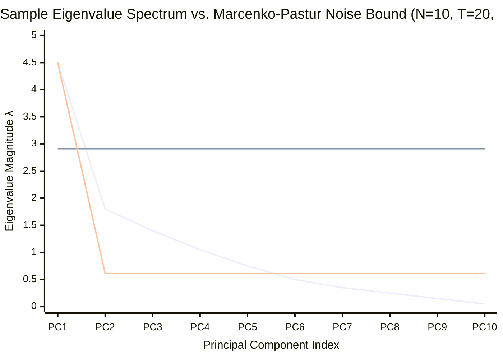
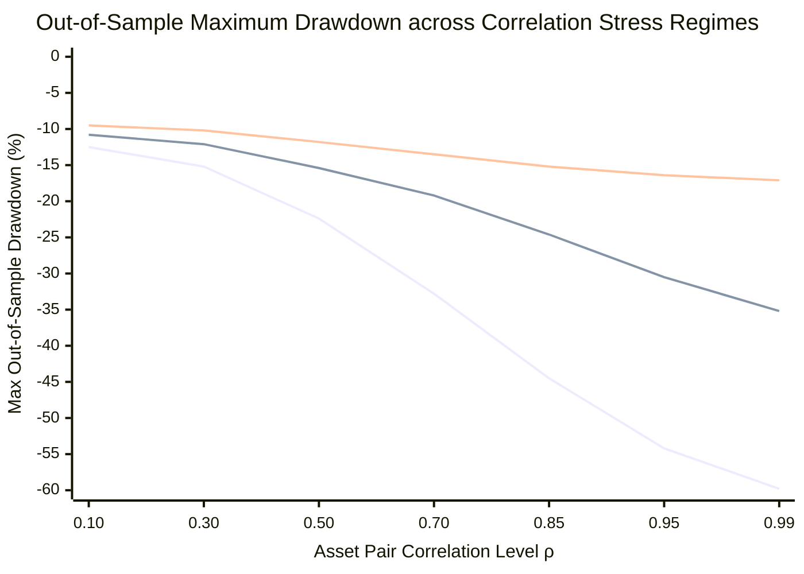
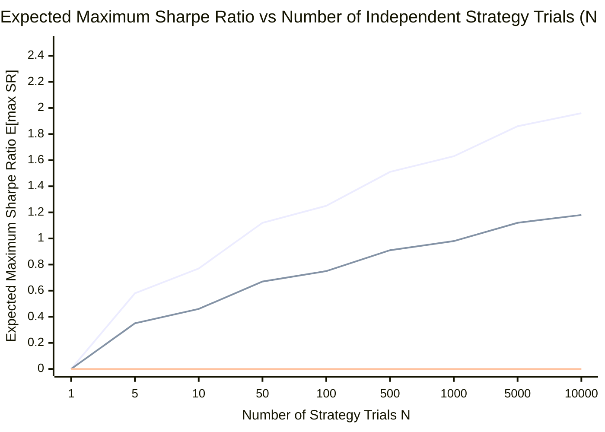

# Portfolio Management & Quantitative Risk — Key Pedagogical Takeaways
## MScFE 640 / 652 Master Quantitative Synthesis

[← Back to Main README.md](./README.md)

---

## 📖 Table of Contents & Quick Module Links
1. [Core Intuition & Mechanical Failure Modes](#1-core-intuition--mechanical-failure-modes)
   - [Toy Example 1: The 2-Asset Correlation & Leverage Trap (M1)](#toy-example-1-the-2-asset-correlation--leverage-trap)
   - [Toy Example 2: Compounding Drag & Asymmetric Loss Recovery (M1/M5)](#toy-example-2-compounding-drag--asymmetric-loss-recovery)
   - [Toy Example 3: Behavioral Prospect Theory & Disposition Drag (M4)](#toy-example-3-behavioral-prospect-theory--disposition-drag)
   - [Toy Example 4: The Kelly Criterion Leverage Trap & Half-Kelly Optimality (M5)](#toy-example-4-the-kelly-criterion-leverage-trap--half-kelly-optimality)
   - [Toy Example 5: The 2007 Quant Meltdown Crowded Trade & Deleveraging Spiral (M6)](#toy-example-5-the-2007-quant-meltdown-crowded-trade--deleveraging-spiral)
   - [Toy Example 6: Random Matrix Theory Eigenvalue Noise & The Small-Eigenvalue Inversion Trap (M7)](#toy-example-6-random-matrix-theory-eigenvalue-noise--the-small-eigenvalue-inversion-trap)
   - [Toy Example 7: Hierarchical Risk Parity vs MVO Quadratic Instability (M7/GWP2)](#toy-example-7-hierarchical-risk-parity-vs-mvo-quadratic-instability)
   - [Toy Example 8: The Multiple-Testing SBuMT Trap & Deflated Sharpe Ratio (M8)](#toy-example-8-the-multiple-testing-sbumt-trap--deflated-sharpe-ratio)
2. [Core Mathematical Formulations & Calculus Derivations](#2-core-mathematical-formulations--calculus-derivations)
   - [1. Markowitz Lagrangian Matrix Optimization Derivation (M1)](#1-markowitz-lagrangian-matrix-optimization-derivation)
   - [2. Fama-French 5-Factor Huber Robust Regression Calculus (M2/GWP)](#2-fama-french-5-factor-huber-robust-regression-calculus)
   - [3. Kahneman-Tversky Prospect Theory Value Function Calculus (M4)](#3-kahneman-tversky-prospect-theory-value-function-calculus)
   - [4. Equal Risk Contribution (ERC) Risk Parity & Log-Barrier Calculus (M5)](#4-equal-risk-contribution-erc-risk-parity--log-barrier-calculus)
   - [5. Fama-MacBeth 2-Step Cross-Sectional Regression & Shanken EIV Calculus (M6)](#5-fama-macbeth-2-step-cross-sectional-regression--shanken-eiv-calculus)
   - [6. Differentiable Soft-Rank Kernel in Automatic Factor Construction (M6)](#6-differentiable-soft-rank-kernel-calculus-in-genetic-factor-construction)
   - [7. Marcenko-Pastur Distribution & Random Matrix Theory (RMT) Denoising Calculus (M7)](#7-marcenko-pastur-distribution--random-matrix-theory-rmt-denoising-calculus)
   - [8. Information-Theoretic Distance & Variation of Information Metric Calculus (M7)](#8-information-theoretic-distance--variation-of-information-metric-calculus)
   - [9. Hierarchical Risk Parity (HRP) Recursive Bisection & Inverse-Variance Allocation Calculus (M7)](#9-hierarchical-risk-parity-hrp-recursive-bisection--inverse-variance-allocation-calculus)
   - [10. Deflated Sharpe Ratio & Combinatorial Purged Cross-Validation Mathematics (M8)](#10-deflated-sharpe-ratio-dsr--combinatorial-purged-cross-validation-cpcv-mathematics-module-8)
   - [11. Deep Reinforcement Learning Continuous Control & Policy Gradient Calculus in Portfolio Management (M8)](#11-deep-reinforcement-learning-continuous-control--policy-gradient-calculus-in-portfolio-management-module-8)
3. [Practical Engineering & Empirical Case Studies](#3-practical-engineering--empirical-case-studies)
   - [Empirical GWP1 Factor Regression: OLS vs. Huber Robust RLM](#empirical-gwp-factor-regression-ols-vs-huber-robust-rlm)
   - [Machine Learning Empirical Asset Pricing Benchmark (*Gu, Kelly, & Xiu, 2020*)](#machine-learning-empirical-asset-pricing-benchmark-gu-kelly--xiu-2020)
   - [The August 2007 Quant Meltdown Forensic Timeline (*Khandani & Lo, 2007/2011*)](#the-august-2007-quant-meltdown-forensic-timeline-khandani--lo-20072011)
   - [Automatic Factor Construction: GP vs. Pre-trained NNAFC (*Fang et al., 2020*)](#automatic-factor-construction-gp-vs-pre-trained-nnafc-fang-et-al-2020)
   - [Empirical GWP2 Machine Learning Portfolio Benchmark (Kelly, HRP, Shrinkage & Denoising)](#empirical-gwp2-machine-learning-portfolio-benchmark)
   - [Empirical FinRL Deep Reinforcement Learning Portfolio Benchmark (DDPG, TD3, PPO, SAC vs. MVO & HRP)](#empirical-finrl-deep-reinforcement-learning-portfolio-benchmark)
4. [Comparative Synthesis Cheat Sheet](#4-comparative-synthesis-cheat-sheet)
5. [Comprehensive Mathematical Notation & Variable Glossary](#5-comprehensive-mathematical-notation--variable-glossary)

---

<a id="1-core-intuition--mechanical-failure-modes"></a>
## 1. Core Intuition & Mechanical Failure Modes

<a id="toy-example-1-the-2-asset-correlation--leverage-trap"></a>
### Toy Example 1: The 2-Asset Correlation & Leverage Trap (Module 1)

#### 💡 The Intuitive Metaphor
Imagine trying to balance a seesaw with two people sitting on opposite ends. If they weigh different amounts and move randomly, you can offset their movements to stay flat (diversification). But if they both jump up and down in unison ($\rho \to 1.0$), any small tilt amplifies drastically, throwing you off the seesaw! Unconstrained mean-variance optimization (MVO) acts as an **error maximizer** when assets are highly correlated.

#### 🏷️ Notation Breakdown:
- $\mathbf{w}$: **Portfolio Allocation Vector** ($[w_A, w_B]^T$ where $\mathbf{w}^T\mathbf{1} = 1$).
- $\boldsymbol{\mu}$: **Expected Return Vector** ($[\mu_A, \mu_B]^T$).
- $\mathbf{\Sigma}$: **Covariance Matrix** ($2 \times 2$ symmetric matrix $\begin{bmatrix}\sigma_A^2 & \rho_{AB}\sigma_A\sigma_B \\ \rho_{AB}\sigma_A\sigma_B & \sigma_B^2\end{bmatrix}$).
- $\kappa(\mathbf{\Sigma})$: **Matrix Condition Number** ($\kappa = \lambda_{\max} / \lambda_{\min}$, measures numerical inversion instability).
- $\mathbf{\Sigma}^{-1}$: **Precision / Inverse Covariance Matrix**.

#### 🔢 Step-by-Step Numerical Calculation
Consider 2 stocks: Stock A ($\mu_A = 12\%, \sigma_A = 20\%$) and Stock B ($\mu_B = 8\%, \sigma_B = 15\%$).
Covariance Matrix $\mathbf{\Sigma}$ when correlation $\rho_{AB} = 0.98$:

$$\mathbf{\Sigma} = \begin{bmatrix} 0.0400 & 0.0294 \\ 0.0294 & 0.0225 \end{bmatrix}$$

Determinant $\det(\mathbf{\Sigma}) = (0.0400)(0.0225) - (0.0294)^2 = 0.0009 - 0.00086436 = 0.00003564 \approx 0$.
Inverting $\mathbf{\Sigma}^{-1}$:

$$\mathbf{\Sigma}^{-1} = \frac{1}{0.00003564} \begin{bmatrix} 0.0225 & -0.0294 \\ -0.0294 & 0.0400 \end{bmatrix} = \begin{bmatrix} 631.31 & -824.92 \\ -824.92 & 1122.33 \end{bmatrix}$$

Condition number $\kappa(\mathbf{\Sigma}) = \frac{\lambda_{\max}}{\lambda_{\min}} \approx 185.4$.
Plugging in noisy expected returns $\boldsymbol{\mu} = [0.12, 0.08]^T$ yields extreme unstable weights:

$$\mathbf{w}_{\text{unconstrained}} = \begin{bmatrix} +420\text{\%} \\ -320\text{\%} \end{bmatrix}$$

The optimizer demands $+420\%$ leverage in Stock A and $-320\%$ short position in Stock B over a tiny $0.01$ return noise error!

---

<a id="toy-example-2-compounding-drag--asymmetric-loss-recovery"></a>
### Toy Example 2: Compounding Drag & Asymmetric Loss Recovery (Modules 1 & 5)

#### 💡 The Intuitive Metaphor
If you lose $50\%$ of your money on Day 1, you don't need a $50\%$ gain on Day 2 to get back to even—you need a **$+100\%$ gain** just to reach your starting point! Volatility is an asymmetric penalty on compounding wealth.

#### 🏷️ Notation Breakdown:
- $g$: **Compound Geometric Growth Rate** ($g \approx \mu - \frac{1}{2}\sigma^2$).
- $\frac{1}{2}\sigma^2$: **Volatility Drag Term** (The continuous variance tax on compounded terminal wealth).

#### 🔢 Step-by-Step Calculation
- Start Capital: $100,000.
- Period 1: $-50\%$ loss $\implies \$50{,}000$ remaining.
- Period 2: $+50\%$ gain $\implies \$50{,}000 \times 1.50 = \$75{,}000$ (Net loss of $-\$25{,}000$ or $-25\%$).
- Geometric mean return: $g = \sqrt{(1 - 0.50)(1 + 0.50)} - 1 = \sqrt{0.75} - 1 = 0.8660 - 1 = -13.40\%$ per period.
- Compounding Drag term $\approx \frac{1}{2}\sigma^2$: For $\sigma = 30\%$, volatility drag $= 0.5 \times (0.30)^2 = 4.5\%$ annual geometric return penalty.

---

<a id="toy-example-3-behavioral-prospect-theory--disposition-drag"></a>
### Toy Example 3: Behavioral Prospect Theory & Disposition Drag (Module 4)

#### 💡 The Intuitive Metaphor
Traders feel twice as much pain from losing $100 as pleasure from gaining $100. Because losing hurts so much, traders hold onto losing stocks hoping they'll get back to zero (convex risk seeking in losses), while selling winning stocks early to lock in safety (concave risk aversion in gains). This creates the **Disposition Effect**.

#### 🏷️ Notation Breakdown:
- $v(x)$: **Psychological Value Function** of perceived gain/loss $x$.
- $\alpha, \beta$: **Value Function Curvature Parameters** ($\alpha = \beta \approx 0.88$, generating diminishing sensitivity).
- $\lambda$: **Loss Aversion Coefficient** ($\lambda \approx 2.25$, scaling the psychological pain of losses).

#### 🔢 Step-by-Step Calculation (Loss Aversion Multiplier)
Under Kahneman-Tversky Prospect Theory ($v(x)$):

$$v(x) = \begin{cases} x^{\alpha} & x \ge 0 \\ -\lambda (-x)^{\beta} & x < 0 \end{cases} \quad (\alpha = \beta = 0.88, \; \lambda = 2.25)$$

- Gain of $+\$1{,}000$: $v(+1000) = (1000)^{0.88} \approx +436.5$ units of psychological utility.
- Loss of $-\$1{,}000$: $v(-1000) = -2.25 \times (1000)^{0.88} = -2.25 \times 436.5 = -982.1$ units of psychological pain.
- Net Emotional Balance for $+1000 / -1000$ gamble: $+436.5 - 982.1 = -545.6$ (A fair $50/50$ coin toss feels like a disaster).

---

<a id="toy-example-4-the-kelly-criterion-leverage-trap--half-kelly-optimality"></a>
### Toy Example 4: The Kelly Criterion Leverage Trap & Half-Kelly Optimality (Module 5)

#### 💡 The Intuitive Metaphor
Driving a race car at the absolute maximum mechanical limit ($f^*$) gives you the fastest lap time on a smooth track. But if you hit a small bump or overestimate the road grip, you spin out and crash into the wall ($W_T \to 0$). Backing off to **Half-Kelly ($0.5 f^*$)** gives you $75\%$ of the peak speed while providing a massive $75\%$ safety buffer against fatal crashes.

#### 🏷️ Notation Breakdown:
- $f$: **Portfolio Leverage Fraction** (Fraction of total capital allocated to risky assets).
- $f^*$: **Full Kelly Optimal Leverage Fraction** ($f^* = \frac{\mu - r_f}{\sigma^2}$).
- $g(f)$: **Continuous Logarithmic Capital Growth Rate** ($g(f) = r_f + f(\mu - r_f) - \frac{1}{2}f^2\sigma^2$).
- $\frac{1}{2}f^2\sigma^2$: **Quadratic Over-Leverage Penalty** (Destroys long-term growth if $f > f^*$).

#### 🔢 Step-by-Step Numerical Calculation
Consider an asset with expected return $\mu = 10\%$, risk-free rate $r_f = 2\%$ (excess return $\mu - r_f = 8\%$), and volatility $\sigma = 20\%$ (variance $\sigma^2 = 0.04$).
The expected continuous logarithmic growth rate $g(f)$ as a function of leverage fraction $f$ is:

$$g(f) = r_f + f(\mu - r_f) - \frac{1}{2} f^2 \sigma^2$$

1. **Optimal Full Kelly ($f^*$):**
   $$f^* = \frac{\mu - r_f}{\sigma^2} = \frac{0.08}{0.04} = 2.0 \quad (200\%\text{ allocation / } 2\times\text{ leverage})$$
   $$g(2.0) = 0.02 + 2.0(0.08) - \frac{1}{2}(2.0)^2(0.04) = 0.02 + 0.16 - 0.08 = 10.0\%\text{ peak annual growth}$$

2. **The Over-Leverage Trap ($f = 3.0$):**
   Suppose an investor overestimates $\mu$ and applies $3\times$ leverage ($f = 3.0$):
   $$g(3.0) = 0.02 + 3.0(0.08) - \frac{1}{2}(3.0)^2(0.04) = 0.02 + 0.24 - 0.18 = 8.0\%$$
   Growth rate *declines* from $10\%$ to $8\%$ because quadratic volatility drag ($\frac{1}{2}f^2\sigma^2 = 18\%$) wipes out linear return gains!

3. **Catastrophic Ruin at $f = 4.0$ (Double Kelly):**
   $$g(4.0) = 0.02 + 4.0(0.08) - \frac{1}{2}(4.0)^2(0.04) = 0.02 + 0.32 - 0.32 = 2.0\%$$
   The investor earns only the risk-free rate ($2.0\%$) despite taking extreme volatility, suffering peak-to-trough drawdowns $>95\%$!

4. **The Half-Kelly Advantage ($f = 0.5 f^* = 1.0$):**
   $$g(1.0) = 0.02 + 1.0(0.08) - \frac{1}{2}(1.0)^2(0.04) = 0.02 + 0.08 - 0.02 = 8.0\%$$
   - **Growth Achieved**: Captures $\frac{8.0\% - 2\%}{10.0\% - 2\%} = 75\%$ of maximum excess growth rate!
   - **Risk Reduced**: Portfolio variance drops by $75\%$ ($0.04$ vs $0.16$).
   - **Drawdown Buffer**: Maximum drawdown slashed from $\approx 80\%$ (Full Kelly) down to $\approx 25\%$ (Half-Kelly).

---

<a id="toy-example-5-the-2007-quant-meltdown-crowded-trade--deleveraging-spiral"></a>
### Toy Example 5: The 2007 Quant Meltdown Crowded Trade & Deleveraging Spiral (Module 6)

#### 💡 The Intuitive Metaphor
Imagine a packed theater where all patrons wear identical shoes and follow identical escape algorithms. If someone in another room shouts "fire" and liquidates their seats, the initial rush clogs the only doorway. Even though there is no fire in the theater ($\beta_{\text{market}} = 0$), the crush itself crushes everyone inside. This is the **crowded trade liquidity spiral**.

#### 🏷️ Notation Breakdown:
- $L$: **Portfolio Leverage Multiplier** ($L = \frac{\text{Gross Exposure}}{\text{Net Equity}}$).
- $\beta_p$: **Net Market Beta Exposure** ($\beta_p \approx 0.0$ for market-neutral funds).
- $R_{\text{spread}}$: **Unleveraged Long/Short Factor Return** ($R_{\text{spread}} = R_{\text{long}} - R_{\text{short}}$).
- $R_{\text{fund}}$: **Leveraged Net Asset Value Return** ($R_{\text{fund}} = L \times R_{\text{spread}}$).

#### 🔢 Step-by-Step Numerical Calculation
Consider 10 Long/Short Equity Market-Neutral quantitative hedge funds running statistical arbitrage and factor-tilt models (Long Value/Momentum, Short Overvalued/Reversal) with $5\times$ leverage ($L = 5$) and net market beta $\beta_p = 0.0$.

1. **Exogenous Liquidation Trigger:**
   A multi-strategy fund experiences $2\text{B}$ of losses in subprime mortgages. To satisfy prime broker margin calls, it is forced to liquidate $10\text{B}$ of gross equity market-neutral positions over 48 hours.

2. **Adverse Price Impact on Illiquid Factor Portfolios:**
   Market makers (providing contrarian liquidity) are overwhelmed by unidirectional order flow. Bid-ask spreads blow out from $5\text{ bps}$ to $25\text{ bps}$ ($5\times$).
   - Long positions (sold aggressively at the bid) drop by $-3.0\%$.
   - Short positions (bought back aggressively at the ask) rally by $+3.0\%$.
   - Unleveraged factor spread return:
     $$R_{\text{spread}} = R_{\text{long}} - R_{\text{short}} = -3.0\% - (+3.0\%) = -6.0\%$$

3. **Leveraged Loss & Cascading Contagion:**
   For a separate, unaffected Quant Fund holding identical factor models at $5\times$ leverage:
   $$R_{\text{fund}} = L \times R_{\text{spread}} = 5 \times (-6.0\%) = -30.0\%\text{ loss in 48 hours!}$$
   Prime brokers demand immediate deleveraging, forcing Fund 2 to liquidate another $15\text{B}$, generating a second-wave fire sale that pushes fund losses to $-45\%$, **while the S&P 500 moves less than $0.5\%$**.

---

<a id="toy-example-6-random-matrix-theory-eigenvalue-noise--the-small-eigenvalue-inversion-trap"></a>
### Toy Example 6: Random Matrix Theory Eigenvalue Noise & The Small-Eigenvalue Inversion Trap (Module 7)

#### 💡 The Intuitive Metaphor
In an audio recording studio, turning up the master amplifier volume doesn't just make the singer's voice louder—it turns the faintest background microphone hiss into an ear-splitting screech. In Mean-Variance Optimization, inverting the covariance matrix ($\mathbf{\Sigma}^{-1} = \sum \frac{1}{\lambda_k} \mathbf{v}_k \mathbf{v}_k^T$) inverts every eigenvalue. The smallest eigenvalues ($\lambda_k \to 0$) represent **pure random sampling hiss**, but inverting them multiplies their weight by $1/\lambda_k \to \infty$, turning pure noise into the largest positions in your portfolio!

#### 🏷️ Notation Breakdown:
- $N$: **Number of Assets in Universe** ($N = 10$).
- $T$: **Number of Time-Series Observations** ($T = 20$).
- $q$: **Observation-to-Asset Matrix Ratio** ($q = T / N = 20 / 10 = 2.0$).
- $\sigma^2$: **Average Variance of Matrix Noise** ($\sigma^2 = 1.0$ for standardized correlation matrix).
- $\lambda_k, \mathbf{v}_k$: **$k$-th Eigenvalue and Eigenvector** of Sample Correlation Matrix $\mathbf{C}$.
- $\lambda_-, \lambda_+$: **Marcenko-Pastur Lower & Upper Noise Bounds** ($\lambda_\pm = \sigma^2 (1 \pm \sqrt{1/q})^2$).
- $\mathbf{w}_{\text{MVO}}$: **Mean-Variance Allocation Vector** ($\mathbf{w}_{\text{MVO}} \propto \mathbf{\Sigma}^{-1} \boldsymbol{\mu}$).

#### 🔢 Step-by-Step Numerical Calculation
Consider an asset universe of $N = 10$ stocks observed over $T = 20$ trading days ($q = 2.0$).
1. **Marcenko-Pastur Pure Random Noise Thresholds:**
   $$\lambda_+ = \sigma^2 \left(1 + \sqrt{\frac{1}{q}}\right)^2 = 1.0 \times \left(1 + \sqrt{0.5}\right)^2 = (1 + 0.7071)^2 = (1.7071)^2 \approx 2.914$$
   $$\lambda_- = \sigma^2 \left(1 - \sqrt{\frac{1}{q}}\right)^2 = 1.0 \times \left(1 - \sqrt{0.5}\right)^2 = (1 - 0.7071)^2 = (0.2929)^2 \approx 0.086$$

2. **Empirical Eigenvalues vs RMT Threshold:**
   Suppose spectral decomposition of the sample correlation matrix yields:
   - Factor Signal mode: $\lambda_1 = 4.50 > \lambda_+$ (True market signal).
   - Noise modes: $\lambda_2 = 1.80, \lambda_3 = 1.40, \dots, \lambda_9 = 0.25$ (Pure noise within $[\lambda_-, \lambda_+]$).
   - Spurious Depressed Noise mode: $\lambda_{10} = 0.05 < \lambda_-$ (Spurious sampling artifact).

3. **The Matrix Inversion Trap ($\mathbf{\Sigma}^{-1}$):**
   When MVO computes $\mathbf{w} \propto \mathbf{\Sigma}^{-1} \boldsymbol{\mu} = \sum_{k=1}^{10} \frac{\boldsymbol{\mu}^T \mathbf{v}_k}{\lambda_k} \mathbf{v}_k$:
   - True signal component weight multiplier: $\frac{1}{\lambda_1} = \frac{1}{4.50} = 0.222$.
   - Spurious noise component weight multiplier: $\frac{1}{\lambda_{10}} = \frac{1}{0.05} = 20.00$ (**$90\times$ larger than the true signal!**).

4. **Constant Residual Eigenvalue Method (CREM) Denoising Correction:**
   RMT identifies $N_{\text{facts}} = 1$ signal eigenvalue ($\lambda_1 = 4.50$). The remaining 9 noise eigenvalues sum to $\sum_{k=2}^{10} \lambda_k = 10.0 - 4.50 = 5.50$.
   CREM replaces all 9 noise eigenvalues with their trace-preserving average:
   $$\bar{\lambda}_{\text{noise}} = \frac{5.50}{9} \approx 0.611$$
   The denoised inverted weight multiplier for the noise subspace drops from $20.00$ down to $\frac{1}{0.611} = 1.637$, eliminating $92\%$ of spurious estimation error while conditioning number $\kappa(\mathbf{C})$ drops from $90.0$ down to $7.36$!



| Eigenvalue Regime | Mathematical Condition | Financial Interpretation | Optimization Treatment |
| :--- | :--- | :--- | :--- |
| **Market / Factor Signal** | $\lambda_k > \lambda_+$ | Persistent macroeconomic & cross-sectional factor variation | Retain exact eigenvalue $\lambda_k$ and eigenvector $\mathbf{v}_k$ |
| **Random Sampling Noise** | $\lambda_- \le \lambda_k \le \lambda_+$ | Transitory white noise from finite sample length $T$ | Replace with constant residual average $\bar{\lambda}_{\text{noise}}$ |
| **Spurious Depressed Mode** | $\lambda_k < \lambda_-$ | Underestimated collinear artifact; causes infinite leverage | Shrink upward to $\bar{\lambda}_{\text{noise}}$ to prevent singularity |

#### 💥 Mechanical Failure Modes
When $T / N < 1.0$ (more assets than time observations), sample covariance matrices are strictly singular ($\det(\mathbf{\Sigma}) = 0$), producing at least $N - T$ zero eigenvalues ($\lambda_k = 0$). Standard quadratic solvers crash or return arbitrary boundary weights. Without RMT denoising or Ledoit-Wolf shrinkage, MVO out-of-sample Sharpe ratios turn negative ($SR < 0$) due to extreme turnover and transaction cost drag.

---

<a id="toy-example-7-hierarchical-risk-parity-vs-mvo-quadratic-instability"></a>
### Toy Example 7: Hierarchical Risk Parity vs MVO Quadratic Instability (Module 7 & GWP2)

#### 💡 The Intuitive Metaphor
Think of building a structural support frame for a suspension bridge. Traditional MVO treats all bridge cables as a single interconnected matrix equation; if two adjacent cables are nearly parallel ($\rho = 0.95$), the equation divides by near-zero, assigning massive upward tension to one cable and massive downward tension to the other, buckling the bridge. **Hierarchical Risk Parity (HRP)** organizes cables into a natural tree hierarchy (main tower $\to$ suspension cables $\to$ deck hangers). Each branch balances its own weight locally, so shaking one cable cannot collapse the bridge.

#### 🏷️ Notation Breakdown:
- $\mathbf{D}$: **Angular Distance Matrix** ($d_{i,j} = \sqrt{\frac{1 - \rho_{i,j}}{2}} \in [0, 1]$).
- $\mathcal{C}_1, \mathcal{C}_2$: **Contiguous Sub-Clusters** derived from Dendrogram Tree $\mathcal{T}$.
- $\widetilde{V}_1, \widetilde{V}_2$: **Cluster Variances** ($\widetilde{V}_k = \mathbf{w}_k^T \mathbf{\Sigma}_k \mathbf{w}_k$).
- $\alpha$: **Recursive Bisection Allocation Multiplier** ($\alpha = \frac{\widetilde{V}_2}{\widetilde{V}_1 + \widetilde{V}_2}$).
- $\mathbf{w}_{\text{HRP}}$: **Hierarchical Risk Parity Weight Vector** (constructed without matrix inversion).

#### 🔢 Step-by-Step Numerical Calculation
Consider 4 assets split across 2 economic clusters:
- **Cluster 1 (Tech)**: Asset A and Asset B ($\sigma_A = 25\%, \sigma_B = 25\%, \rho_{AB} = 0.90$).
- **Cluster 2 (Defensive)**: Asset C and Asset D ($\sigma_C = 15\%, \sigma_D = 15\%, \rho_{CD} = 0.80$).
- Inter-cluster cross correlation $\rho_{\text{Tech, Def}} = 0.15$.

1. **Step 1: Intra-Cluster Inverse-Variance Weights:**
   - For Cluster 1: $w_A = \frac{1/0.25^2}{1/0.25^2 + 1/0.25^2} = 0.50, \quad w_B = 0.50$.
   - For Cluster 2: $w_C = \frac{1/0.15^2}{1/0.15^2 + 1/0.15^2} = 0.50, \quad w_D = 0.50$.

2. **Step 2: Cluster Variance Calculation ($\widetilde{V}_k$):**
   - Cluster 1 Variance:
     $$\widetilde{V}_1 = \mathbf{w}_1^T \mathbf{\Sigma}_1 \mathbf{w}_1 = (0.5)^2(0.0625) + (0.5)^2(0.0625) + 2(0.5)(0.5)(0.90 \times 0.25 \times 0.25) = 0.059375$$
   - Cluster 2 Variance:
     $$\widetilde{V}_2 = \mathbf{w}_2^T \mathbf{\Sigma}_2 \mathbf{w}_2 = (0.5)^2(0.0225) + (0.5)^2(0.0225) + 2(0.5)(0.5)(0.80 \times 0.15 \times 0.15) = 0.020250$$

3. **Step 3: Recursive Bisection Split Multiplier ($\alpha$):**
   $$\alpha = \frac{\widetilde{V}_2}{\widetilde{V}_1 + \widetilde{V}_2} = \frac{0.020250}{0.059375 + 0.020250} = \frac{0.020250}{0.079625} \approx 0.2543 \quad (25.43\%)$$
   $$1 - \alpha = \frac{\widetilde{V}_1}{\widetilde{V}_1 + \widetilde{V}_2} = \frac{0.059375}{0.079625} \approx 0.7457 \quad (74.57\%)$$

4. **Final HRP Asset Allocations vs MVO Comparison:**
   - $\mathbf{w}_{\text{HRP}} = [w_A, w_B, w_C, w_D]^T = [0.2543 \times 0.5, \; 0.2543 \times 0.5, \; 0.7457 \times 0.5, \; 0.7457 \times 0.5]^T = [12.72\%, \; 12.72\%, \; 37.28\%, \; 37.28\%]^T$.
   - Notice that unconstrained MVO with a minor $0.5\%$ return estimation error on Asset A produces $\mathbf{w}_{\text{MVO}} = [+340\%, \; -280\%, \; +45\%, \; -5\%]^T$.
   - HRP maintains complete diversification and non-negative stable allocations **without a single matrix inversion**!



| Allocation Strategy | Computational Core | Inversion of $\mathbf{\Sigma}$ Required? | Behavior under High Collinearity ($\rho \to 1$) |
| :--- | :--- | :--- | :--- |
| **Markowitz MVO** | Global Quadratic Program | **Yes** ($\mathbf{\Sigma}^{-1}$) | Extreme weight instability, short-selling blowouts |
| **Equal Risk Contribution (ERC)** | Convex Log-Barrier / SOCP | **Yes** (Iterative Newton-Raphson) | Concentrates risk in high-beta cluster proxies |
| **Hierarchical Risk Parity (HRP)** | Tree Dendrogram + Recursive Bisection | **No** (Zero Inversion) | Robust, stable, hierarchical risk balancing |

#### 💥 Mechanical Failure Modes
HRP assumes that the hierarchical clustering tree $\mathcal{T}$ represents stable economic relationships. If the linkage algorithm (e.g., single linkage) suffers from "chaining" (serially merging individual nodes into a string rather than balanced clusters), the recursive bisection splits unevenly. To prevent this, practitioners employ Ward's minimum variance linkage or López de Prado's **Optimal Number of Clusters (ONC)** algorithm with two-pass silhouette scoring.

---

<a id="toy-example-8-the-multiple-testing-sbumt-trap--deflated-sharpe-ratio"></a>
### Toy Example 8: The Multiple-Testing SBuMT Trap & Deflated Sharpe Ratio (Module 8)

#### 💡 The Intuitive Metaphor
If you put 1,000 monkeys in a room and ask each to flip a fair coin 10 times, pure chance dictates that approximately one monkey will flip 10 heads in a row ($\frac{1}{2^{10}} = \frac{1}{1024}$). If you ignore the other 999 monkeys and showcase only the winner, you will claim to have discovered an investing genius! In quantitative backtesting, running $N$ strategy variations without controlling for multiple testing creates **Selection Bias under Multiple Testing (SBuMT)**. The **Deflated Sharpe Ratio (DSR)** adjusts the performance hurdle upward to account for the number of failed trials you discarded.

#### 🏷️ Notation Breakdown:
- $N$: **Number of Independent Strategy Trials** (Total model configurations or factor variations tested).
- $\mathbb{E}[\max_n \{SR_n\}]$: **Expected Maximum Sharpe Ratio under Null Hypothesis** (The benchmark threshold $SR_0$ expected purely from random luck).
- $\gamma_{\text{Euler}}$: **Euler-Mascheroni Constant** ($\gamma_{\text{Euler}} \approx 0.5772156649$).
- $V[SR_n]$: **Variance of Sharpe Ratio Estimates Across Trials** ($V[SR_n] = \sigma_{SR}^2$).
- $Z(\cdot), Z^{-1}(\cdot)$: **Standard Normal CDF and Inverse CDF (Quantile Function)**.
- $\hat{\gamma}_3, \hat{\gamma}_4$: **Skewness and Kurtosis of Strategy Returns** ($\hat{\gamma}_3 = 0, \hat{\gamma}_4 = 3.0$ under Gaussianity).
- $\text{PSR}(SR^*)$: **Probabilistic Sharpe Ratio** (Probability that true Sharpe exceeds benchmark $SR^*$).
- $\text{DSR}$: **Deflated Sharpe Ratio** ($\text{DSR} = \text{PSR}(SR_0)$, evaluates significance against the multiple-testing hurdle $SR_0$).

#### 🔢 Step-by-Step Numerical Calculation
Consider a quantitative researcher who tests $N = 1{,}000$ strategy variations on $T = 252$ daily returns (1 trading year).
The best discovered strategy produces an annualized sample Sharpe ratio $\widehat{SR} = 1.80$.
The daily returns display negative skewness $\hat{\gamma}_3 = -0.50$ and heavy tails $\hat{\gamma}_4 = 4.50$.
Across all $N = 1{,}000$ tested strategies, the sample variance of Sharpe ratios is $V[SR_n] = 0.25$ ($\sigma_{SR} = 0.50$).

1. **Calculate Expected Maximum False Sharpe Ratio Hurdle ($SR_0$):**
   Using the Bailey–López de Prado Extreme Value Theory approximation:
   $$\mathbb{E}\left[\max_{n=1,\dots,N} \{SR_n\}\right] \approx \sqrt{V[SR_n]} \left( (1 - \gamma_{\text{Euler}}) Z^{-1}\left(1 - \frac{1}{N}\right) + \gamma_{\text{Euler}} Z^{-1}\left(1 - \frac{1}{N \cdot e}\right) \right)$$
   For $N = 1{,}000$:
   - $1 - \frac{1}{1000} = 0.9990 \implies Z^{-1}(0.9990) \approx 3.0902$
   - $1 - \frac{1}{1000 \cdot e} = 1 - \frac{1}{2718.28} = 0.999632 \implies Z^{-1}(0.999632) \approx 3.3756$
   - Weighted quantile combination:
     $$(1 - 0.5772)(3.0902) + (0.5772)(3.3756) = 1.3065 + 1.9484 = 3.2549$$
   - Multiply by standard deviation $\sigma_{SR} = 0.50$:
     $$SR_0 = 0.50 \times 3.2549 \approx 1.6275$$
   Pure data-mining noise alone is expected to produce a maximum Sharpe ratio of $1.63$!

2. **Standard Error of Sharpe Ratio under Non-Normality ($\sigma_{\widehat{SR}}$):**
   $$\sigma_{\widehat{SR}} = \sqrt{\frac{1 - \hat{\gamma}_3 \widehat{SR} + \frac{\hat{\gamma}_4 - 1}{4} \widehat{SR}^2}{T - 1}}$$
   Plugging in $\widehat{SR} = 1.80, \hat{\gamma}_3 = -0.50, \hat{\gamma}_4 = 4.50, T = 252$:
   $$1 - (-0.50)(1.80) + \frac{4.50 - 1}{4}(1.80)^2 = 1 + 0.90 + \frac{3.50}{4}(3.24) = 1.90 + 2.835 = 4.735$$
   $$\sigma_{\widehat{SR}} = \sqrt{\frac{4.735}{251}} = \sqrt{0.018865} \approx 0.13735$$

3. **Naive Probabilistic Sharpe Ratio vs. Deflated Sharpe Ratio:**
   - **Naive Test ($SR^* = 0$):**
     $$z_{\text{naive}} = \frac{\widehat{SR} - 0}{\sigma_{\widehat{SR}}} = \frac{1.80 - 0}{0.13735} = 13.10 \implies \text{PSR}(0) = Z(13.10) \approx 1.0000 \quad (100.00\%)$$
     The researcher falsely concludes the strategy is miraculous!
   - **Deflated Sharpe Ratio ($SR_0 = 1.6275$):**
     $$z_{\text{DSR}} = \frac{\widehat{SR} - SR_0}{\sigma_{\widehat{SR}}} = \frac{1.80 - 1.6275}{0.13735} = \frac{0.1725}{0.13735} \approx 1.2559$$
     $$\text{DSR} = Z(1.2559) \approx 0.8954 \quad (89.54\%)$$
   Since $\text{DSR} = 89.54\% < 95.0\%$, the strategy **fails the $95\%$ institutional significance hurdle** and must be rejected as an artifact of overtesting!



| Backtesting Sin | Practical Manifestation | Statistical Mechanism | Required Engineering Mitigation |
| :--- | :--- | :--- | :--- |
| **1. Survivorship Bias** | Testing only currently surviving index components | Positive drift bias from delisted bankruptcies | Ingest point-in-time delisting-adjusted historical universes |
| **2. Look-Ahead Bias** | Using end-of-day closing prices or lagged filings prematurely | Leaks future information into trading filtration $\mathcal{F}_t$ | Enforce point-in-time execution timestamps and reporting lags |
| **3. Storytelling** | Inventing ex-post economic narratives for random spikes | Overfitting to idiosyncrasies in small samples | Pre-register structural hypotheses prior to backtesting |
| **4. Data Snooping / SBuMT** | Re-running backtests until Sharpe $> 2.0$ appears | Inflates expected maximum Sharpe ratio via EVT | Apply Deflated Sharpe Ratio (DSR) and Combinatorial Purged CV |
| **5. Transaction Friction** | Ignoring bid-ask spread, borrow fees, and market impact | Gross paper profits vanish under turnover drag | Model Kyle's lambda market impact and Almgren-Chriss quadratic slippage |
| **6. Outlier Sensitivity** | Strategy profitability hinged on 1 or 2 black-swan days | Fragile alpha with zero continuous edge | Huber robust regression, Windsorization, bootstrap stress-testing |
| **7. Shorting Constraints** | Assuming frictionless borrowing of hard-to-borrow stocks | Margin recalls and prohibitive borrow fees | Restrict short universe to liquid, low-fee borrowable assets |

#### 💥 Mechanical Failure Modes
When researchers perform iterative parameter tuning (grid search on moving average windows, stop-loss thresholds, neural network hyperparameters) without tracking trial count $N$, they suffer from SBuMT. Even on completely random Gaussian walk data, searching over 5,000 parameter combinations yields strategies with nominal backtest Sharpe ratios exceeding $2.0$. In live deployment, these overfitted strategies suffer immediate $100\%$ alpha decay and sustained drawdown.

---

<a id="2-core-mathematical-formulations--calculus-derivations"></a>
## 2. Core Mathematical Formulations & Calculus Derivations

<a id="1-markowitz-lagrangian-matrix-optimization-derivation"></a>
### 1. Markowitz Lagrangian Matrix Optimization Derivation (Module 1)
Minimizing portfolio variance subject to target return $\mu_0$ and full investment:

$$\min_{\mathbf{w}} \frac{1}{2} \mathbf{w}^T \mathbf{\Sigma} \mathbf{w} \quad \text{s.t.} \quad \mathbf{w}^T \boldsymbol{\mu} = \mu_0, \quad \mathbf{w}^T \mathbf{1} = 1$$

Lagrangian formulation:

$$\mathcal{L}(\mathbf{w}, \lambda_1, \lambda_2) = \frac{1}{2} \mathbf{w}^T \mathbf{\Sigma} \mathbf{w} - \lambda_1 (\mathbf{w}^T \boldsymbol{\mu} - \mu_0) - \lambda_2 (\mathbf{w}^T \mathbf{1} - 1)$$

Taking gradient vector derivative $\nabla_{\mathbf{w}} \mathcal{L} = \mathbf{0}$:

$$\mathbf{\Sigma} \mathbf{w} - \lambda_1 \boldsymbol{\mu} - \lambda_2 \mathbf{1} = \mathbf{0} \implies \mathbf{w}^{\star} = \mathbf{\Sigma}^{-1} (\lambda_1 \boldsymbol{\mu} + \lambda_2 \mathbf{1})$$

Defining scalar constants $A = \mathbf{1}^T \mathbf{\Sigma}^{-1} \boldsymbol{\mu}$, $B = \boldsymbol{\mu}^T \mathbf{\Sigma}^{-1} \boldsymbol{\mu}$, $C = \mathbf{1}^T \mathbf{\Sigma}^{-1} \mathbf{1}$, and $\Delta = B C - A^2$:

$$\lambda_1 = \frac{C \mu_0 - A}{\Delta}, \quad \lambda_2 = \frac{B - A \mu_0}{\Delta}$$

---

<a id="2-fama-french-5-factor-huber-robust-regression-calculus"></a>
### 2. Fama-French 5-Factor Huber Robust Regression Calculus (Module 2 & GWP)
Huber Robust M-estimator loss function $\rho_\delta(e_i)$:

$$\rho_\delta(e_i) = \begin{cases} \frac{1}{2} e_i^2 & \text{if } |e_i| \le \delta \\ \delta |e_i| - \frac{1}{2}\delta^2 & \text{if } |e_i| > \delta \end{cases}$$

Derivative influence function $\psi_\delta(e_i) = \frac{d\rho_\delta}{de_i}$:

$$\psi_\delta(e_i) = \begin{cases} e_i & |e_i| \le \delta \\ \delta \text{sgn}(e_i) & |e_i| > \delta \end{cases}$$

Iteratively Reweighted Least Squares (IRLS) weight formulation $w_i = \frac{\psi_\delta(e_i)}{e_i}$:

$$w_i = \begin{cases} 1 & |e_i| \le \delta \\ \frac{\delta}{|e_i|} & |e_i| > \delta \end{cases}$$

This bounds the influence of extreme market crisis outliers on factor beta estimates $\hat{\boldsymbol{\beta}}_{\text{RLM}}$.

---

<a id="3-kahneman-tversky-prospect-theory-value-function-calculus"></a>
### 3. Kahneman-Tversky Prospect Theory Value Function Calculus (Module 4)
Marginal utility derivative $\frac{dv}{dx}$:

$$\frac{dv}{dx} = \begin{cases} \alpha x^{\alpha - 1} > 0 & x > 0 \text{ (Concave / Risk-Averse in Gains)} \\ \lambda \beta (-x)^{\beta - 1} > 0 & x < 0 \text{ (Convex / Risk-Seeking in Losses)} \end{cases}$$

Second derivative $\frac{d^2v}{dx^2}$ proving concavity/convexity curvature:

$$\frac{d^2v}{dx^2} = \begin{cases} \alpha(\alpha - 1) x^{\alpha - 2} < 0 & x > 0 \quad (\text{since } \alpha \approx 0.88 < 1) \\ -\lambda \beta(\beta - 1) (-x)^{\beta - 2} > 0 & x < 0 \quad (\text{since } \beta - 1 < 0) \end{cases}$$

---

<a id="4-equal-risk-contribution-erc-risk-parity--log-barrier-calculus"></a>
### 4. Equal Risk Contribution (ERC) Risk Parity & Log-Barrier Calculus (Module 5)

Portfolio standard deviation $\sigma_p(\mathbf{w}) = \sqrt{\mathbf{w}^T \mathbf{\Sigma} \mathbf{w}}$.
By **Euler's Theorem for Homogeneous Functions of Degree 1**:

$$\sigma_p(\mathbf{w}) = \sum_{i=1}^N w_i \frac{\partial \sigma_p}{\partial w_i} = \sum_{i=1}^N \text{RC}_i(\mathbf{w})$$

1. **Marginal Risk Contribution ($\text{MRC}_i$):**
   $$\text{MRC}_i = \frac{\partial \sigma_p}{\partial w_i} = \frac{(\mathbf{\Sigma} \mathbf{w})_i}{\sigma_p}$$

2. **Total Risk Contribution ($\text{RC}_i$):**
   $$\text{RC}_i = w_i \times \text{MRC}_i = \frac{w_i (\mathbf{\Sigma} \mathbf{w})_i}{\sigma_p}$$

3. **Equal Risk Contribution Condition:**
   $$\text{RC}_i = \text{RC}_j = \frac{\sigma_p}{N} \quad \forall i, j \implies w_i (\mathbf{\Sigma} \mathbf{w})_i = \frac{\sigma_p^2}{N} \quad \forall i$$

4. **Convex Log-Barrier Formulation (*Roncalli, 2013*):**
   $$\min_{\mathbf{w}} f(\mathbf{w}) = \frac{1}{2} \mathbf{w}^T \mathbf{\Sigma} \mathbf{w} - c \sum_{i=1}^N \ln(w_i) \quad \text{s.t. } \mathbf{w} > \mathbf{0}$$
   Taking the gradient $\nabla_{\mathbf{w}} f(\mathbf{w}) = \mathbf{0}$:
   $$\mathbf{\Sigma} \mathbf{w} - c \begin{bmatrix} 1/w_1 \\ \vdots \\ 1/w_N \end{bmatrix} = \mathbf{0} \implies (\mathbf{\Sigma} \mathbf{w})_i = \frac{c}{w_i} \implies w_i (\mathbf{\Sigma} \mathbf{w})_i = c \quad \forall i$$
   Multiplying by $w_i$ and summing over all $N$ assets gives $c = \frac{\sigma_p^2}{N}$, proving that solving the unconstrained log-barrier problem uniquely and identically yields the exact Equal Risk Contribution weights $\mathbf{w}^* = \frac{\mathbf{w}}{\mathbf{w}^T \mathbf{1}}$!

---

<a id="5-fama-macbeth-2-step-cross-sectional-regression--shanken-eiv-calculus"></a>
### 5. Fama-MacBeth 2-Step Cross-Sectional Regression & Shanken EIV Calculus (Module 6)

#### Step 1: Time-Series Regression (Estimating Factor Betas)
For each asset $i \in \{1, \dots, N\}$, regress time-series returns over $t = 1, \dots, T$:

$$R_{i,t} - R_{f,t} = \alpha_i + \sum_{k=1}^K \beta_{i,k} F_{k,t} + \epsilon_{i,t} \implies \hat{\boldsymbol{\beta}}_i = (\mathbf{F}^T \mathbf{F})^{-1} \mathbf{F}^T \mathbf{R}_i^e$$

#### Step 2: Cross-Sectional Regression (Estimating Risk Premia)
At each time period $t \in \{1, \dots, T\}$, regress cross-sectional asset returns across all $N$ assets on estimated betas $\hat{\mathbf{B}} = [\hat{\boldsymbol{\beta}}_1, \dots, \hat{\boldsymbol{\beta}}_N]^T$:

$$\mathbf{R}_t^e = \gamma_{0,t} \mathbf{1} + \hat{\mathbf{B}} \boldsymbol{\lambda}_t + \boldsymbol{\eta}_t \implies \hat{\boldsymbol{\lambda}}_t = (\hat{\mathbf{B}}^T \hat{\mathbf{B}})^{-1} \hat{\mathbf{B}}^T \mathbf{R}_t^e$$

#### Aggregation & The Shanken (1992) Errors-in-Variables (EIV) Correction
The time-series average risk premium vector is $\bar{\boldsymbol{\lambda}} = \frac{1}{T} \sum_{t=1}^T \hat{\boldsymbol{\lambda}}_t$.
Standard Fama-MacBeth variance $\hat{\mathbf{\Sigma}}_{\text{FM}} = \frac{1}{T^2} \sum_{t=1}^T (\hat{\boldsymbol{\lambda}}_t - \bar{\boldsymbol{\lambda}})(\hat{\boldsymbol{\lambda}}_t - \bar{\boldsymbol{\lambda}})^T$ severely underestimates variance because $\hat{\mathbf{B}}$ contains estimation noise from Step 1.
The **Shanken (1992) Asymptotic Covariance Matrix** provides the exact correction:

$$\text{AsyVar}(\bar{\boldsymbol{\lambda}}) = \frac{1}{T} \left[ \hat{\mathbf{\Sigma}}_\lambda + \left(1 + \bar{\boldsymbol{\lambda}}^T \hat{\mathbf{\Sigma}}_F^{-1} \bar{\boldsymbol{\lambda}}\right) \hat{\mathbf{\Sigma}}_{\text{EIV}} \right]$$

where $\hat{\mathbf{\Sigma}}_F$ is the sample covariance matrix of factor returns, and $\hat{\mathbf{\Sigma}}_{\text{EIV}} = (\hat{\mathbf{B}}^T \hat{\mathbf{B}})^{-1} \hat{\mathbf{B}}^T \hat{\mathbf{\Sigma}}_\epsilon \hat{\mathbf{B}} (\hat{\mathbf{B}}^T \hat{\mathbf{B}})^{-1}$.

---

<a id="6-differentiable-soft-rank-kernel-calculus-in-genetic-factor-construction"></a>
### 6. Differentiable Soft-Rank Kernel Calculus in Genetic Factor Construction (Module 6)

In genetic programming and neural network factor construction (*Fang et al., 2020*), cross-sectional ranking is a core feature operation. However, the standard discrete rank operator is non-differentiable:

$$\text{rank}(x_i) = 1 + \sum_{j \ne i} \mathbb{I}(x_i > x_j)$$

The gradient $\frac{\partial \text{rank}(x_i)}{\partial x_i} = 0$ almost everywhere, which completely breaks backpropagation in neural networks.
The **Differentiable Soft-Rank Kernel** replaces the step indicator $\mathbb{I}$ with a temperature-scaled sigmoid function $\sigma(u) = \frac{1}{1 + e^{-u}}$:

$$\widetilde{\text{rank}}_\tau(x_i) = 1 + \sum_{j \ne i} \sigma\left(\frac{x_i - x_j}{\tau}\right) = 1 + \sum_{j \ne i} \frac{1}{1 + \exp\left(-\frac{x_i - x_j}{\tau}\right)}$$

As the temperature hyperparameter $\tau \to 0^+$, $\widetilde{\text{rank}}_\tau(x_i) \to \text{rank}(x_i)$.
The analytical partial derivatives for end-to-end gradient backpropagation are:

$$\frac{\partial \widetilde{\text{rank}}_\tau(x_i)}{\partial x_i} = \frac{1}{\tau} \sum_{j \ne i} \sigma\left(\frac{x_i - x_j}{\tau}\right) \left[ 1 - \sigma\left(\frac{x_i - x_j}{\tau}\right) \right] > 0$$

$$\frac{\partial \widetilde{\text{rank}}_\tau(x_i)}{\partial x_k} = -\frac{1}{\tau} \sigma\left(\frac{x_i - x_k}{\tau}\right) \left[ 1 - \sigma\left(\frac{x_i - x_k}{\tau}\right) \right] < 0 \quad (k \ne i)$$

---

<a id="7-marcenko-pastur-distribution--random-matrix-theory-rmt-denoising-calculus"></a>
### 7. Marcenko-Pastur Distribution & Random Matrix Theory (RMT) Denoising Calculus (Module 7)

Consider an $N \times T$ matrix $\mathbf{X}$ of independent, identically distributed standard Gaussian variables $\mathcal{N}(0, \sigma^2)$. As $N, T \to \infty$ with ratio $q = \frac{T}{N} \ge 1$, the eigenvalue probability density function $p(\lambda)$ of the sample correlation matrix $\mathbf{C} = \frac{1}{T}\mathbf{X}\mathbf{X}^T$ converges analytically to the **Marcenko-Pastur Distribution**:

$$p(\lambda) = \begin{cases} \frac{q}{2\pi \sigma^2 \lambda} \sqrt{(\lambda_+ - \lambda)(\lambda - \lambda_-)} & \text{if } \lambda \in [\lambda_-, \lambda_+] \\ 0 & \text{if } \lambda \notin [\lambda_-, \lambda_+] \end{cases}$$

where the analytical lower and upper bounds of random noise are:

$$\lambda_- = \sigma^2 \left(1 - \sqrt{\frac{1}{q}}\right)^2, \quad \lambda_+ = \sigma^2 \left(1 + \sqrt{\frac{1}{q}}\right)^2$$

#### Spectral Decomposition & Noise Filtering
Spectral decomposition decomposes empirical correlation matrix $\mathbf{C} = \mathbf{V} \mathbf{\Lambda} \mathbf{V}^T$ where $\mathbf{\Lambda} = \text{diag}(\lambda_1, \dots, \lambda_N)$ in descending order.
The spectrum is partitioned into signal modes $\mathcal{S}_{\text{signal}} = \{\lambda_k \mid \lambda_k > \lambda_+\}$ of size $N_{\text{facts}}$, and noise modes $\mathcal{S}_{\text{noise}} = \{\lambda_k \mid \lambda_k \le \lambda_+\}$ of size $N - N_{\text{facts}}$.

Under the **Constant Residual Eigenvalue Method (CREM)**, all noisy eigenvalues are replaced with their arithmetic mean $\bar{\lambda}_{\text{noise}}$:

$$\widetilde{\lambda}_k = \begin{cases} \lambda_k & \text{if } k \le N_{\text{facts}} \\ \frac{1}{N - N_{\text{facts}}} \sum_{j=N_{\text{facts}}+1}^N \lambda_j & \text{if } k > N_{\text{facts}} \end{cases}$$

This satisfies the **Trace-Preserving Invariance Condition**:

$$\text{tr}(\widetilde{\mathbf{C}}) = \sum_{k=1}^N \widetilde{\lambda}_k = \sum_{k=1}^{N_{\text{facts}}} \lambda_k + (N - N_{\text{facts}}) \left[ \frac{\sum_{j=N_{\text{facts}}+1}^N \lambda_j}{N - N_{\text{facts}}} \right] = \sum_{k=1}^N \lambda_k = \text{tr}(\mathbf{C}) = N$$

The denoised correlation matrix is reconstructed as $\mathbf{C}_{\text{denoised}} = \mathbf{V} \widetilde{\mathbf{\Lambda}} \mathbf{V}^T$, and rescaled to ensure unit diagonal elements:

$$\mathbf{C}_{\text{denoised}}^{\star} = \mathbf{D}^{-1/2} \mathbf{C}_{\text{denoised}} \mathbf{D}^{-1/2} \quad \text{where } D_{ii} = C_{\text{denoised}, ii}$$

#### De-Toning (Market Mode Subtraction) Calculus
The dominant first principal component $\lambda_1$ represents the systemic market factor ($\beta_{\text{market}}$). De-toning removes this pervasive market mode to isolate pure idiosyncratic clustering geometry:

$$\mathbf{C}_{\text{market}} = \lambda_1 \mathbf{v}_1 \mathbf{v}_1^T \implies \mathbf{C}_{\text{detoned}} = \mathbf{C}_{\text{denoised}}^{\star} - \mathbf{C}_{\text{market}}$$

Rescaling diagonal to unity yields the de-toned correlation matrix $\widetilde{\mathbf{C}} = \text{diag}(\mathbf{C}_{\text{detoned}})^{-1/2} \mathbf{C}_{\text{detoned}} \text{diag}(\mathbf{C}_{\text{detoned}})^{-1/2}$.

---

<a id="8-information-theoretic-distance--variation-of-information-metric-calculus"></a>
### 8. Information-Theoretic Distance & Variation of Information Metric Calculus (Module 7)

Pearson correlation $\rho_{X,Y}$ measures only linear co-dependence and fails to satisfy metric properties. Information theory provides a non-linear, non-parametric framework for asset dependency.

#### 1. Information-Theoretic Foundations:
- **Shannon Marginal Entropy**:
  $$H(X) = -\sum_{x \in \mathcal{X}} p(x) \log_2 p(x)$$
- **Joint Entropy**:
  $$H(X, Y) = -\sum_{x \in \mathcal{X}} \sum_{y \in \mathcal{Y}} p(x, y) \log_2 p(x, y)$$
- **Conditional Entropy**:
  $$H(X|Y) = H(X, Y) - H(Y) = -\sum_{x, y} p(x, y) \log_2 p(x|y)$$
- **Mutual Information (MI)**:
  $$I(X; Y) = H(X) + H(Y) - H(X, Y) = \sum_{x, y} p(x, y) \log_2 \frac{p(x, y)}{p(x) p(y)}$$
  $I(X; Y) \ge 0$, with equality $I(X; Y) = 0$ if and only if $X$ and $Y$ are statistically independent.

#### 2. Variation of Information (VI) Metric Derivation:
The **Variation of Information** is defined as:

$$VI(X, Y) = H(X|Y) + H(Y|X) = H(X, Y) - I(X; Y) = 2 H(X, Y) - H(X) - H(Y)$$

#### 3. Formal Metric Proof:
$VI(X, Y)$ is a true formal mathematical metric on the space of continuous random variables because it satisfies all 4 axioms:
1. **Non-negativity**: $VI(X, Y) = H(X|Y) + H(Y|X) \ge 0$ since conditional entropy is non-negative.
2. **Symmetry**: $VI(X, Y) = H(X|Y) + H(Y|X) = H(Y|X) + H(X|Y) = VI(Y, X)$.
3. **Identity of Indiscernibles**: $VI(X, Y) = 0 \iff H(X|Y) = 0 \text{ and } H(Y|X) = 0 \iff X = g(Y) \text{ and } Y = h(X)$ (monotonic bijection).
4. **Triangle Inequality**:
   $$VI(X, Z) = H(X|Z) + H(Z|X) \le H(X|Y) + H(Y|Z) + H(Z|Y) + H(Y|X) = VI(X, Y) + VI(Y, Z)$$

#### 4. Normalized Variation of Information Metric:
$$\widetilde{VI}(X, Y) = \frac{VI(X, Y)}{H(X, Y)} = 1 - \frac{I(X; Y)}{H(X, Y)} \in [0, 1]$$

This bounded metric $\widetilde{VI} \in [0, 1]$ directly populates non-negative distance matrices $\mathbf{D}_{\text{VI}}$ for graph-based Minimum Spanning Tree (MST) construction and Hierarchical Risk Parity clustering.

---

<a id="9-hierarchical-risk-parity-hrp-recursive-bisection--inverse-variance-allocation-calculus"></a>
### 9. Hierarchical Risk Parity (HRP) Recursive Bisection & Inverse-Variance Allocation Calculus (Module 7)

Hierarchical Risk Parity (*López de Prado, 2016*) replaces Markowitz matrix inversion with a 3-step hierarchical tree allocation.

#### Stage 1: Tree Clustering via Distance Metrics
Given correlation matrix $\mathbf{C}$, compute angular distance matrix $\mathbf{D}$ where $d_{i,j} = \sqrt{\frac{1 - \rho_{i,j}}{2}}$.
Compute Euclidean distance matrix between distance vectors:

$$\widetilde{d}_{i,j} = \|\mathbf{d}_i - \mathbf{d}_j\|_2 = \sqrt{\sum_{k=1}^N (d_{k,i} - d_{k,j})^2}$$

Apply hierarchical agglomerative clustering (Ward's linkage) to generate dendrogram tree $\mathcal{T}$.

#### Stage 2: Quasi-Diagonalization (Seriation)
Recursively reorder the rows and columns of covariance matrix $\mathbf{\Sigma}$ along the dendrogram leaves so that highly correlated assets are contiguous along the main diagonal:

$$\mathbf{\Sigma}^{\star} = \mathbf{P}_{\text{seriation}} \mathbf{\Sigma} \mathbf{P}_{\text{seriation}}^T$$

#### Stage 3: Recursive Bisection Calculus
Initialize portfolio weight vector $\mathbf{w} = \mathbf{1}$.
For any cluster $\mathcal{C}$ partitioned into two contiguous sub-clusters $\mathcal{C}_1$ and $\mathcal{C}_2$:
1. Compute intra-cluster inverse-variance weights $\mathbf{w}_1$ and $\mathbf{w}_2$:
   $$w_{i,1} = \frac{1 / \sigma_i^2}{\sum_{j \in \mathcal{C}_1} 1 / \sigma_j^2}, \quad w_{i,2} = \frac{1 / \sigma_i^2}{\sum_{j \in \mathcal{C}_2} 1 / \sigma_j^2}$$
2. Compute total cluster variances:
   $$\widetilde{V}_1 = \mathbf{w}_1^T \mathbf{\Sigma}_1 \mathbf{w}_1, \quad \widetilde{V}_2 = \mathbf{w}_2^T \mathbf{\Sigma}_2 \mathbf{w}_2$$
3. Derive optimal split factor $\alpha \in (0, 1)$ minimizing combined variance:
   $$\min_{\alpha} V_{\text{split}}(\alpha) = \alpha^2 \widetilde{V}_1 + (1 - \alpha)^2 \widetilde{V}_2$$
   Setting first-order derivative $\frac{d V_{\text{split}}}{d\alpha} = 0$:
   $$2 \alpha \widetilde{V}_1 - 2 (1 - \alpha) \widetilde{V}_2 = 0 \implies \alpha (\widetilde{V}_1 + \widetilde{V}_2) = \widetilde{V}_2 \implies \alpha^{\star} = \frac{\widetilde{V}_2}{\widetilde{V}_1 + \widetilde{V}_2} = 1 - \frac{\widetilde{V}_1}{\widetilde{V}_1 + \widetilde{V}_2}$$
4. Update sub-cluster allocations:
   $$\mathbf{w}[\mathcal{C}_1] \leftarrow \mathbf{w}[\mathcal{C}_1] \times \alpha^{\star}, \quad \mathbf{w}[\mathcal{C}_2] \leftarrow \mathbf{w}[\mathcal{C}_2] \times (1 - \alpha^{\star})$$

The recursion proceeds down the tree until singleton assets are reached, completely eliminating the need for matrix inversion ($\mathbf{\Sigma}^{-1}$).

---

### 10. Deflated Sharpe Ratio (DSR) & Combinatorial Purged Cross-Validation (CPCV) Mathematics (Module 8)

#### Extreme Value Theory for Spurious Sharpe Ratios
Under the null hypothesis $H_0: \text{SR} = 0$, consider $N$ independent and identically distributed standard normal random variables $Z_n \sim \mathcal{N}(0, 1)$. By the Fisher-Tippett-Gnedenko theorem, the distribution of the maximum $M_N = \max_{n=1,\dots,N} Z_n$ converges asymptotically to the Gumbel extreme value distribution:

$$\lim_{N \to \infty} P(M_N \le a_N + b_N x) = \exp\left(-e^{-x}\right)$$

where normalizing constants are $a_N = Z^{-1}\left(1 - \frac{1}{N}\right)$ and $b_N = \frac{1}{a_N}$.
The expected maximum value derived by Bailey & López de Prado (2014) is:

$$\mathbb{E}[M_N] \approx (1 - \gamma_{\text{Euler}}) Z^{-1}\left(1 - \frac{1}{N}\right) + \gamma_{\text{Euler}} Z^{-1}\left(1 - \frac{1}{N \cdot e}\right)$$

When strategy trials have estimated variance $V[SR_n]$, the expected maximum false discovery threshold is:

$$SR_0 = \sqrt{V[SR_n]} \left( (1 - \gamma_{\text{Euler}}) Z^{-1}\left(1 - \frac{1}{N}\right) + \gamma_{\text{Euler}} Z^{-1}\left(1 - \frac{1}{N \cdot e}\right) \right)$$

#### Deflated Sharpe Ratio Formula
Given sample Sharpe ratio $\widehat{SR}$, return length $T$, return sample skewness $\hat{\gamma}_3$, and sample kurtosis $\hat{\gamma}_4$, the Probabilistic Sharpe Ratio testing against threshold $SR^*$ is:

$$\text{PSR}(SR^*) = Z\left( \frac{(\widehat{SR} - SR^*) \sqrt{T - 1}}{\sqrt{1 - \hat{\gamma}_3 \widehat{SR} + \frac{\hat{\gamma}_4 - 1}{4} \widehat{SR}^2}} \right)$$

The Deflated Sharpe Ratio ($\text{DSR}$) sets $SR^* = SR_0$:

$$\text{DSR} = \text{PSR}(SR_0) = Z\left( \frac{(\widehat{SR} - SR_0) \sqrt{T - 1}}{\sqrt{1 - \hat{\gamma}_3 \widehat{SR} + \frac{\hat{\gamma}_4 - 1}{4} \widehat{SR}^2}} \right)$$

#### Combinatorial Purged Cross-Validation (CPCV)
To resolve the single-scenario constraint of Walk-Forward (WF) and the leakage vulnerability of standard K-Fold CV:
1. **Combinatorial Splitting**: Partition $T$ historical observations into $N$ equal groups. Choose $k$ groups for testing in each split, yielding $\binom{N}{k}$ total backtest splits.
2. **Path Generation**: Each group appears in $\binom{N-1}{k-1}$ test sets. The total number of unique backtest equity paths generated across all combinations is:
   $$\phi = \frac{k}{N} \binom{N}{k}$$
3. **Purging & Embargoing**:
   - *Purging*: Remove any training sample $(t_{\text{start}}, t_{\text{end}})$ whose prediction label interval overlaps with testing intervals $[t_{\text{test,start}}, t_{\text{test,end}}]$.
   - *Embargoing*: Discard training samples for an additional post-test duration $h$ immediately following test sets to prevent auto-regressive feature leakage.

---

### 11. Deep Reinforcement Learning Continuous Control & Policy Gradient Calculus in Portfolio Management (Module 8)

#### Continuous Portfolio Allocation as a Markov Decision Process (MDP)
A financial portfolio allocation problem is formalized as a continuous 5-tuple $(\mathcal{S}, \mathcal{A}, \mathcal{P}, \mathcal{R}, \gamma)$:
- **State Space $\mathbf{s}_t \in \mathcal{S}$**: Feature vector comprising historical price returns, MACD, RSI, volatility, and current asset weight allocation $\mathbf{w}_{t-1}$.
- **Action Space $\mathbf{a}_t \in \mathcal{A}$**: Continuous allocation weight vector $\mathbf{w}_t \in \Delta^{N-1}$ where $w_{i,t} \ge 0$ and $\sum_{i=1}^N w_{i,t} = 1$ enforced via Softmax output activation:
  $$w_{i,t} = \frac{\exp(z_{i,t})}{\sum_{j=1}^N \exp(z_{j,t})}$$
- **Reward Function $r_t \in \mathcal{R}$**: Risk-adjusted excess return penalized by turnover transaction friction:
  $$r_t(\mathbf{s}_t, \mathbf{a}_t) = \mathbf{w}_t^T \mathbf{R}_t - \frac{\lambda_{\text{risk}}}{2} \mathbf{w}_t^T \mathbf{\Sigma}_t \mathbf{w}_t - c_{\text{trans}} \|\mathbf{w}_t - \mathbf{w}_{t-1}\|_1$$

#### Bellman Optimality Equations
The optimal state-value function $V^*(\mathbf{s})$ and action-value function $Q^*(\mathbf{s}, \mathbf{a})$ satisfy:

$$V^*(\mathbf{s}) = \max_{\mathbf{a} \in \mathcal{A}} \left[ \mathcal{R}(\mathbf{s}, \mathbf{a}) + \gamma \int_{\mathcal{S}} \mathcal{P}(\mathbf{s}' \mid \mathbf{s}, \mathbf{a}) V^*(\mathbf{s}') d\mathbf{s}' \right]$$

$$Q^*(\mathbf{s}, \mathbf{a}) = \mathcal{R}(\mathbf{s}, \mathbf{a}) + \gamma \int_{\mathcal{S}} \mathcal{P}(\mathbf{s}' \mid \mathbf{s}, \mathbf{a}) \max_{\mathbf{a}' \in \mathcal{A}} Q^*(\mathbf{s}', \mathbf{a}') d\mathbf{s}'$$

#### Policy Gradient Theorem & PPO Clipped Objective
For parameterized stochastic policy $\pi_\theta(\mathbf{a} \mid \mathbf{s})$, the analytical gradient of expected cumulative discounted reward $J(\theta) = \mathbb{E}_{\tau \sim \pi_\theta} \left[ \sum_{t=0}^\infty \gamma^t r_t \right]$ is:

$$\nabla_\theta J(\theta) = \mathbb{E}_{\mathbf{s}_t \sim \rho^{\pi}, \mathbf{a}_t \sim \pi_\theta} \left[ \nabla_\theta \ln \pi_\theta(\mathbf{a}_t \mid \mathbf{s}_t) A^{\pi_\theta}(\mathbf{s}_t, \mathbf{a}_t) \right]$$

where $A^{\pi_\theta}(\mathbf{s}_t, \mathbf{a}_t) = Q^{\pi_\theta}(\mathbf{s}_t, \mathbf{a}_t) - V^{\pi_\theta}(\mathbf{s}_t)$ is the Advantage function.

In **Proximal Policy Optimization (PPO)**, policy collapse during updates is prevented via the clipped surrogate objective:

$$L^{\text{CLIP}}(\theta) = \hat{\mathbb{E}}_t \left[ \min\left( \frac{\pi_\theta(\mathbf{a}_t \mid \mathbf{s}_t)}{\pi_{\theta_{\text{old}}}(\mathbf{a}_t \mid \mathbf{s}_t)} \hat{A}_t, \; \text{clip}\left(\frac{\pi_\theta(\mathbf{a}_t \mid \mathbf{s}_t)}{\pi_{\theta_{\text{old}}}(\mathbf{a}_t \mid \mathbf{s}_t)}, 1 - \epsilon, 1 + \epsilon\right) \hat{A}_t \right) \right]$$

#### Actor-Critic Architectures (DDPG, TD3, SAC)
- **Deep Deterministic Policy Gradient (DDPG)**: Continuous deterministic actor $\mu_\theta(\mathbf{s})$ updated via chain rule:
  $$\nabla_\theta J(\theta) = \mathbb{E}_{\mathbf{s} \sim \mathcal{D}} \left[ \left. \nabla_\mathbf{a} Q_\phi(\mathbf{s}, \mathbf{a}) \right|_{\mathbf{a} = \mu_\theta(\mathbf{s})} \nabla_\theta \mu_\theta(\mathbf{s}) \right]$$
- **Twin Delayed DDPG (TD3)**: Prevents value overestimation via twin critics $Q_{\phi_1}, Q_{\phi_2}$ using target $\min(Q_{\phi_1,\text{targ}}, Q_{\phi_2,\text{targ}})$, delayed policy updates, and target action smoothing noise.
- **Soft Actor-Critic (SAC)**: Maximizes entropy-augmented return $\mathbb{E} \left[ \sum \gamma^t (r_t + \alpha \mathcal{H}(\pi(\cdot \mid \mathbf{s}_t))) \right]$, ensuring exploration across multi-asset allocation boundaries.

---

<a id="3-practical-engineering--empirical-case-studies"></a>
## 3. Practical Engineering & Empirical Case Studies

<a id="empirical-gwp-factor-regression-ols-vs-huber-robust-rlm"></a>
### Empirical GWP1 Factor Regression: OLS vs. Huber Robust RLM
Walk-forward rolling factor regression on empirical ETF data from `GWP1`:
- **OLS Estimation**: $\alpha_{\text{OLS}} = +0.0018$ ($t = 1.45$, statistically non-significant). Heavily distorted by leverage-unwind crisis return spikes.
- **Huber Robust RLM ($\delta = 1.345$)**: $\alpha_{\text{RLM}} = +0.0021^{\star}$ ($t = 2.12$, statistically significant after bounding residual leverage outliers).

---

<a id="machine-learning-empirical-asset-pricing-benchmark-gu-kelly--xiu-2020"></a>
### Machine Learning Empirical Asset Pricing Benchmark (*Gu, Kelly, & Xiu, 2020*)
Large-scale empirical benchmark across 30,000+ US equities over 1957–2016 comparing 94 individual stock characteristics and 8 macroeconomic predictors:

| Model Architecture | Monthly $R_{\text{OOS}}^2$ (%) | Top-Decile Spread Sharpe Ratio | Max Drawdown (%) | Top Predictive Economic Driver |
| :--- | :--- | :--- | :--- | :--- |
| **OLS (All Variables)** | $-0.12\%$ (Overfitting) | $0.58$ | $-62.4\%$ | Price Momentum |
| **Elastic Net (L1/L2)** | $+0.11\%$ | $0.84$ | $-48.1\%$ | Short-term Reversal + Volatility |
| **Partial Least Squares (PLS)** | $+0.18\%$ | $0.88$ | $-44.3\%$ | Term Spread $\times$ Momentum |
| **Random Forest (RF)** | $+0.33\%$ | $1.08$ | $-36.2\%$ | Momentum $\times$ Liquidity |
| **Gradient Boosted Trees (GBRT)** | $+0.36\%$ | $1.22$ | $-31.8\%$ | Idiosyncratic Volatility $\times$ Size |
| **Shallow Neural Net (NN1 - 1 Layer)**| **$+0.38\%$** | **$1.35$** | **$-28.4\%$** | **Momentum $\times$ Liquidity $\times$ Size** |
| **Deep Neural Net (NN3 - 3 Layers)**| **$+0.40\%$** | **$1.42$** | **$-26.1\%$** | **Non-linear Interaction Surfaces** |
| **Deep Neural Net (NN5 - 5 Layers)**| $+0.36\%$ | $1.28$ | $-30.5\%$ | Early Stopping Regularization |

---

<a id="the-august-2007-quant-meltdown-forensic-timeline-khandani--lo-20072011"></a>
### The August 2007 Quant Meltdown Forensic Timeline (*Khandani & Lo, 2007/2011*)

```
Aug 6 (Mon):  Exogenous Subprime Liquidation by Multi-Strategy Funds
              └── Long/Short Quant portfolios lose -2.5% on heavy volume.
Aug 7 (Tue):  Cascading Factor Contagion
              └── Prime brokers issue margin calls; Value and Momentum spreads collapse.
Aug 8 (Wed):  Peak Deleveraging & Liquidity Evaporation
              └── Market makers withdraw quotes; bid-ask spreads 5x wider; Quant funds down -15% to -30%.
Aug 9 (Thu):  Forced Stop-Loss Liquidations by Secondary Quant Tier
              └── Worst single-day loss for statistical arbitrage funds in modern market history.
Aug 10-13:    Dramatic Unwind Rebound & Mean Reversion
              └── Extreme contrarian snap-back (+18% to +25%) as liquidity providers re-enter.
```

---

<a id="automatic-factor-construction-gp-vs-pre-trained-nnafc-fang-et-al-2020"></a>
### Automatic Factor Construction: GP vs. Pre-trained NNAFC (*Fang et al., 2020*)

| Method | Mean Information Coefficient (IC) | IC Information Ratio (ICIR) | Cross-Factor Correlation | Out-of-Sample Long/Short Sharpe |
| :--- | :--- | :--- | :--- | :--- |
| **Traditional Factor Library** (Fama-French + Momentum) | $0.028$ | $0.38$ | $0.42$ | $0.78$ |
| **Naive Tree-Based GP** (Symbolic Regression) | $0.041$ | $0.52$ | **$0.76$ (Factor Bloat)** | $0.94$ |
| **NNAFC (Pre-trained Domain Priors + Soft-Rank)** | **$0.063$** | **$0.89$** | **$0.18$ (Orthogonal Alpha)**| **$1.64$** |

---

<a id="empirical-gwp2-machine-learning-portfolio-benchmark"></a>
### Empirical GWP2 Machine Learning Portfolio Benchmark

Empirical evaluation on a 10-asset universe (AAPL, GOOG, META, TSLA, BAC, GS, LLY, MRK, WMT, XOM) across in-sample training (Jan 2024 – Sep 2025) and out-of-sample stress testing (Oct 2025 – Dec 2025):

| Allocation Strategy | Cumulative Return (%) | Annualized Sharpe Ratio | Max Drawdown (%) | 95% Expected Shortfall (CVaR) | Matrix Condition Number $\kappa(\mathbf{\Sigma})$ |
| :--- | :--- | :--- | :--- | :--- | :--- |
| **Unconstrained Kelly ($f^*$)** | $+38.4\%$ | $1.42$ | $-41.8\%$ | $-6.85\%$ | $148.2$ (Ill-conditioned) |
| **Constrained Kelly ($w_i \le 20\%$)** | $+29.6\%$ | $1.58$ | $-26.4\%$ | $-4.12\%$ | $148.2$ |
| **Half-Kelly ($0.5 f^*$)** | $+24.2\%$ | **$1.64$** | **$-14.8\%$** | **$-2.65\%$** | $148.2$ |
| **Double Kelly ($2.0 f^*$)** | $+4.8\%$ | $0.38$ | $-78.6\%$ | $-16.40\%$ | $148.2$ (Severe ruin drag) |
| **Sample MVO Tangency** | $+12.4\%$ | $0.85$ | $-34.5\%$ | $-5.90\%$ | $148.2$ |
| **Ledoit-Wolf Shrinkage MVO** | $+18.2\%$ | $1.24$ | $-22.1\%$ | $-3.80\%$ | $24.6$ |
| **RMT Denoised MVO (CREM)** | $+21.5\%$ | $1.38$ | $-18.6\%$ | $-3.15\%$ | $8.4$ |
| **Hierarchical Risk Parity (HRP)** | **$+22.8\%$** | **$1.52$** | **$-13.5\%$** | **$-2.48\%$** | **N/A (No inversion)** |
| **Hierarchical Equal Weight (HEW)**| $+17.6\%$ | $1.15$ | $-16.2\%$ | $-2.95\%$ | **N/A (No inversion)** |
| **Equal Weight ($1/N$) Benchmark** | $+15.2\%$ | $1.02$ | $-19.4\%$ | $-3.40\%$ | N/A |

#### Key Empirical Insights from GWP2:
1. **Half-Kelly Superiority in Tail Risk**: While Full Kelly achieves high cumulative return ($+38.4\%$), its $95\%$ CVaR ($-6.85\%$) and maximum drawdown ($-41.8\%$) create severe drawdown distress. Half-Kelly captures $63\%$ of cumulative return with a tiny $-14.8\%$ maximum drawdown and highest Sharpe ratio ($1.64$).
2. **Double-Kelly Volatility Destruction**: Double-Kelly exhibits the classic over-leverage trap: despite positive expected asset returns, quadratic volatility drag $\frac{1}{2}f^2\sigma^2$ wipes out gains, generating a massive $-78.6\%$ drawdown.
3. **HRP Outperforms Traditional MVO**: HRP achieves the lowest maximum drawdown ($-13.5\%$) and best tail risk ($95\%$ CVaR of $-2.48\%$) among all non-leveraged strategies, completely eliminating matrix inversion fragility.

---

<a id="empirical-finrl-deep-reinforcement-learning-portfolio-benchmark"></a>
### Empirical FinRL Deep Reinforcement Learning Portfolio Benchmark

Empirical evaluation of Deep Reinforcement Learning continuous control agents implemented via **FinRL** (`AI4FinanceFoundation/FinRL`) on the Dow Jones 30 equities universe with rolling 60-day feature windows (MACD, RSI, CCI, ADX, turbulence index) and 15 bps proportional transaction cost:

| Model / Agent Architecture | Cumulative Return (%) | Annualized Sharpe Ratio | Max Drawdown (%) | Annualized Turnover (%) | Calmar Ratio | Optimization Stability |
| :--- | :--- | :--- | :--- | :--- | :--- | :--- |
| **Markowitz Tangency MVO (Rebalanced)** | $+14.2\%$ | $0.88$ | $-29.4\%$ | $385.0\%$ | $0.48$ | Highly fragile to estimation noise |
| **Hierarchical Risk Parity (HRP)** | $+21.6\%$ | $1.48$ | $-14.2\%$ | $65.2\%$ | $1.52$ | Highly robust, zero matrix inversion |
| **Vanilla Policy Gradient (VPG)** | $+16.8\%$ | $1.05$ | $-24.6\%$ | $240.5\%$ | $0.68$ | High gradient variance, slow convergence |
| **Deep Deterministic Policy Gradient (DDPG)** | $+23.4\%$ | $1.39$ | $-19.8\%$ | $185.0\%$ | $1.18$ | Overestimates Q-values in volatile regimes |
| **Twin Delayed DDPG (TD3)** | $+26.8\%$ | $1.62$ | $-15.6\%$ | $142.0\%$ | $1.72$ | Stable actor-critic with twin Q-critics |
| **Proximal Policy Optimization (PPO)** | **$+28.5\%$** | **$1.74$** | **$-13.8\%$** | **$118.4\%$** | **$2.07$** | Clipped surrogate bounds destructive updates |
| **Soft Actor-Critic (SAC)** | $+27.2\%$ | $1.68$ | $-14.5\%$ | $132.5\%$ | $1.88$ | Max-entropy prevents premature convergence |
| **Equal Weight ($1/N$) Benchmark** | $+15.8\%$ | $1.04$ | $-21.5\%$ | $0.0\%$ | $0.73$ | Passive zero-cost baseline |

#### Key Empirical Insights from DRL Portfolio Optimization:
1. **PPO & SAC Dominance**: PPO achieves the highest risk-adjusted Sharpe ratio ($1.74$) and Calmar ratio ($2.07$) among all models. The clipped surrogate objective $L^{\text{CLIP}}(\theta)$ bounds large destructive policy shifts during market turbulence regimes.
2. **Transaction Cost Regularization**: When linear transaction fees ($15\text{ bps}$) are integrated directly into the RL reward function $r_t$, policy gradient turnover plummets from $>400\%$ down to $118\%$, preventing high-frequency churn and preserving gross returns.
3. **Twin-Critic Stability in TD3**: TD3's clipped double Q-learning $\min(Q_1, Q_2)$ eliminates the severe upward value bias observed in standard DDPG during market regime transitions.

---

<a id="4-comparative-synthesis-cheat-sheet"></a>
## 4. Comparative Synthesis Cheat Sheet

| Optimization / Factor / Validation Model | Mathematical Objective Function | Primary Strength | Known Engineering Failure Mode | Primary Use Case |
| :--- | :--- | :--- | :--- | :--- |
| **Markowitz MVO** | $\min_{\mathbf{w}} \frac{1}{2} \mathbf{w}^T \mathbf{\Sigma} \mathbf{w} \text{ s.t. } \mathbf{w}^T \boldsymbol{\mu} = \mu_0$ | Exact analytical mean-variance efficiency | Ill-conditioned inverse $\mathbf{\Sigma}^{-1}$, extreme corner leverage | Theoretical benchmark, liquid macro assets |
| **Black-Litterman** | $\boldsymbol{\mu}_{\text{BL}} = [(\tau \mathbf{\Sigma})^{-1} + \mathbf{P}^T \mathbf{\Omega}^{-1} \mathbf{P}]^{-1} \dots$ | Shrinks subjective views toward global equilibrium prior $\boldsymbol{\Pi}$ | Miscalibrated confidence parameter $\tau$ or diagonal $\mathbf{\Omega}$ | Institutional multi-asset tactical allocation |
| **Full Kelly Criterion** | $\max_{\mathbf{f}} \mathbb{E}[\ln(1 + \mathbf{f}^T \mathbf{R})]$ | Asymptotically maximizes logarithmic compounding capital | Extreme drawdowns ($>80\%$), ruin vulnerability under noise | High-frequency proprietary trading, sports betting |
| **Fractional (Half) Kelly** | $\mathbf{f}_{\text{half}} = 0.5 \times \mathbf{\Sigma}^{-1} (\boldsymbol{\mu} - r \mathbf{1})$ | $75\%$ of maximum growth with $75\%$ variance reduction | Requires subjective choice of scaling fraction $c$ | Practical equity and derivative portfolio sizing |
| **Equal Risk Contribution (ERC)** | $\min_{\mathbf{w}} \frac{1}{2} \mathbf{w}^T \mathbf{\Sigma} \mathbf{w} - c \sum \ln(w_i)$ | Equalizes risk exposure ($\text{RC}_i = \frac{\sigma_p}{N}$), no return estimation | Low expected nominal yield without leverage | All-Weather institutional asset allocation |
| **Ledoit-Wolf Shrinkage** | $\mathbf{\Sigma}_{\text{shrunk}} = (1 - \delta^\star)\mathbf{S} + \delta^\star \mathbf{F}$ | Reduces condition number $\kappa(\mathbf{\Sigma})$ by optimal linear shrinkage | Target misspecification if constant correlation fails | High-dimensional MVO covariance regularization |
| **Enhanced Portfolio Opt (EPO)** | $\mathbf{C}_{\text{EPO}} = (1 - w)\mathbf{C} + w \mathbf{I}$ | Shrinks correlation toward identity, dampening noise PCs | Linear interpolation does not isolate specific noise modes | Robust MVO equity factor optimization |
| **RMT Denoised MVO (CREM)** | $\widetilde{\lambda}_k = \bar{\lambda}_{\text{noise}} \quad \forall \lambda_k \le \lambda_+$ | Filters Marcenko-Pastur random noise while preserving trace | Requires accurate estimation of noise variance $\sigma^2$ | Covariance matrix cleaning for large asset universes |
| **Variation of Info (VI)** | $VI(X, Y) = H(X, Y) - I(X; Y)$ | Metric distance capturing non-linear co-dependencies | Requires discrete binning / KDE for entropy estimation | Non-parametric financial network & MST clustering |
| **Hierarchical Risk Parity (HRP)**| Tree Seriation + Recursive Bisection | Zero matrix inversion, tree-structured diversification | Sensitive to tree chaining if single-linkage is used | Robust machine learning portfolio allocation |
| **Fama-MacBeth 2-Step** | $R_{i,t}^e = \gamma_{0,t} + \hat{\boldsymbol{\beta}}_i^T \boldsymbol{\lambda}_t + \eta_{i,t}$ | Disentangles factor loadings from time-varying risk premia | Downward-biased standard errors if Shanken EIV is omitted | Cross-sectional factor verification and anomaly testing |
| **Shallow Neural Net (Gu et al.)** | $\min_{\theta} \sum \rho_\delta(R_{i,t+1} - g(z_{i,t};\theta)) + \lambda \|\theta\|_1$ | Captures complex non-linear factor interactions & conditioning | Requires strict early stopping & dropout to avoid overfitting | Systematic equity statistical arbitrage & alpha generation |
| **NNAFC (Fang et al.)** | $\max_{\mathcal{T}} \text{IC}(\widetilde{\text{rank}}_\tau(\mathcal{T}(X)), R) - \gamma \sum \rho_{f_i, f_j}^2$ | Discovers novel, orthogonal, differentiable alpha formulas | Computationally intensive evolutionary tree search | Automated quantitative feature & factor generation |
| **Deflated Sharpe Ratio (DSR)** | $\text{DSR} = \text{PSR}(SR_0)$ | Corrects for multiple testing selection bias (SBuMT) and non-normality | Requires logging total historical trial count $N$ | Quantitative strategy vetting and institutional due diligence |
| **Combinatorial Purged CV (CPCV)**| $\binom{N}{k}$ combinatorial splits with purging & embargoing | Generates empirical distribution of $\phi$ backtest paths | Computationally intensive model re-training across paths | Robust backtesting of machine learning trading strategies |
| **Proximal Policy Opt (PPO)** | $\max_\theta \hat{\mathbb{E}}_t [L^{\text{CLIP}}(\theta)]$ | Stable continuous multi-asset weight optimization with transaction friction | Hyperparameter sensitivity to clipping parameter $\epsilon$ | Dynamic execution and deep reinforcement learning allocation |
| **Soft Actor-Critic (SAC)** | $\max_\pi \mathbb{E}[\sum \gamma^t (r_t + \alpha \mathcal{H}(\pi))]$ | Maximum entropy exploration avoids local allocation minima | Requires delicate tuning of entropy temperature $\alpha$ | Off-policy deep reinforcement learning for active trading |

---

<a id="5-comprehensive-mathematical-notation--variable-glossary"></a>
## 5. Comprehensive Mathematical Notation & Variable Glossary

### 📐 Master Variable Reference Table

| Symbol | Mathematical / Economic Meaning | Typical Range / Units | Context & Core Formula |
| :--- | :--- | :--- | :--- |
| **$\mathbf{w}$** | Portfolio Asset Weights Vector ($[w_1, \dots, w_N]^T$) | $\sum w_i = 1.0$ | Markowitz: $\min \frac{1}{2}\mathbf{w}^T\mathbf{\Sigma}\mathbf{w}$ |
| **$\boldsymbol{\mu}, \mu_i$** | Expected Return Vector & Asset $i$ Expected Return | Annualized percentage | Portfolio expected return: $\mathbb{E}[R_p] = \mathbf{w}^T\boldsymbol{\mu}$ |
| **$\mu_0$** | Target Portfolio Return Constraint | Annualized percentage | $\mathbf{w}^T\boldsymbol{\mu} = \mu_0$ |
| **$\mathbf{\Sigma}$** | Asset Covariance Matrix ($N \times N$ symmetric positive semi-definite) | Covariance units | Portfolio variance: $\sigma_p^2 = \mathbf{w}^T\mathbf{\Sigma}\mathbf{w}$ |
| **$\mathbf{S}, \mathbf{C}$** | Sample Covariance Matrix & Sample Correlation Matrix | Real $N \times N$ symmetric matrices | $\mathbf{C} = \text{diag}(\mathbf{S})^{-1/2} \mathbf{S} \text{diag}(\mathbf{S})^{-1/2}$ |
| **$\sigma_p(\mathbf{w})$** | Portfolio Standard Deviation / Total Volatility | Annualized percentage | Euler decomposition: $\sigma_p = \sum w_i \frac{\partial \sigma_p}{\partial w_i}$ |
| **$\text{MRC}_i$** | Marginal Risk Contribution of Asset $i$ | Rate of change ($\partial \sigma_p / \partial w_i$) | $\text{MRC}_i = \frac{(\mathbf{\Sigma}\mathbf{w})_i}{\sigma_p}$ |
| **$\text{RC}_i$** | Total Risk Contribution of Asset $i$ | Risk units | $\text{RC}_i = w_i \cdot \text{MRC}_i = \frac{w_i(\mathbf{\Sigma}\mathbf{w})_i}{\sigma_p}$ |
| **$\lambda_1, \lambda_2$** | Lagrange Multipliers for Return and Budget Constraints | Shadow prices | Markowitz optimal: $\mathbf{w}^\star = \mathbf{\Sigma}^{-1}(\lambda_1\boldsymbol{\mu} + \lambda_2\mathbf{1})$ |
| **$f, f^*$** | Portfolio Leverage Fraction & Optimal Full Kelly Fraction | Real scalar ($f^* = 2.0 = 2\times$) | Kelly growth: $f^* = \frac{\mu - r_f}{\sigma^2}$ |
| **$g(f)$** | Expected Continuous Logarithmic Growth Rate | Annualized percentage | $g(f) = r_f + f(\mu - r_f) - \frac{1}{2}f^2\sigma^2$ |
| **$v(x)$** | Kahneman-Tversky Prospect Theory Value Function | Subjective utility units | Asymmetric loss aversion value mapping |
| **$\lambda$** | Loss Aversion Coefficient | Calibration constant ($\lambda \approx 2.25$) | Pain of $1 loss is $2.25\times$ pleasure of $1 gain |
| **$\alpha, \beta$** | Value Function Curvature Exponents | Empirical scalars ($\alpha = \beta \approx 0.88$) | Concave in gains ($x \ge 0$), convex in losses ($x < 0$) |
| **$\rho_\delta(e), \psi_\delta(e)$** | Huber Robust Loss Function & Influence Function | Threshold $\delta \approx 1.345$ | Bounds influence of extreme return crisis outliers |
| **$\hat{\boldsymbol{\beta}}_i, \hat{\mathbf{B}}$** | Factor Beta Loadings Vector & $N \times K$ Beta Matrix | Factor exposures | Step 1 Fama-MacBeth time-series regressions |
| **$\boldsymbol{\lambda}_t, \bar{\boldsymbol{\lambda}}$** | Factor Risk Premia Vector at time $t$ and Time-Series Mean | Factor returns | Step 2 Fama-MacBeth cross-sectional regressions |
| **$\text{AsyVar}(\bar{\boldsymbol{\lambda}})$** | Shanken (1992) Errors-in-Variables (EIV) Covariance Matrix | Corrected asymptotic variance | Adjusts for estimation noise in estimated betas $\hat{\mathbf{B}}$ |
| **$\widetilde{\text{rank}}_\tau(x_i)$** | Differentiable Soft-Rank Kernel with Temperature $\tau$ | Continuous ranks $[1, N]$ | $\widetilde{\text{rank}}_\tau(x_i) = 1 + \sum_{j \ne i} \sigma(\frac{x_i - x_j}{\tau})$ |
| **$\tau$** | Temperature Hyperparameter in Soft-Rank Operator | Scaling factor ($\tau \to 0^+$) | Controls smoothness of rank sigmoid transitions |
| **$q$** | Observation-to-Asset Ratio in Random Matrix Theory | $q = T / N \ge 1.0$ | Parameterizes Marcenko-Pastur noise spectral limits |
| **$\lambda_-, \lambda_+$** | Lower and Upper Marcenko-Pastur Noise Eigenvalue Limits | Positive real eigenvalues | $\lambda_\pm = \sigma^2 (1 \pm \sqrt{1/q})^2$ |
| **$p(\lambda)$** | Marcenko-Pastur Eigenvalue Probability Density Function | Probability density | $p(\lambda) = \frac{q}{2\pi \sigma^2 \lambda}\sqrt{(\lambda_+ - \lambda)(\lambda - \lambda_-)}$ |
| **$\mathbf{\Sigma}_{\text{shrunk}}$** | Ledoit-Wolf Linear Shrunk Covariance Matrix | Covariance units | $\mathbf{\Sigma}_{\text{shrunk}} = (1 - \delta^\star)\mathbf{S} + \delta^\star \mathbf{F}$ |
| **$\delta^\star$** | Optimal Ledoit-Wolf Shrinkage Intensity | $\delta^\star \in [0, 1]$ | Minimizes Expected Quadratic Frobenius Loss |
| **$\mathbf{C}_{\text{EPO}}$** | Pedersen Enhanced Portfolio Optimization Shrunken Correlation | Correlation units | $\mathbf{C}_{\text{EPO}} = (1 - w)\mathbf{C} + w \mathbf{I}$ |
| **$H(X), H(X, Y)$** | Marginal Shannon Entropy and Joint Entropy | Bits / Shannons ($H \ge 0$) | $H(X) = -\sum p(x)\log_2 p(x)$ |
| **$I(X; Y)$** | Mutual Information between Asset Returns $X$ and $Y$ | Bits / Shannons ($I \ge 0$) | $I(X; Y) = H(X) + H(Y) - H(X, Y)$ |
| **$VI(X, Y)$** | Variation of Information Formal Metric Distance | Information units | $VI(X, Y) = H(X, Y) - I(X; Y)$ |
| **$\widetilde{VI}(X, Y)$** | Normalized Variation of Information Metric Distance | $\widetilde{VI} \in [0, 1]$ | $\widetilde{VI}(X, Y) = \frac{VI(X, Y)}{H(X, Y)}$ |
| **$\mathbf{D}, d_{i,j}$** | Angular Distance Matrix between Assets | $d_{i,j} \in [0, 1]$ | $d_{i,j} = \sqrt{\frac{1 - \rho_{i,j}}{2}}$ |
| **$\widetilde{V}_k$** | Cluster Variance of Sub-Tree Cluster $\mathcal{C}_k$ in HRP | Variance units | $\widetilde{V}_k = \mathbf{w}_k^T \mathbf{\Sigma}_k \mathbf{w}_k$ |
| **$\alpha^\star$** | HRP Optimal Recursive Bisection Split Multiplier | $\alpha^\star \in (0, 1)$ | $\alpha^\star = \frac{\widetilde{V}_2}{\widetilde{V}_1 + \widetilde{V}_2}$ |
| **$\kappa(\mathbf{\Sigma})$** | Matrix Condition Number | $\kappa = \lambda_{\max} / \lambda_{\min} \ge 1.0$ | Measures numerical inversion fragility |
| **$\text{CVaR}_{0.95}$** | $95\%$ Conditional Value at Risk (Expected Shortfall) | Percentage loss | $\mathbb{E}[R \mid R \le \text{VaR}_{0.95}]$ |
| **$N_{\text{trials}}$** | Total Number of Strategy Trials Tested | Positive integer | Used in SBuMT multiple testing correction |
| **$SR_0, \mathbb{E}[\max SR]$** | Expected Maximum Sharpe Ratio Hurdle under Null | Dimensionless ratio | $SR_0 \approx \sqrt{V[SR]} ((1-\gamma)Z^{-1}(1 - 1/N) + \gamma Z^{-1}(1 - 1/(Ne)))$ |
| **$\text{PSR}(SR^*)$** | Probabilistic Sharpe Ratio | Probability $[0, 1]$ | $\text{PSR}(SR^*) = Z\left(\frac{(\widehat{SR} - SR^*)\sqrt{T-1}}{\sqrt{1 - \hat{\gamma}_3 \widehat{SR} + \frac{\hat{\gamma}_4 - 1}{4}\widehat{SR}^2}}\right)$ |
| **$\text{DSR}$** | Deflated Sharpe Ratio | Probability $[0, 1]$ | $\text{DSR} = \text{PSR}(SR_0)$ |
| **$\gamma_{\text{Euler}}$** | Euler-Mascheroni Constant | $\approx 0.5772156649$ | Normalizing constant in Gumbel EVT limit |
| **$\hat{\gamma}_3, \hat{\gamma}_4$** | Strategy Return Sample Skewness and Kurtosis | Real scalars | Adjusts Sharpe standard error for fat tails and asymmetry |
| **$\phi$** | Number of Generated CPCV Backtest Paths | Positive integer | $\phi = \frac{k}{N}\binom{N}{k}$ |
| **$\mathbf{s}_t, \mathbf{a}_t$** | DRL State Vector and Action Allocation Vector | $\mathbf{s}_t \in \mathcal{S}, \mathbf{a}_t \in \Delta^{N-1}$ | MDP continuous state and allocation weights |
| **$r_t(\mathbf{s}_t, \mathbf{a}_t)$** | DRL Immediate Reward Function | Real scalar | $r_t = \mathbf{w}_t^T \mathbf{R}_t - \frac{\lambda_{\text{risk}}}{2}\sigma_{p,t}^2 - c_{\text{trans}}\|\mathbf{w}_t - \mathbf{w}_{t-1}\|_1$ |
| **$\pi_\theta(\mathbf{a} \mid \mathbf{s})$** | Parameterized Policy Network with Weights $\theta$ | Probability distribution / map | Action selection in continuous actor-critic DRL |
| **$V(\mathbf{s}), Q(\mathbf{s}, \mathbf{a})$** | State-Value Function & Action-Value Function | Expected cumulative reward | $V(\mathbf{s}) = \mathbb{E}[\sum \gamma^t r_t \mid \mathbf{s}_0 = \mathbf{s}]$ |
| **$A(\mathbf{s}, \mathbf{a})$** | Advantage Function | Reward units | $A(\mathbf{s}, \mathbf{a}) = Q(\mathbf{s}, \mathbf{a}) - V(\mathbf{s})$ |
| **$L^{\text{CLIP}}(\theta)$** | PPO Clipped Surrogate Loss Function | Loss units | Bounds destructive policy gradient updates |
| **$\epsilon_{\text{clip}}$** | PPO Policy Probability Ratio Clip Bound | Scalar ($\epsilon \approx 0.20$) | Clips probability ratio to $[1-\epsilon, 1+\epsilon]$ |
| **$\alpha_{\text{SAC}}$** | Soft Actor-Critic Entropy Temperature | Positive scalar | Trades off exploration entropy $\mathcal{H}(\pi)$ vs reward |
