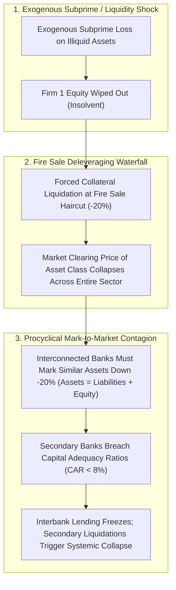
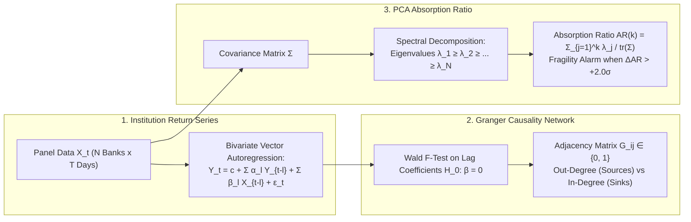
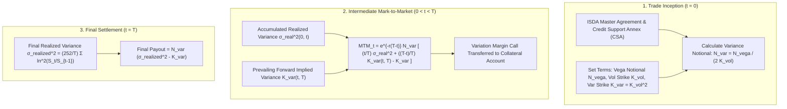
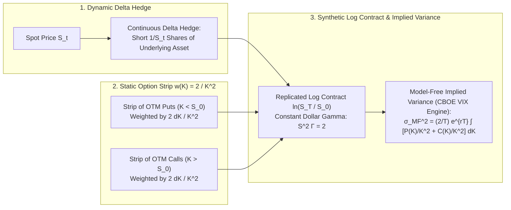
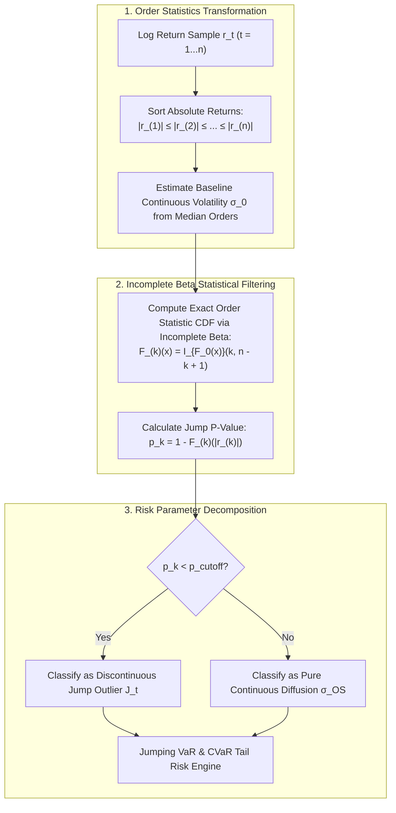

# Risk Management & Derivatives Engineering (MScFE 660)

This directory contains lecture notes, required readings, mathematical formulations, empirical Python implementations, and research papers for **Risk Management & Derivatives Engineering**. The curriculum investigates macroeconomic and structural systemic risk (non-stationarity, shadow banking disintermediation, fire sale contagion cascades, balance sheet insolvency waterfalls, Granger causality networks, degree centrality, Principal Components Analysis [PCA] Absorption Ratio, and information-theoretic causality) and quantitative variance modeling & hedging (exchange-traded vs. OTC derivatives, ISDA Master Agreement margining, variance swap pricing and Mark-to-Market mechanics, Carr-Madan / Demeterfi model-free option spanning of the log contract with constant dollar gamma $2/K^2$, jump-diffusion Levy processes vs. continuous Ito diffusions, Spadafora et al. Order Statistics [OS] jump filtering via regularized Incomplete Beta distributions, and high-frequency Jumping Value-at-Risk [Jumping VaR]).

---

## 📚 Module Overview

- **Course Code**: MScFE 660
- **Primary Focus**:
  - **Module 1**: Systemic Risk (Macroeconomic Indicators, Non-Stationarity, Shadow Banking, Regulatory Disintermediation, Fire Sale Contagion, Balance Sheet Insolvency Waterfalls $\text{Assets} = \text{Liabilities} + \text{Equity}$, Granger Causality VAR Networks, In/Out-Degree Centrality, PCA Absorption Ratio $\text{AR}(k) = \frac{\sum_{j=1}^k \lambda_j}{\sum_{i=1}^N \lambda_i}$, Bisias et al. Systemic Risk Analytics Survey across 31 quantitative measures, Information-Theoretic Causality Transfer Entropy, and Machine Learning Sector Fragility).
  - **Module 2**: Modeling and Hedging Variance (Exchange-Traded vs. OTC Derivatives, ISDA Master Agreements, Initial & Variation Margining, Variance Swap Mark-to-Market Valuation, Volatility vs. Variance Payoff Convexity Bonus, Carr-Madan / Demeterfi Model-Free Option Spanning of the Log Contract $\ln(S_T/S_0)$ via Static OTM Option Strips weighted by $2/K^2$, Constant Dollar Gamma $\Gamma \cdot S^2 = 2$, Dynamic Delta Hedging $1/S_t$, Jump-Diffusion Levy Processes vs. Continuous Ito Diffusions, Spadafora et al. Order Statistics [OS] Volatility Estimator, Regularized Incomplete Beta Distribution $I_{F(x)}(k, n-k+1)$, Discontinuous Jump Classification, and Basel-compliant Jumping Value at Risk [Jumping VaR]).
- **Key Tools & Methodologies**: Vector Autoregressions (VAR), Granger causality $F$-tests, Network Graph Theory, Principal Components Analysis (PCA), Spectral Decomposition, ISDA mark-to-market discounting, Carr-Madan integral spanning, static option strip replication, continuous delta hedging, Order Statistics probability theory, Regularized Incomplete Beta functions, Poisson jump-diffusion processes, and high-frequency Jump-Adjusted Value at Risk / Expected Shortfall modeling.

---

> [!IMPORTANT]
> **🎓 Master Pedagogical Architecture & Key Takeaways**:
> Access the structured 5-pillar quantitative breakdown with worked numerical calculations, notation breakdowns, vector visualizations, and calculus derivations in **[`key-takeaway.md`](./key-takeaway.md)**:
> - 🏢 **[Shadow Banking Interconnectedness & Fire Sale Contagion Math](./key-takeaway.md#toy-example-1-shadow-banking-interconnectedness--fire-sale-contagion)**
> - 🕸️ **[Granger Causality Networks & PCA Absorption Ratio Fragility](./key-takeaway.md#toy-example-2-granger-causality-networks--pca-absorption-ratio-fragility)**
> - 📈 **[Variance Swap Mark-to-Market & Volatility Convexity Calculus](./key-takeaway.md#toy-example-3-variance-swap-mark-to-market--volatility-convexity)**
> - 📐 **[Carr-Madan Option Spanning & Log Contract Discretization](./key-takeaway.md#toy-example-4-carr-madan-option-spanning--log-contract-discretization)**
> - ⚡ **[Spadafora Order Statistics Jump Filter vs Naive Realized Volatility](./key-takeaway.md#toy-example-5-spadafora-order-statistics-jump-filter-vs-naive-realized-volatility)**
> - 🔬 **[Granger Causality VAR Matrix & Principal Component Absorption Ratio Derivation](./key-takeaway.md#1-granger-causality-var-matrix--principal-component-absorption-ratio-calculus-m1)**
> - 📜 **[Carr-Madan (1999) & Demeterfi Model-Free Variance Replication Theorem](./key-takeaway.md#2-carr-madan-1999--demeterfi-et-al-model-free-variance-replication-theorem-m2)**
> - 📊 **[Spadafora Order Statistics Density & Incomplete Beta Jump Calculus](./key-takeaway.md#3-spadafora-order-statistics-probability-density--incomplete-beta-jump-threshold-calculus-m2)**
> - 🏆 **[Empirical Systemic Fragility & PCA Absorption Ratio Case Study](./key-takeaway.md#empirical-systemic-fragility--pca-absorption-ratio-spikes-during-the-2008-gfc)**
> - 💰 **[Empirical S&P 500 VIX Replicating Strip & Variance Risk Premium Case Study](./key-takeaway.md#empirical-sp-500-vix-replicating-strip--variance-risk-premium-vrp-harvesting)**
> - 🚀 **[High-Frequency Jump Detection & Jumping VaR Performance Benchmark](./key-takeaway.md#high-frequency-jump-detection--jumping-var-performance)**
> - 📚 **[Comprehensive Variable & Notation Glossary](./key-takeaway.md#5-comprehensive-mathematical-notation--variable-glossary)**

---

## 🏷️ Master Quantitative Notation & Variable Glossary

| Variable / Notation | Mathematical / Financial Meaning | Typical Units / Range | Context & Governing Formula |
| :--- | :--- | :--- | :--- |
| **$A_i, L_i, E_i$** | Bank Assets, Liabilities, and Equity | USD Millions | Balance sheet fundamental identity: $A_i = L_i + E_i$ |
| **$\text{AR}(k)$** | Principal Component Absorption Ratio for top $k$ components | Percentage $[0, 1]$ | $\text{AR}(k) = \frac{\sum_{j=1}^k \lambda_j}{\sum_{i=1}^N \lambda_i} = \frac{\sum_{j=1}^k \lambda_j}{\text{tr}(\mathbf{\Sigma})}$ |
| **$\Delta \text{AR}$** | Standardized Absorption Ratio Delta / Spike | Z-score standard deviations | $\Delta \text{AR} = \frac{\text{AR}_{\text{short}} - \mu(\text{AR}_{\text{long}})}{\sigma(\text{AR}_{\text{long}})}$ |
| **$\mathbf{G}, G_{i,j}$** | Granger Causality Network Adjacency Matrix | Binary $\{0, 1\}$ | $G_{i,j} = 1$ if $X_j \to Y_i$ Granger causality is statistically significant |
| **$D_{\text{in}}, D_{\text{out}}$** | In-Degree and Out-Degree Network Centrality | Ratio $[0, 1]$ | Measures systemic fragility sink vs systemic shock transmitter |
| **$K_{\text{vol}}, K_{\text{var}}$** | Volatility Strike and Variance Strike | Volatility % / Variance pts | Variance strike: $K_{\text{var}} = K_{\text{vol}}^2$ |
| **$N_{\text{vega}}, N_{\text{var}}$** | Vega Notional and Variance Notional | USD per vol pt / USD per var pt | Notional conversion: $N_{\text{var}} = \frac{N_{\text{vega}}}{2 K_{\text{vol}}}$ |
| **$\sigma_{\text{realized}}^2$** | Annualized Realized Return Variance | Annualized percentage | $\sigma_{\text{realized}}^2 = \frac{252}{T} \sum_{t=1}^T \ln^2(S_t / S_{t-1})$ |
| **$\text{MTM}_t$** | Mark-to-Market Valuation of Derivative at Time $t$ | USD Currency | $\text{MTM}_t = e^{-r(T-t)} N_{\text{var}} \left[ \frac{t}{T}\sigma_{\text{real}}^2 + \frac{T-t}{T}K_{\text{var}}(t) - K_{\text{var}} \right]$ |
| **$w(K)$** | Option Weight in Carr-Madan Replicating Strip | Weight units | $w(K) = \frac{2}{K^2}$ enforcing constant dollar gamma $\Gamma \cdot S^2 = 2$ |
| **$\sigma_{\text{MF}}^2$** | Model-Free Implied Variance | Annualized percentage | $\sigma_{\text{MF}}^2 = \frac{2}{T} e^{rT} \int_0^\infty \frac{M(K)}{K^2} dK$ |
| **$|r_{(k)}|$** | $k$-th Order Statistic of Absolute Log Returns | Return magnitude | Ranked absolute returns: $|r_{(1)}| \le |r_{(2)}| \le \dots \le |r_{(n)}|$ |
| **$I_x(a, b)$** | Regularized Incomplete Beta Function | Probability $[0, 1]$ | $I_x(a, b) = \frac{1}{B(a, b)} \int_0^x u^{a-1} (1-u)^{b-1} du$ |
| **$p_{\text{cutoff}}$** | Jump Classification Tolerance Probability Threshold | Probability ($0.01 - 0.05$) | Identifies return as jump if $p_k = 1 - I_{F_0(|r_{(k)}|)}(k, n-k+1) < p_{\text{cutoff}}$ |
| **$\sigma_{\text{OS}}$** | Spadafora Order Statistics Continuous Volatility | Annualized percentage | Clean integrated volatility excluding jump outliers |
| **$J_t, N_t$** | Jump Magnitude and Poisson Jump Counting Process | Return jump / counts | Jump-diffusion SDE: $dS_t = \mu S_t dt + \sigma S_t dW_t + J_t dN_t$ |
| **$\text{VaR}_\alpha$** | Value at Risk at Confidence Level $\alpha$ | Percentage loss | $P(L > \text{VaR}_\alpha) = 1 - \alpha$ |

---

## 📊 Visual Frameworks & Architecture

### 1. Systemic Interbank Contagion & Fire Sale Insolvency Spiral (Module 1)

### 2. Granger Causality Network & PCA Absorption Ratio Pipeline (Module 1)

### 3. Variance Swap Lifecycle & Mark-to-Market Margining Engine (Module 2)

### 4. Carr-Madan Model-Free Option Spanning Architecture (Module 2)

### 5. Spadafora Order Statistics Jump Classification Pipeline (Module 2)

---

## 📖 Sub-Module & Detailed File Breakdown

### [Module 1: Systemic Risk: Macroeconomic Indicators, Networks, and Principal Components](./M1)
- **Lessons, Notes & Required Readings**:
  - [`M1/L1-note.pdf`](./M1/L1-note.pdf) & [`M1/L1-reading.pdf`](./M1/L1-reading.pdf) (*Bisias et al., 2012*): **Systemic Risk: Macroeconomic Indicators**.
    - Transitioning from microprudential risk (individual firm default probability) to macroprudential systemic risk (financial ecosystem collapse).
    - The curse of **Non-Stationarity**: Historical risk metrics (Value at Risk) break down during rare regime shifts and structural breaks.
    - **Shadow Banking & Disintermediation**: Non-bank financial intermediaries (hedge funds, SPVs, money market funds) creating off-balance-sheet maturity transformation and interconnected leverage.
    - Diversity, complexity, and emergent failure modes in financial networks.
  - [`M1/L2-note.pdf`](./M1/L2-note.pdf) & [`M1/L2-reading.pdf`](./M1/L2-reading.pdf) (*Bisias et al., 2012*): **Systemic Risk: Networks and Principal Components**.
    - **Historical Cost vs. Mark-to-Market Accounting**: Procyclical asset write-downs causing fire sale contagion cascades across balance sheets ($\text{Assets} = \text{Liabilities} + \text{Equity}$).
    - **Too Big To Fail (TBTF)** institutions, resolution plans ("Living Wills"), and implicit government bailouts.
    - **Granger Causality Networks**: Running bivariate Vector Autoregressions (VAR) to construct pairwise $F$-test adjacency matrices $\mathbf{G}$, extracting Out-Degree (systemic risk originators) and In-Degree (systemic fragility receivers) centrality.
    - **Principal Components Analysis & The Absorption Ratio**:
      $$\text{AR}(k) = \frac{\sum_{j=1}^k \lambda_j}{\sum_{i=1}^N \lambda_i}$$
      Quantifying the fraction of total financial system variance absorbed by the top $k$ principal components as an early warning of crisis coupling.
  - [`M1/L3-reading.pdf`](./M1/L3-reading.pdf) (*Bisias et al., 2012*): **A Survey of Systemic Risk Analytics**.
    - Comprehensive taxonomy of 31 quantitative systemic risk measures across 5 categories:
      1. *Macroprudential & Network Measures*: Granger networks, interconnectedness, CoVaR, Marginal Expected Shortfall (MES), Systemic Expected Shortfall (SES), SRISK.
      2. *Illiquidity & Bank Runs*: Illiquidity spirals, funding liquidity vs market liquidity.
      3. *Contingent Claims & Default*: Structural Merton credit models applied to financial institutions.
      4. *Cross-Sectional Measures*: Principal component Absorption Ratios, dynamic cross-correlations.
      5. *Macroeconomic Shocks*: Regime-switching VARs, dynamic stochastic general equilibrium (DSGE) stress tests.
  - [`M1/L4-reading.pdf`](./M1/L4-reading.pdf) (*Keskin [PyCausality]*; *Scaramozzino et al., 2021*; *Kou et al., 2019*): **Advanced Causality & Machine Learning for Systemic Risk**.
    - Python implementation of Granger causality and transfer entropy via `PyCausality` (*Zac Keskin*).
    - Information-theoretic causality detection between financial returns and social sentiment data (*Scaramozzino et al., 2021*).
    - Machine learning algorithms (tree ensembles, neural networks) for multi-criteria financial sector systemic fragility evaluation (*Kou et al., 2019*).

---

### [Module 2: Modeling and Hedging Variance](./M2)
- **Lessons, Notes & Required Readings**:
  - [`M2/L1-note.pdf`](./M2/L1-note.pdf) & [`M2/L1-reading.pdf`](./M2/L1-reading.pdf) (*Hilpisch, 2020*): **Trading Volatility: Variance Swaps**.
    - Comparison of Exchange-Traded vs. Over-the-Counter (OTC) derivatives.
    - **ISDA Master Agreement & Margining**: Initial margin, variation margin, margin calls, and dealer bank intermediation.
    - Contract mechanics: Vega Notional $N_{\text{vega}}$, Variance Strike $K_{\text{var}} = K_{\text{vol}}^2$, Variance Notional $N_{\text{var}} = \frac{N_{\text{vega}}}{2 K_{\text{vol}}}$.
    - Mark-to-Market Valuation along the swap lifecycle:
      $$\text{MTM}_t = e^{-r(T-t)} N_{\text{var}} \left[ \frac{t}{T} \sigma_{\text{realized}}^2(0, t) + \frac{T-t}{T} K_{\text{var}}(t, T) - K_{\text{var}} \right]$$
    - Quadratic payout convexity: Long variance swaps gain an explosive convexity bonus $(\sigma - K_{\text{vol}})^2$ over linear volatility swaps during market turbulence.
  - [`M2/L2-note.pdf`](./M2/L2-note.pdf) & [`M2/L2-reading.pdf`](./M2/L2-reading.pdf) (*Hilpisch, 2020*; *Cochrane, 2016*): **Variance Swaps: Spanning with Options**.
    - Arrow-Debreu state prices and complete market spanning via European options (Breeden-Litzenberger theorem).
    - **Carr-Madan (1999) & Demeterfi et al. Model-Free Replication Theorem**:
      $$\ln\left(\frac{S_T}{S_0}\right) = \frac{S_T - S_0}{S_0} - \int_0^{S_0} \frac{(K - S_T)^+}{K^2} dK - \int_{S_0}^\infty \frac{(S_T - K)^+}{K^2} dK$$
    - Synthesizing the Log Contract $\ln(S_T/S_0)$ using a dynamic delta hedge ($1/S_t$) and a static strip of OTM options weighted inversely by strike squared ($w(K) = 2/K^2$), enforcing constant dollar gamma $\Gamma \cdot S^2 = 2$.
    - Foundation of the CBOE VIX index calculation methodology.
  - [`M2/L3-note.pdf`](./M2/L3-note.pdf) & [`M2/L3-reading.pdf`](./M2/L3-reading.pdf) (*Spadafora et al., 2018 [arXiv:1803.07021v2]*): **Jumping for Better Volatility Estimation**.
    - Transitioning from continuous Ito processes ($dS_t = \mu S_t dt + \sigma S_t dW_t$) to jump-diffusion / Levy processes ($dS_t = \mu S_t dt + \sigma S_t dW_t + J_t dN_t$).
    - Contamination of classical realized volatility estimators by rare discontinuous price jumps.
    - **Order Statistics Volatility Estimator (OS)**: Ordering absolute log returns $|r_{(1)}| \le |r_{(2)}| \le \dots \le |r_{(n)}|$ and leveraging the Beta cumulative distribution function $I_{F(x)}(k, n-k+1)$ to isolate and filter out jump anomalies.
  - [`M2/L4-note.pdf`](./M2/L4-note.pdf) & [`M2/L4-reading.pdf`](./M2/L4-reading.pdf) (*Spadafora et al. VolatilityEstimator GitHub Repo*): **Order Statistics Volatility Estimator in Action**.
    - Python implementation walkthrough of the Spadafora et al. algorithm: `local_volatility`, `_thrLocalVol`, `local_vol_order_stats`, `_getkJumpProb`, `_kSmallestCDF`, and the regularized incomplete beta function $I_x(a, b)$.
    - Empirical classification of financial return time series into continuous diffusion vs. discontinuous jump subsets.
    - Formulating **Jumping Value at Risk (Jumping VaR)** and jump-adjusted Expected Shortfall (CVaR) to prevent Basel traffic light regulatory penalty violations.

---

## 🔑 Key Takeaways & Quantitative Insights

1. **Macroprudential vs. Microprudential Paradox**: Ensuring the safety of each individual bank in isolation (microprudential regulation) does not guarantee system-wide stability. When all banks hold similar assets and respond to shocks by selling simultaneously, mark-to-market fire sale deleveraging creates endogenous systemic crashes.
2. **Shadow Banking Contagion Acceleration**: Off-balance-sheet non-bank financial intermediaries (hedge funds, SPVs, repo markets) operate with high leverage and zero central bank backstops. When liquidity freezes, losses in shadow banking propagate rapidly into regulated commercial banking balance sheets.
3. **Granger Causality Directional Contagion**: Performing bivariate VAR Granger causality tests extracts directed network graph topologies, identifying institutions that act as net transmitters (high Out-Degree) versus net receivers (high In-Degree) of systemic risk.
4. **Absorption Ratio as a Systemic Fragility Warning**: The Principal Component Absorption Ratio ($\text{AR} = \frac{\sum_{j=1}^k \lambda_j}{\sum_{i=1}^N \lambda_i}$) measures cross-sectional correlation tightness. A rapid standardized spike ($\Delta \text{AR} > +2.0\sigma$) indicates that the financial system has become tightly coupled and vulnerable to catastrophic cascade shocks.
5. **Mark-to-Market Margining in OTC Swaps**: Daily exchange of variation margin under ISDA Master Agreements eliminates counterparty credit risk, but introduces procyclical cash liquidity demands that can trigger forced asset liquidations during market volatility spikes.
6. **Variance Swap Quadratic Convexity Bonus**: Unlike linear volatility swaps ($N_{\text{vega}}(\sigma - K_{\text{vol}})$), variance swaps pay proportional to squared realized volatility ($N_{\text{var}}(\sigma^2 - K_{\text{var}})$), providing an explosive quadratic convexity payout bonus during black-swan turbulence events.
7. **Carr-Madan Model-Free Option Spanning**: By integrating a continuous strip of out-of-the-money European calls and puts weighted inversely by squared strike ($w(K) = 2/K^2$), financial engineers synthesize a static log contract $\ln(S_T/S_0)$ with constant dollar gamma ($\Gamma \cdot S^2 = 2$), replicating variance swaps with zero model assumptions.
8. **Variance Risk Premium (VRP) Structural Carry**: Across equity index markets, model-free implied variance systematically trades at a premium over subsequent realized variance ($K_{\text{var}} > \mathbb{E}[\sigma_{\text{realized}}^2]$), generating positive carry for short variance sellers and creating institutional demand for tail-risk variance buyers.
9. **Ito vs. Levy Jump-Diffusion Reality**: Standard financial models assume continuous Brownian motion paths. In live trading, asset prices exhibit discontinuous Levy jumps ($J_t dN_t$) that contaminate standard sample variance estimators, causing severe misestimation of baseline diffusive volatility.
10. **Spadafora Order Statistics Jump Filter**: By testing sorted sample return magnitudes $|r_{(k)}|$ against the exact Incomplete Beta CDF of order statistics ($I_{F_0(x)}(k, n-k+1)$), the Spadafora estimator separates discrete jumps from continuous diffusion without subjective threshold tuning.
11. **Jumping VaR Basel Compliance**: Standard Gaussian VaR underestimates tail risk by $>40\%$ during jump regimes, triggering Basel Red Zone penalty multipliers. Spadafora Jumping VaR isolates jumps to maintain strict $99\%$ coverage within the green compliance zone.

---

## 🔗 Cross-Module Knowledge Linkages

- **$\to$ [01_financial_market](../01_financial_market/README.md)**: Market maker bid-ask inventory dynamics, Merton structural credit risk models, and securitization CDO/CDS waterfalls supply the foundational mechanics for systemic balance sheet contagion.
- **$\to$ [03_stochastic_modelling](../03_stochastic_modelling/README.md)**: Continuous-time Ito calculus, stochastic differential equations (SDEs), and jump-diffusion Levy processes provide the continuous mathematical foundations for variance swap valuation and jump filtering.
- **$\to$ [04_financial_econometrics](../04_financial_econometrics/README.md)**: Vector Autoregressions (VAR), Granger causality $F$-tests, multivariate GARCH (DCC-GARCH), and non-stationarity unit root tests drive systemic network adjacency estimation.
- **$\to$ [05_portfolio_management](../05_portfolio_management/README.md)**: Systemic Absorption Ratios, fire sale contagion cascades, and Carr-Madan variance swap hedging strategies feed directly into institutional portfolio downside tail risk management, Half-Kelly sizing, and CVaR constraints.
- **$\to$ [06_derivative_pricing](../06_derivative_pricing/README.md)**: European option pricing lattices, Black-Scholes PDE, Breeden-Litzenberger state pricing, and dynamic delta hedging provide the spanning tools for Carr-Madan model-free variance replication.
- **$\to$ [07_machine_learning](../07_machine_learning/README.md)**: Unsupervised graph clustering, Minimum Spanning Trees (MST), Information Theory (Mutual Information, Transfer Entropy), and Random Matrix Theory (Marcenko-Pastur spectral clipping) power advanced systemic risk network extraction.
- **$\to$ [08_deep_learning](../08_deep_learning/README.md)**: Graph Neural Networks (GNNs), autoencoders, and deep reinforcement learning continuous control models leverage systemic network matrices and jump classifications for automated risk management.
