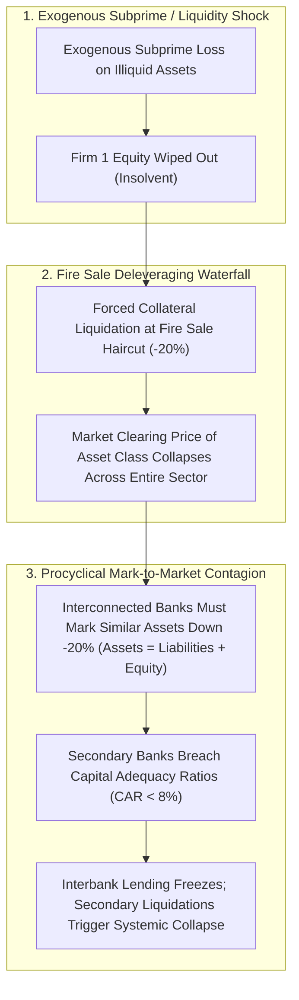
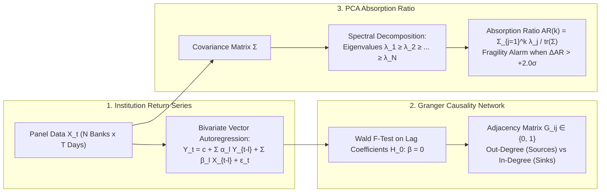
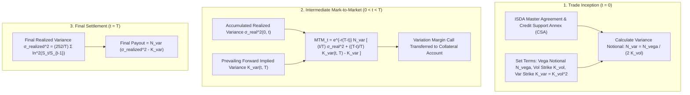
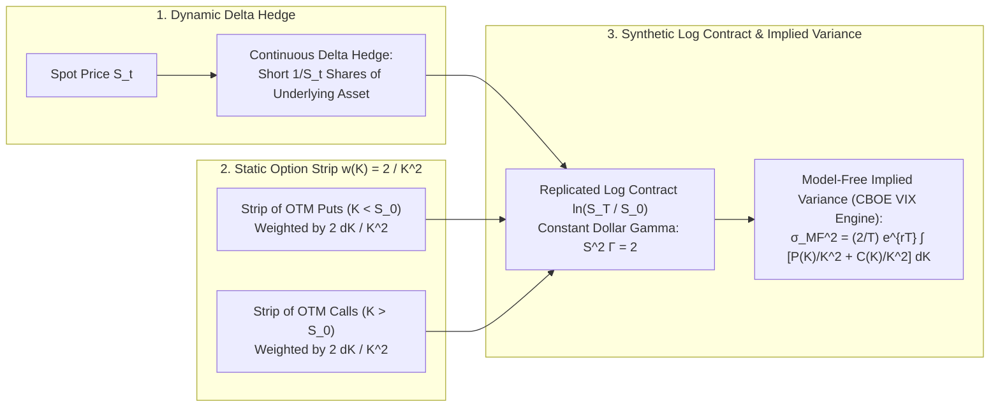
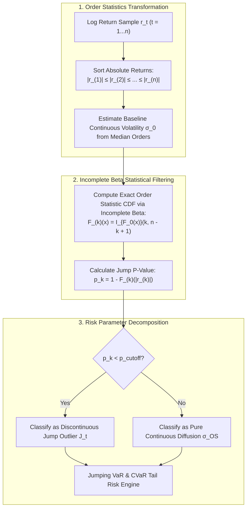
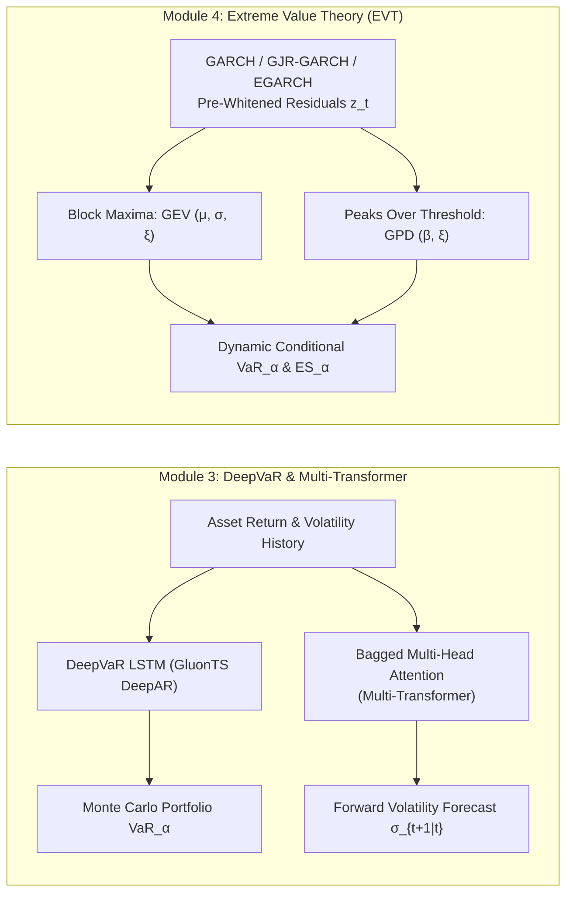
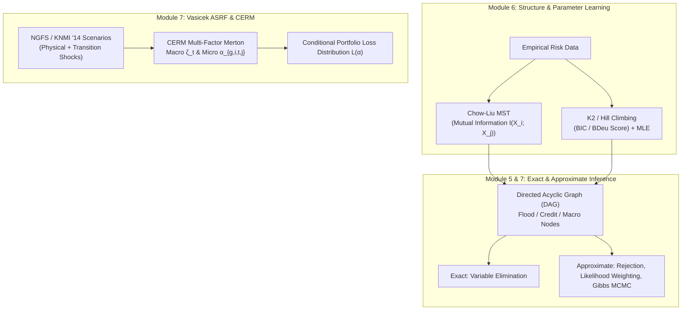
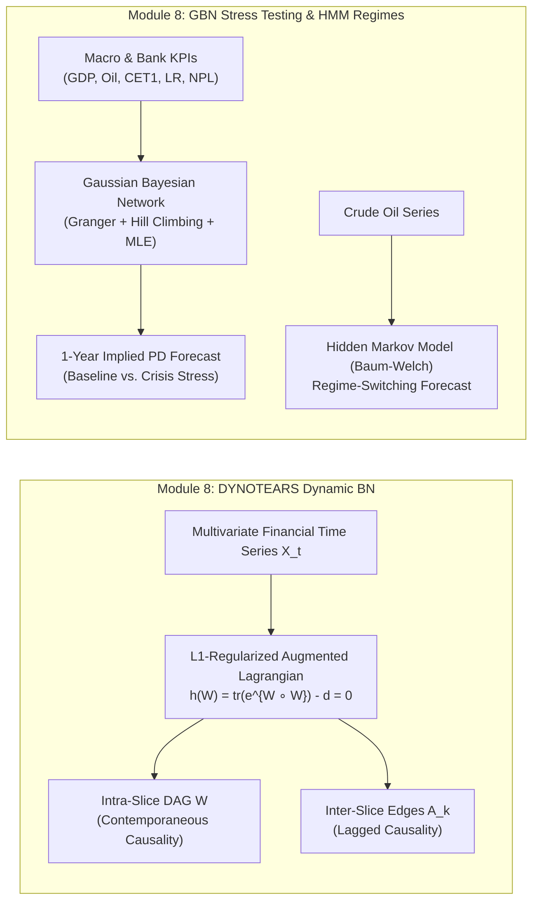

# Risk Management & Derivatives Engineering (MScFE 660)

This directory contains lecture notes, required readings, mathematical formulations, empirical Python implementations, and research papers for **Risk Management & Derivatives Engineering**. Across **8 comprehensive modules**, the curriculum investigates macroeconomic and structural systemic risk (**M1**), quantitative variance modeling, Carr-Madan option spanning, and Spadafora Order Statistics jump filtering (**M2**), deep learning tail loss estimation with DeepVaR LSTMs and Multi-Transformers (**M3**), Extreme Value Theory (GEV Block Maxima, GPD Peaks Over Threshold, and Conditional EVT-GARCH) (**M4**), Bayesian Networks, exact Variable Elimination, and approximate MCMC/Likelihood Weighting inference (**M5**), network topology and structure learning via Chow-Liu MST, K2, and BIC/BDeu scoring (**M6**), climate-related credit risk, the Vasicek ASRF model, and the Climate Extended Risk Model (CERM) (**M7**), and Dynamic Bayesian Networks (DYNOTEARS), Gaussian Bayesian Network stress testing, and Hidden Markov Models for coherent risk management (**M8**).

---

## 📚 Module Overview

- **Course Code**: MScFE 660
- **Primary Focus**:
  - **Module 1**: Systemic Risk (Macroeconomic Indicators, Non-Stationarity, Shadow Banking, Fire Sale Contagion, Balance Sheet Insolvency Waterfalls, Granger Causality VAR Networks, In/Out-Degree Centrality, PCA Absorption Ratio $\text{AR}(k)$, Bisias et al. 31-Measure Survey, Transfer Entropy, and ML Sector Fragility).
  - **Module 2**: Modeling and Hedging Variance (OTC vs. Exchange-Traded Derivatives, ISDA Master Agreements, Variance Swap Mark-to-Market & Convexity, Carr-Madan / Demeterfi Model-Free Option Spanning of the Log Contract $w(K)=2/K^2$, Spadafora et al. Order Statistics [OS] Jump Filtering via Regularized Incomplete Beta $I_{F(x)}(k, n-k+1)$, and Jumping VaR).
  - **Module 3**: Estimating Tail Loss with Deep Learning (DeepVaR Probabilistic LSTM / DeepAR Autoregressive Likelihood, Monte Carlo Portfolio VaR Backtesting, Scaled Dot-Product Multi-Head Attention, and Bagged Multi-Transformer Volatility Forecasting).
  - **Module 4**: Estimating Tail Loss with Extreme Value Theory (Fisher-Tippett-Gnedenko Theorem, Block Maxima & Generalized Extreme Value [GEV] Distribution, Pickands-Balkema-de Haan Theorem, Peaks Over Threshold [POT] & Generalized Pareto Distribution [GPD], and Conditional EVT with GARCH / EGARCH / GJR-GARCH / AP-ARCH).
  - **Module 5**: Bayesian Networks for Financial Risk Management (Graph & Network Theory, DAG Factorization, Factor Graphs, Monty Hall Conditional Updating, Exact Inference via Variable Elimination, and Approximate Inference via Direct/Rejection Sampling, Likelihood Weighting, and Gibbs MCMC).
  - **Module 6**: Network Learning for Risk Management (Degree Distributions, CCDF & Power Laws, Components & Communities, Chow-Liu Algorithm & Kruskal's Minimum Spanning Tree, K2 Algorithm [Cooper-Herskovits], Score-Based Hill Climbing [BIC/BDeu], and MLE Parameter Learning in `pgmpy`).
  - **Module 7**: Climate Risk and the Vasicek Model (Physical vs. Transition Climate Risk, Urban Flood Disaster Prediction via Bayesian Networks [d-separation, Markov blanket, Jeffrey's rule], Achmea Bank Mortgage Climate Stress Testing, Vasicek Asymptotic Single Risk Factor [ASRF] Loss Distribution, and the Multi-Factor Climate Extended Risk Model [CERM]).
  - **Module 8**: Dynamic Bayesian Networks and Coherent Risk Management (Coherent Asset Allocation & Causal Structure, DYNOTEARS Continuous Acyclicity Optimization $\text{tr}(e^{\mathbf{W} \circ \mathbf{W}}) - d = 0$, Gaussian Bayesian Network [GBN] Financial Stress Testing for 1-Year PD, Granger Causality / Cointegration / ADF Tests, and Hidden Markov Models [Baum-Welch] for Oil Price Prediction).
- **Key Tools & Methodologies**: VAR & Granger Causality, PCA Absorption Ratio, Carr-Madan Option Spanning, Spadafora Order Statistics, `GluonTS` DeepAR/DeepVaR, Multi-Transformer Attention, GEV/GPD & GJR-GARCH, `pgmpy` & `pomegranate`, Chow-Liu MST, K2 & Hill Climbing, Vasicek ASRF & CERM, `CausalNex` DYNOTEARS, Gaussian Bayesian Networks, and Baum-Welch HMMs.

---

> [!IMPORTANT]
> **🎓 Master Pedagogical Architecture & Key Takeaways**:
> Access the structured 5-pillar quantitative breakdown with worked numerical calculations, notation breakdowns, vector visualizations, calculus derivations, and research reading summaries in **[`key-takeaway.md`](./key-takeaway.md)**:
> - 🏢 **[Shadow Banking Interconnectedness & Fire Sale Contagion (M1)](./key-takeaway.md#toy-example-1-shadow-banking-interconnectedness--fire-sale-contagion)**
> - 🕸️ **[Granger Causality Networks & PCA Absorption Ratio Fragility (M1)](./key-takeaway.md#toy-example-2-granger-causality-networks--pca-absorption-ratio-fragility)**
> - 📈 **[Variance Swap Mark-to-Market & Volatility Convexity (M2)](./key-takeaway.md#toy-example-3-variance-swap-mark-to-market--volatility-convexity)**
> - 📐 **[Carr-Madan Option Spanning & Log Contract Discretization (M2)](./key-takeaway.md#toy-example-4-carr-madan-option-spanning--log-contract-discretization)**
> - ⚡ **[Spadafora Order Statistics Jump Filter vs Naive Realized Volatility (M2)](./key-takeaway.md#toy-example-5-spadafora-order-statistics-jump-filter-vs-naive-realized-volatility)**
> - 🤖 **[DeepVaR Probabilistic LSTM & Multi-Transformer Volatility Forecasting (M3)](./key-takeaway.md#toy-example-6-deepvar-probabilistic-lstm--multi-transformer-volatility-forecasting)**
> - 🌊 **[Extreme Value Theory: Block Maxima (GEV) vs. Peaks Over Threshold (GPD) (M4)](./key-takeaway.md#toy-example-7-extreme-value-theory--block-maxima-gev-vs-peaks-over-threshold-gpd)**
> - 🎯 **[Bayesian Network Exact Inference vs. Approximate Sampling (M5)](./key-takeaway.md#toy-example-8-bayesian-network-exact-inference-vs-approximate-sampling)**
> - 🌲 **[Network Structure Learning: Chow-Liu MST & K2 Scoring (M6)](./key-takeaway.md#toy-example-9-network-structure-learning--chow-liu-mst--k2-scoring)**
> - 🌍 **[Vasicek Single-Factor Credit Loss & Climate Extended Risk Model (CERM) (M7)](./key-takeaway.md#toy-example-10-vasicek-single-factor-credit-loss--climate-extended-risk-model-cerm)**
> - ⏱️ **[DYNOTEARS Dynamic Bayesian Networks & GBN PD Stress Testing (M8)](./key-takeaway.md#toy-example-11-dynotears-dynamic-bayesian-networks--gbn-pd-stress-testing)**
> - 📚 **[Research Reading Summaries (Achmea Climate Credit Risk, Veneto Flood BN, CERM, UniVe GBN Stress Testing)](./key-takeaway.md#research-summary-1-climate-related-credit-risk-on-achmea-banks-mortgage-portfolio)**
> - 🧮 **[Comprehensive Variable & Notation Glossary](./key-takeaway.md#5-comprehensive-mathematical-notation--variable-glossary)**

---

## 🏷️ Master Quantitative Notation & Variable Glossary

| Symbol | Mathematical / Economic Meaning | Typical Units / Range | Context & Core Formula |
| :--- | :--- | :--- | :--- |
| **$A_i, L_i, E_i$** | Bank Assets, Liabilities, and Equity | USD Millions | Balance sheet fundamental identity: $A_i = L_i + E_i$ |
| **$\text{AR}(k)$** | Principal Component Absorption Ratio for top $k$ components | Percentage $[0, 1]$ | $\text{AR}(k) = \frac{\sum_{j=1}^k \lambda_j}{\sum_{i=1}^N \lambda_i} = \frac{\sum_{j=1}^k \lambda_j}{\text{tr}(\mathbf{\Sigma})}$ |
| **$\Delta \text{AR}$** | Standardized Absorption Ratio Delta / Spike | Z-score standard deviations | $\Delta \text{AR} = \frac{\text{AR}_{\text{short}} - \mu(\text{AR}_{\text{long}})}{\sigma(\text{AR}_{\text{long}})}$ |
| **$\mathbf{G}, G_{i,j}$** | Granger Causality Network Adjacency Matrix | Binary $\{0, 1\}$ | $G_{i,j} = 1$ if $X_j \to Y_i$ Granger causality is statistically significant |
| **$D_{\text{in}}, D_{\text{out}}$** | In-Degree and Out-Degree Network Centrality | Ratio $[0, 1]$ | Measures systemic fragility sink vs systemic shock transmitter |
| **$K_{\text{vol}}, K_{\text{var}}$** | Volatility Strike and Variance Strike | Volatility % / Variance pts | Variance strike: $K_{\text{var}} = K_{\text{vol}}^2$ |
| **$N_{\text{vega}}, N_{\text{var}}$** | Vega Notional and Variance Notional | USD per vol pt / USD per var pt | Notional conversion: $N_{\text{var}} = \frac{N_{\text{vega}}}{2 K_{\text{vol}}}$ |
| **$\sigma_{\text{realized}}^2$** | Annualized Realized Return Variance | Annualized percentage | $\sigma_{\text{realized}}^2 = \frac{252}{T} \sum_{t=1}^T \ln^2(S_t / S_{t-1})$ |
| **$\text{MTM}_t$** | Mark-to-Market Valuation of Derivative at Time $t$ | USD Currency | $\text{MTM}_t = e^{-r(T-t)} N_{\text{var}} \left[ \frac{t}{T}\sigma_{\text{real}}^2 + \frac{T-t}{T}K_{\text{var}}(t) - K_{\text{var}} \right]$ |
| **$w(K)$** | Option Weight in Carr-Madan Replicating Strip | Weight units | $w(K) = \frac{2}{K^2}$ enforcing constant dollar gamma $\Gamma \cdot S^2 = 2$ |
| **$\sigma_{\text{MF}}^2$** | Model-Free Implied Variance | Annualized percentage | $\sigma_{\text{MF}}^2 = \frac{2}{T} e^{rT} \int_0^\infty \frac{M(K)}{K^2} dK$ |
| **$|r_{(k)}|$** | $k$-th Order Statistic of Absolute Log Returns | Return magnitude | Ranked absolute returns: $|r_{(1)}| \le |r_{(2)}| \le \dots \le |r_{(n)}|$ |
| **$I_x(a, b)$** | Regularized Incomplete Beta Function | Probability $[0, 1]$ | $I_x(a, b) = \frac{1}{B(a, b)} \int_0^x u^{a-1} (1-u)^{b-1} du$ |
| **$p_{\text{cutoff}}$** | Jump Classification Tolerance Probability Threshold | Probability ($0.01 - 0.05$) | Identifies return as jump if $p_k = 1 - I_{F_0(|r_{(k)}|)}(k, n-k+1) < p_{\text{cutoff}}$ |
| **$\sigma_{\text{OS}}$** | Spadafora Order Statistics Continuous Volatility | Annualized percentage | Clean integrated volatility excluding jump outliers |
| **$\text{VaR}_\alpha, \text{ES}_\alpha$** | Value at Risk and Expected Shortfall at Confidence $\alpha$ | Percentage loss | $P(L > \text{VaR}_\alpha) = 1 - \alpha$; $\text{ES}_\alpha = \mathbb{E}[L \mid L > \text{VaR}_\alpha]$ |
| **$\mathbf{h}_t, \mathbf{Q}, \mathbf{K}, \mathbf{V}$** | LSTM Hidden State; Transformer Query, Key, Value Matrices | Real Vectors / Matrices | $\text{Attention}(\mathbf{Q},\mathbf{K},\mathbf{V}) = \text{softmax}\left(\frac{\mathbf{Q}\mathbf{K}^T}{\sqrt{d_k}}\right)\mathbf{V}$ |
| **$\xi, \beta, u$** | EVT Tail Shape Index, GPD Scale, and Threshold | Real / % Loss | $\text{VaR}_\alpha^{\text{GPD}} = u + \frac{\beta}{\xi}\left[\left(\frac{N}{N_u}(1-\alpha)\right)^{-\xi} - 1\right]$ |
| **$\text{Pa}(X_i), I(X_i; X_j)$** | DAG Parent Set and Mutual Information | Node Set / Nats ($\ge 0$) | $P(X_1,\dots,X_n) = \prod_{i=1}^n P(X_i \mid \text{Pa}(X_i))$ |
| **$g(i, \pi_i), \text{BIC}$** | K2 Marginal Likelihood and Bayesian Information Criterion | Log-score | $\text{BIC} = \ell(\hat{\theta}; \mathcal{D}) - \frac{k_{\text{params}}}{2}\ln N$ |
| **$\rho, \Phi^{-1}(\text{PD})$** | Vasicek Asset Correlation and Default Threshold | $[0, 1]$ / Z-score | $L(\alpha) = \text{LGD} \cdot \Phi\left(\frac{\Phi^{-1}(\text{PD}) + \sqrt{\rho}\,\Phi^{-1}(\alpha)}{\sqrt{1-\rho}}\right)$ |
| **$\zeta_t, \alpha_{g,i,t,j}, R_{g,i,t}$** | CERM Macro-Correlation, Micro-Correlation, Systematic Variance | Real / $[0, 1]$ | $R_{g,i,t} = \sum_{j=1}^{R+2} (\alpha_{g,i,t,j}\zeta_{t,j})^2$ |
| **$\mathbf{W}, \mathbf{A}_k, h(\mathbf{W})$** | DYNOTEARS Intra-Slice, Lag-$k$ Matrices, Acyclicity Penalty | $\mathbb{R}^{d \times d}$ / Scalar | $h(\mathbf{W}) = \text{tr}(e^{\mathbf{W} \circ \mathbf{W}}) - d = 0$ |

---

## 📊 Visual Frameworks & Architecture

### 1. Systemic Interbank Contagion & Fire Sale Insolvency Spiral (Module 1)

### 2. Granger Causality Network & PCA Absorption Ratio Pipeline (Module 1)

### 3. Variance Swap Lifecycle & Mark-to-Market Margining Engine (Module 2)

### 4. Carr-Madan Model-Free Option Spanning Architecture (Module 2)

### 5. Spadafora Order Statistics Jump Classification Pipeline (Module 2)

### 6. Deep Learning & Extreme Value Theory Tail Loss Architecture (Modules 3 & 4)

### 7. Bayesian Network Inference, Structure Learning & Climate Credit Risk (Modules 5–7)

### 8. Dynamic Bayesian Networks (DYNOTEARS) & Financial Stress Testing (Module 8)

---

## 📖 Sub-Module & Detailed File Breakdown

### [Module 1: Systemic Risk: Macroeconomic Indicators, Networks, and Principal Components](./M1)
- **Lessons, Notes & Required Readings**:
  - [`M1/L1-note.pdf`](./M1/L1-note.pdf) & [`M1/L1-reading.pdf`](./M1/L1-reading.pdf) (*Bisias et al., 2012*): **Systemic Risk: Macroeconomic Indicators**.
    - Transitioning from microprudential risk (individual firm default probability) to macroprudential systemic risk (financial ecosystem collapse).
    - The curse of **Non-Stationarity**: Historical risk metrics (Value at Risk) break down during rare regime shifts and structural breaks.
    - **Shadow Banking & Disintermediation**: Non-bank financial intermediaries (hedge funds, SPVs, money market funds) creating off-balance-sheet maturity transformation and interconnected leverage.
    - Diversity, complexity, and emergent failure modes in financial networks.
  - [`M1/L2-note.pdf`](./M1/L2-note.pdf) & [`M1/L2-reading.pdf`](./M1/L2-reading.pdf) (*Bisias et al., 2012*): **Systemic Risk: Networks and Principal Components**.
    - **Historical Cost vs. Mark-to-Market Accounting**: Procyclical asset write-downs causing fire sale contagion cascades across balance sheets ($\text{Assets} = \text{Liabilities} + \text{Equity}$).
    - **Too Big To Fail (TBTF)** institutions, resolution plans ("Living Wills"), and implicit government bailouts.
    - **Granger Causality Networks**: Running bivariate Vector Autoregressions (VAR) to construct pairwise $F$-test adjacency matrices $\mathbf{G}$, extracting Out-Degree (systemic risk originators) and In-Degree (systemic fragility receivers) centrality.
    - **Principal Components Analysis & The Absorption Ratio**:
      $$\text{AR}(k) = \frac{\sum_{j=1}^k \lambda_j}{\sum_{i=1}^N \lambda_i}$$
      Quantifying the fraction of total financial system variance absorbed by the top $k$ principal components as an early warning of crisis coupling.
  - [`M1/L3-reading.pdf`](./M1/L3-reading.pdf) (*Bisias et al., 2012*): **A Survey of Systemic Risk Analytics**.
    - Comprehensive taxonomy of 31 quantitative systemic risk measures across 5 categories:
      1. *Macroprudential & Network Measures*: Granger networks, interconnectedness, CoVaR, Marginal Expected Shortfall (MES), Systemic Expected Shortfall (SES), SRISK.
      2. *Illiquidity & Bank Runs*: Illiquidity spirals, funding liquidity vs market liquidity.
      3. *Contingent Claims & Default*: Structural Merton credit models applied to financial institutions.
      4. *Cross-Sectional Measures*: Principal component Absorption Ratios, dynamic cross-correlations.
      5. *Macroeconomic Shocks*: Regime-switching VARs, dynamic stochastic general equilibrium (DSGE) stress tests.
  - [`M1/L4-reading.pdf`](./M1/L4-reading.pdf) (*Keskin [PyCausality]*; *Scaramozzino et al., 2021*; *Kou et al., 2019*): **Advanced Causality & Machine Learning for Systemic Risk**.
    - Python implementation of Granger causality and transfer entropy via `PyCausality` (*Zac Keskin*).
    - Information-theoretic causality detection between financial returns and social sentiment data (*Scaramozzino et al., 2021*).
    - Machine learning algorithms (tree ensembles, neural networks) for multi-criteria financial sector systemic fragility evaluation (*Kou et al., 2019*).

---

### [Module 2: Modeling and Hedging Variance](./M2)
- **Lessons, Notes & Required Readings**:
  - [`M2/L1-note.pdf`](./M2/L1-note.pdf) & [`M2/L1-reading.pdf`](./M2/L1-reading.pdf) (*Hilpisch, 2020*): **Trading Volatility: Variance Swaps**.
    - Comparison of Exchange-Traded vs. Over-the-Counter (OTC) derivatives.
    - **ISDA Master Agreement & Margining**: Initial margin, variation margin, margin calls, and dealer bank intermediation.
    - Contract mechanics: Vega Notional $N_{\text{vega}}$, Variance Strike $K_{\text{var}} = K_{\text{vol}}^2$, Variance Notional $N_{\text{var}} = \frac{N_{\text{vega}}}{2 K_{\text{vol}}}$.
    - Mark-to-Market Valuation along the swap lifecycle:
      $$\text{MTM}_t = e^{-r(T-t)} N_{\text{var}} \left[ \frac{t}{T} \sigma_{\text{realized}}^2(0, t) + \frac{T-t}{T} K_{\text{var}}(t, T) - K_{\text{var}} \right]$$
    - Quadratic payout convexity: Long variance swaps gain an explosive convexity bonus $(\sigma - K_{\text{vol}})^2$ over linear volatility swaps during market turbulence.
  - [`M2/L2-note.pdf`](./M2/L2-note.pdf) & [`M2/L2-reading.pdf`](./M2/L2-reading.pdf) (*Hilpisch, 2020*; *Cochrane, 2016*): **Variance Swaps: Spanning with Options**.
    - Arrow-Debreu state prices and complete market spanning via European options (Breeden-Litzenberger theorem).
    - **Carr-Madan (1999) & Demeterfi et al. Model-Free Replication Theorem**:
      $$\ln\left(\frac{S_T}{S_0}\right) = \frac{S_T - S_0}{S_0} - \int_0^{S_0} \frac{(K - S_T)^+}{K^2} dK - \int_{S_0}^\infty \frac{(S_T - K)^+}{K^2} dK$$
    - Synthesizing the Log Contract $\ln(S_T/S_0)$ using a dynamic delta hedge ($1/S_t$) and a static strip of OTM options weighted inversely by strike squared ($w(K) = 2/K^2$), enforcing constant dollar gamma $\Gamma \cdot S^2 = 2$.
    - Foundation of the CBOE VIX index calculation methodology.
  - [`M2/L3-note.pdf`](./M2/L3-note.pdf) & [`M2/L3-reading.pdf`](./M2/L3-reading.pdf) (*Spadafora et al., 2018 [arXiv:1803.07021v2]*): **Jumping for Better Volatility Estimation**.
    - Transitioning from continuous Ito processes ($dS_t = \mu S_t dt + \sigma S_t dW_t$) to jump-diffusion / Levy processes ($dS_t = \mu S_t dt + \sigma S_t dW_t + J_t dN_t$).
    - Contamination of classical realized volatility estimators by rare discontinuous price jumps.
    - **Order Statistics Volatility Estimator (OS)**: Ordering absolute log returns $|r_{(1)}| \le |r_{(2)}| \le \dots \le |r_{(n)}|$ and leveraging the Beta cumulative distribution function $I_{F(x)}(k, n-k+1)$ to isolate and filter out jump anomalies.
  - [`M2/L4-note.pdf`](./M2/L4-note.pdf) & [`M2/L4-reading.pdf`](./M2/L4-reading.pdf) (*Spadafora et al. VolatilityEstimator GitHub Repo*): **Order Statistics Volatility Estimator in Action**.
    - Python implementation walkthrough of the Spadafora et al. algorithm: `local_volatility`, `_thrLocalVol`, `local_vol_order_stats`, `_getkJumpProb`, `_kSmallestCDF`, and the regularized incomplete beta function $I_x(a, b)$.
    - Empirical classification of financial return time series into continuous diffusion vs. discontinuous jump subsets.
    - Formulating **Jumping Value at Risk (Jumping VaR)** and jump-adjusted Expected Shortfall (CVaR) to prevent Basel traffic light regulatory penalty violations.

---

### [Module 3: Estimating Tail Loss with Deep Learning](./M3)
- **Lessons, Notes & Required Readings**:
  - [`M3/L1-note.pdf`](./M3/L1-note.pdf) & [`M3/L1-reading.pdf`](./M3/L1-reading.pdf) (*Fatouros et al., 2022*): **DeepVaR: Value at Risk Meets Long-Short Term Memory**.
    - Probabilistic autoregressive forecasting of portfolio return distributions using LSTM networks (DeepAR), replacing static historical windows with dynamic Monte Carlo VaR estimation and Kupiec/Christoffersen backtesting.
  - [`M3/L2-note.pdf`](./M3/L2-note.pdf) & [`M3/L2-reading.pdf`](./M3/L2-reading.pdf) (*Fatouros GitHub*): **DeepVaR: The Python Implementation**.
    - Implementing DeepAR in `GluonTS` with Maximum Likelihood Estimation (MLE) of conditional mean $\mu_t$ and scale $\sigma_t$ for multi-asset portfolios.
  - [`M3/L3-note.pdf`](./M3/L3-note.pdf) & [`M3/L3-reading.pdf`](./M3/L3-reading.pdf) (*Ramos-Perez et al., 2021*): **Forecasting Volatility with Transformers**.
    - Encoder-decoder Transformer architecture and Scaled Dot-Product Self-Attention ($\text{softmax}(\mathbf{Q}\mathbf{K}^T/\sqrt{d_k})\mathbf{V}$) for capturing long-range volatility clustering compared to GARCH.
  - [`M3/L4-note.pdf`](./M3/L4-note.pdf) & [`M3/L4-reading.pdf`](./M3/L4-reading.pdf) (*Ramos-Perez GitHub*): **Multi-Transformer in Action**.
    - Bagged ensemble of Multi-Head Attention layers combined with feed-forward networks to stabilize S&P 500 realized volatility forecasts.

---

### [Module 4: Estimating Tail Loss with Extreme Value Theory](./M4)
- **Lessons, Notes & Required Readings**:
  - [`M4/L1-note.pdf`](./M4/L1-note.pdf) & [`M4/L1-reading.pdf`](./M4/L1-reading.pdf) (*Hansen, 2020*): **Risk Modeling with Extreme Value Theory**.
    - Contrasting **Block Maxima Method (BMM)** modeled via the Generalized Extreme Value (GEV) distribution against **Peaks Over Threshold (POT)** modeled via the Generalized Pareto Distribution (GPD).
  - [`M4/L2-note.pdf`](./M4/L2-note.pdf), [`M4/L2-reading.pdf`](./M4/L2-reading.pdf) & [`M4/Pratiwi_2019_J._Phys.__Conf._Ser._1217_012090.pdf`](./M4/Pratiwi_2019_J._Phys.__Conf._Ser._1217_012090.pdf) (*Pratiwi et al., 2019*): **Block Maxima: Indonesian Gold**.
    - Empirical GEV fitting for Value at Risk analysis on gold price returns.
  - [`M4/L3-note.pdf`](./M4/L3-note.pdf) & [`M4/L3-reading.pdf`](./M4/L3-reading.pdf) (*Nortey et al., 2015*): **The Theorem and Politics of Extreme Values**.
    - **Fisher-Tippett-Gnedenko Theorem** (Fréchet $\xi > 0$, Gumbel $\xi = 0$, Weibull $\xi < 0$ Maximum Domains of Attraction) and extreme value modeling of the Ghana Stock Exchange Index.
  - [`M4/L4-note.pdf`](./M4/L4-note.pdf) & [`M4/L4-reading.pdf`](./M4/L4-reading.pdf) (*Omari et al., 2017*): **Extreme Innovations in Value at Risk Modeling**.
    - Conditional EVT combining asymmetric volatility filters (**EGARCH**, **GJR-GARCH**, **AP-ARCH**) with GPD tail estimation on standardized residuals for daily currency exchange rates.

---

### [Module 5: Bayesian Networks for Financial Risk Management](./M5)
- **Lessons, Notes & Required Readings**:
  - [`M5/L1-note.pdf`](./M5/L1-note.pdf) & [`M5/L1-reading.pdf`](./M5/L1-reading.pdf) (*Kochenderfer et al., 2022 [Ch. 2]*; *Coscia, 2021*): **Reintroduction to Graphs and Networks**.
    - Directed Acyclic Graphs (DAGs), conditional independence, and joint distribution factorization $P(X_1, \dots, X_n) = \prod_i P(X_i \mid \text{Pa}(X_i))$.
  - [`M5/L2-note.pdf`](./M5/L2-note.pdf) & [`M5/L2-reading.pdf`](./M5/L2-reading.pdf) (*Meyer*; *Schreiber [`pomegranate`]*): **The Monty Hall Problem**.
    - Factor graphs and Bayesian belief updating under new evidence implemented in `pomegranate`.
  - [`M5/L3-note.pdf`](./M5/L3-note.pdf) & [`M5/L3-reading.pdf`](./M5/L3-reading.pdf) (*Kochenderfer et al., 2022 [Ch. 3]*): **Sampling and Inference**.
    - Exact inference (**Variable Elimination**, Belief Propagation) vs. approximate inference (**Direct/Rejection Sampling**, **Likelihood Weighting**, **Gibbs Sampling / MCMC**).
  - [`M5/L4-code.ipynb`](./M5/L4-code.ipynb) & [`M5/L4-reading.pdf`](./M5/L4-reading.pdf): **Inference and Sampling in Practice**.
    - Hands-on Python implementation of exact and approximate Bayesian Network inference.

---

### [Module 6: Network Learning for Risk Management](./M6)
- **Lessons, Notes & Required Readings**:
  - [`M6/L1-note.pdf`](./M6/L1-note.pdf) & [`M6/L1-reading.pdf`](./M6/L1-reading.pdf) (*Coscia, 2021 [Ch. 6, 7, 9]*): **Going Deeper with Bayesian Nets**.
    - Network topology metrics: degree distributions, Complement of Cumulative Distribution Function (CCDF), power laws, connected components, and community/cluster detection.
  - [`M6/L2-note.pdf`](./M6/L2-note.pdf) & [`M6/L2-reading.pdf`](./M6/L2-reading.pdf) (*Schreiber*; *Kochenderfer et al.*): **How to Learn the Structure of a Network**.
    - **Chow-Liu Algorithm** using pairwise Mutual Information $I(X_i; X_j)$ and Kruskal's Minimum Spanning Tree (MST).
  - [`M6/L3-note.pdf`](./M6/L3-note.pdf) & [`M6/L3-reading.pdf`](./M6/L3-reading.pdf) (*Cooper & Herskovits, 1992*): **K2: Learning Bayesian Network Structure**.
    - Greedy score-based structure search maximizing the K2 marginal likelihood $g(i, \pi_i)$ given a topological ordering.
  - [`M6/L4-code.ipynb`](./M6/L4-code.ipynb) & [`M6/L4-reading.pdf`](./M6/L4-reading.pdf) (*`pgmpy`*): **Learning Bayesian Network Structure and Parameters from Data**.
    - Score-based Hill Climbing (BIC / BDeu) and Maximum Likelihood / Bayesian parameter estimation in `pgmpy`.

---

### [Module 7: Climate Risk and the Vasicek Model](./M7)
- **Lessons, Notes & Required Readings**:
  - [`M7/L1-note.pdf`](./M7/L1-note.pdf) & [`M7/L1-reading.pdf`](./M7/L1-reading.pdf) (*Wu et al., 2019*; *Wouters Thesis*): **Climate Change as Financial Risk**.
    - Taxonomy of **Physical Risk** (acute floods/wildfires, chronic subsidence/heat stress) and **Transition Risk** (carbon tax policy shocks, renewable technology shifts).
    - *Reading Summary — Achmea Bank Mortgage Climate Credit Risk*: Evaluates 8 physical drivers (KNMI '14: €10M – €100M damage per driver) and 6 NGFS transition scenarios (up to €1B NPV impact, $\le 10\%$ Merton MVL) on an €8.5B mortgage portfolio, integrating into IFRS 9 / A-IRB via macro adjustments and LTV/energy-label shocks ([full synthesis](./key-takeaway.md#research-summary-1-climate-related-credit-risk-on-achmea-banks-mortgage-portfolio)).
  - [`M7/L2-note.pdf`](./M7/L2-note.pdf) & [`M7/L2-reading.pdf`](./M7/L2-reading.pdf) (*Riccardo Spolaor*): **Predicting Disaster with Python**.
    - **d-separation**, **Markov blankets**, hard/soft/virtual/negative evidence, and **Jeffrey's rule**.
    - *Reading Summary — Veneto Flood Disaster Prediction*: 9-node `pgmpy` Bayesian Network across Veneto municipalities; exact `VariableElimination` ($P(\text{Flood})=0.0785$ baseline; $0.1608$ worst-case) outperforms Rejection Sampling and small-$N$ MCMC under evidence, identifying slope and population density as key spatial drivers ([full synthesis](./key-takeaway.md#research-summary-2-flood-disaster-prediction-via-bayesian-networks-in-veneto-italy)).
  - [`M7/L3-reading.pdf`](./M7/L3-reading.pdf) (*Garnier et al., 2022 [arXiv:2103.03275]*): **The Climate Extended Risk Model (CERM)**.
    - *Reading Summary — CERM*: Multi-factor Merton model with Gaussian copula extending Basel ASRF to $R+2$ systematic factors (economic, transition, $R$ regional physical) via macro-correlations $\zeta_t$ and micro-correlations $\alpha_{g,i,t,j}$ across NGFS *Orderly*, *Delayed*, and *Hot House World* scenarios ([full synthesis](./key-takeaway.md#research-summary-3-the-climate-extended-risk-model-cerm)).
  - [`M7/L4-code.ipynb`](./M7/L4-code.ipynb) & [`M7/L4-reading.pdf`](./M7/L4-reading.pdf) (*quantpie*): **Credit and Climate Risk in Python**.
    - Implementing the Vasicek single-factor portfolio loss distribution and multi-factor CERM Monte Carlo simulations in Python.

---

### [Module 8: Dynamic Bayesian Networks and Coherent Risk Management](./M8)
- **Lessons, Notes & Required Readings**:
  - [`M8/L1-note.pdf`](./M8/L1-note.pdf) & [`M8/L1-reading.pdf`](./M8/L1-reading.pdf) (*Rebonato & Denev, 2011*): **Coherent Asset Allocation and Causal Structure**.
    - Incorporating causal stress-event networks into portfolio allocation beyond naive Markowitz correlation matrices.
  - [`M8/L2-code.ipynb`](./M8/L2-code.ipynb), [`M8/L2-reading.pdf`](./M8/L2-reading.pdf) & [`M8/SnP100.csv`](./M8/SnP100.csv) (*CausalNex*): **Systemic Risk and Bayesian Networks for Time Series (DYNOTEARS)**.
    - Learning intra-slice ($\mathbf{W}$) and inter-slice ($\mathbf{A}_k$) dynamic causal graphs on S&P 100 equities via the smooth acyclicity constraint $h(\mathbf{W}) = \text{tr}(e^{\mathbf{W} \circ \mathbf{W}}) - d = 0$.
  - [`M8/L3-note.pdf`](./M8/L3-note.pdf) & [`M8/L3-reading.pdf`](./M8/L3-reading.pdf) (*Carraro, 2018 [UniVe Thesis]*): **Estimating Probability of Default with Bayesian Networks**.
    - Stationarity, **Augmented Dickey-Fuller (ADF)** tests, cointegration, and Granger causality.
    - *Reading Summary — Financial Stress Testing with GBNs*: Combines VAR Granger causality, Hill Climbing (BGe/BIC), and MLE on 6 macro and 9 firm-specific series (34 spline-interpolated monthly points) with IRB-implied PD ($\text{LGD}=0.45, M=2.50$), finding CET1, LR, and GDP drive PD while highlighting NPL omission vs. expert networks ([full synthesis](./key-takeaway.md#research-summary-4-financial-stress-testing-with-gaussian-bayesian-networks)).
  - [`M8/L4-note.pdf`](./M8/L4-note.pdf) & [`M8/L4-reading.pdf`](./M8/L4-reading.pdf) (*Alvi, 2018 [arXiv:1804.10869]*): **Bayesian Networks at Work: Oil Price Prediction**.
    - Regime-switching **Hidden Markov Models (HMMs)**, emission distributions, and **Baum-Welch** expectation-maximization for crude oil forecasting.

---

## 🔑 Key Takeaways & Quantitative Insights

1. **Macroprudential vs. Microprudential Paradox**: Ensuring the safety of each individual bank in isolation (microprudential regulation) does not guarantee system-wide stability. When all banks hold similar assets and respond to shocks by selling simultaneously, mark-to-market fire sale deleveraging creates endogenous systemic crashes.
2. **Shadow Banking Contagion Acceleration**: Off-balance-sheet non-bank financial intermediaries (hedge funds, SPVs, repo markets) operate with high leverage and zero central bank backstops. When liquidity freezes, losses in shadow banking propagate rapidly into regulated commercial banking balance sheets.
3. **Granger Causality Directional Contagion**: Performing bivariate VAR Granger causality tests extracts directed network graph topologies, identifying institutions that act as net transmitters (high Out-Degree) versus net receivers (high In-Degree) of systemic risk.
4. **Absorption Ratio as a Systemic Fragility Warning**: The Principal Component Absorption Ratio ($\text{AR} = \frac{\sum_{j=1}^k \lambda_j}{\sum_{i=1}^N \lambda_i}$) measures cross-sectional correlation tightness. A rapid standardized spike ($\Delta \text{AR} > +2.0\sigma$) indicates that the financial system has become tightly coupled and vulnerable to catastrophic cascade shocks.
5. **Mark-to-Market Margining in OTC Swaps**: Daily exchange of variation margin under ISDA Master Agreements eliminates counterparty credit risk, but introduces procyclical cash liquidity demands that can trigger forced asset liquidations during market volatility spikes.
6. **Variance Swap Quadratic Convexity Bonus**: Unlike linear volatility swaps ($N_{\text{vega}}(\sigma - K_{\text{vol}})$), variance swaps pay proportional to squared realized volatility ($N_{\text{var}}(\sigma^2 - K_{\text{var}})$), providing an explosive quadratic convexity payout bonus during black-swan turbulence events.
7. **Carr-Madan Model-Free Option Spanning**: By integrating a continuous strip of out-of-the-money European calls and puts weighted inversely by squared strike ($w(K) = 2/K^2$), financial engineers synthesize a static log contract $\ln(S_T/S_0)$ with constant dollar gamma ($\Gamma \cdot S^2 = 2$), replicating variance swaps with zero model assumptions.
8. **Variance Risk Premium (VRP) Structural Carry**: Across equity index markets, model-free implied variance systematically trades at a premium over subsequent realized variance ($K_{\text{var}} > \mathbb{E}[\sigma_{\text{realized}}^2]$), generating positive carry for short variance sellers and creating institutional demand for tail-risk variance buyers.
9. **Ito vs. Levy Jump-Diffusion & Spadafora OS Jumping VaR**: Discontinuous Levy jumps ($J_t dN_t$) contaminate naive sample variance. Testing sorted absolute returns $|r_{(k)}|$ against the Incomplete Beta CDF $I_{F_0(x)}(k, n-k+1)$ isolates jumps without subjective tuning, keeping $99\%$ Jumping VaR in the Basel Green Zone.
10. **Deep Learning Tail Loss (DeepVaR & Multi-Transformer)**: Autoregressive LSTMs output dynamic parametric return distributions ($\mu_t, \sigma_t$) for Monte Carlo VaR, while bagged Multi-Head Attention Transformers capture long-range volatility clustering across crisis regimes.
11. **Extreme Value Theory (GEV & Conditional GPD-GARCH)**: By discarding calm interior returns via Block Maxima (GEV) or Peaks Over Threshold (GPD) on GJR-GARCH/EGARCH standardized residuals, EVT accurately models heavy-tailed ($\xi > 0$) VaR and Expected Shortfall.
12. **Bayesian Networks, Structure Learning & Rare-Evidence Inference**: Exact Variable Elimination provides ground-truth posteriors, while Likelihood Weighting and Gibbs MCMC scale to large DAGs (with Rejection Sampling failing under rare evidence). Chow-Liu MSTs, K2, and BIC/BDeu Hill Climbing learn causal topologies directly from data.
13. **Climate Credit Risk (Vasicek ASRF & CERM)**: Physical hazards (uncorrelated, localized, high-severity) and transition shocks (gradual, portfolio-wide, carbon-tax driven) monotonically increase PD, LGD, ECL, and TREA; CERM extends Basel ASRF with macro-correlations $\zeta_t$ and micro-correlations $\alpha_{g,i,t,j}$ to quantify long-term climate unsustainability.
14. **Dynamic Bayesian Networks (DYNOTEARS) & GBN Stress Testing**: DYNOTEARS learns both contemporaneous ($\mathbf{W}$) and lagged ($\mathbf{A}_k$) causal structures via smooth acyclicity constraints, while Gaussian Bayesian Networks and Baum-Welch HMMs propagate macroeconomic shocks (GDP, Oil) to bank capital (CET1, LR) and 1-year PD.

---

## 🔗 Cross-Module Knowledge Linkages

- **$\to$ [01_financial_market](../01_financial_market/README.md)**: Market maker bid-ask inventory dynamics, Merton structural credit risk models, and securitization CDO/CDS waterfalls supply the foundational mechanics for systemic balance sheet contagion.
- **$\to$ [03_stochastic_modelling](../03_stochastic_modelling/README.md)**: Continuous-time Ito calculus, stochastic differential equations (SDEs), and jump-diffusion Levy processes provide the continuous mathematical foundations for variance swap valuation and jump filtering.
- **$\to$ [04_financial_econometrics](../04_financial_econometrics/README.md)**: Vector Autoregressions (VAR), Granger causality $F$-tests, multivariate GARCH (DCC-GARCH), and non-stationarity unit root tests drive systemic network adjacency estimation.
- **$\to$ [05_portfolio_management](../05_portfolio_management/README.md)**: Systemic Absorption Ratios, fire sale contagion cascades, and Carr-Madan variance swap hedging strategies feed directly into institutional portfolio downside tail risk management, Half-Kelly sizing, and CVaR constraints.
- **$\to$ [06_derivative_pricing](../06_derivative_pricing/README.md)**: European option pricing lattices, Black-Scholes PDE, Breeden-Litzenberger state pricing, and dynamic delta hedging provide the spanning tools for Carr-Madan model-free variance replication.
- **$\to$ [07_machine_learning](../07_machine_learning/README.md)**: Unsupervised graph clustering, Minimum Spanning Trees (MST), Information Theory (Mutual Information, Transfer Entropy), and Random Matrix Theory (Marcenko-Pastur spectral clipping) power advanced systemic risk network extraction.
- **$\to$ [08_deep_learning](../08_deep_learning/README.md)**: Graph Neural Networks (GNNs), autoencoders, and deep reinforcement learning continuous control models leverage systemic network matrices and jump classifications for automated risk management.
