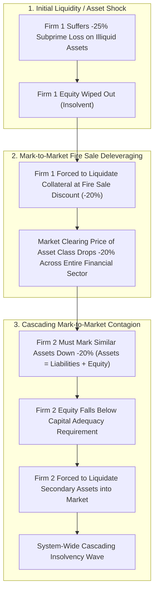
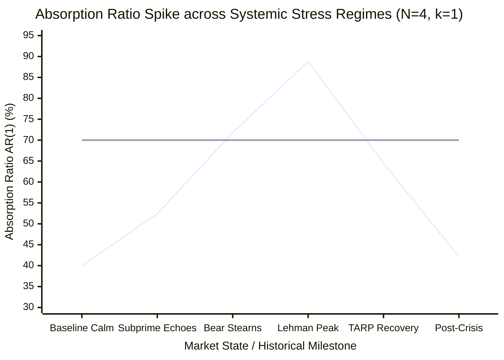
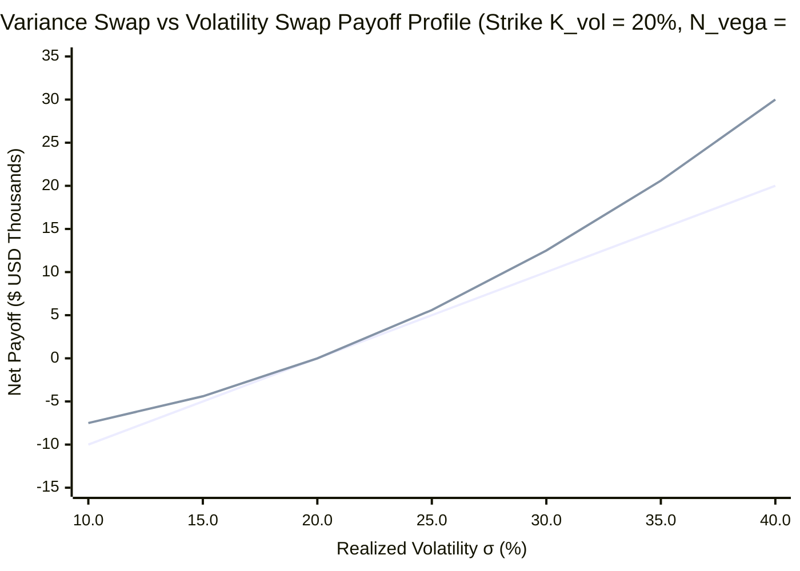
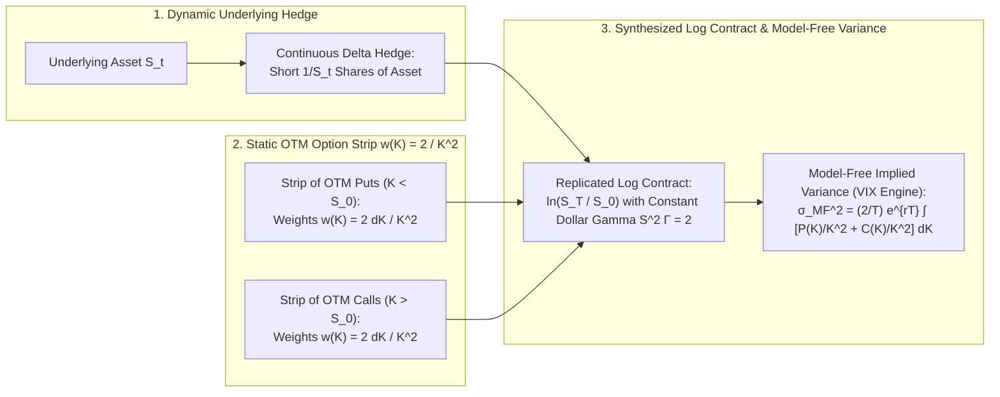
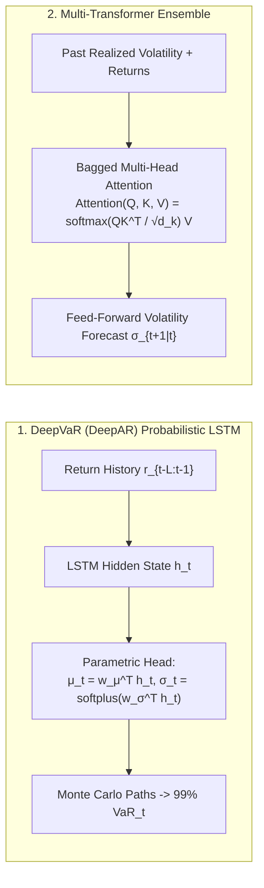
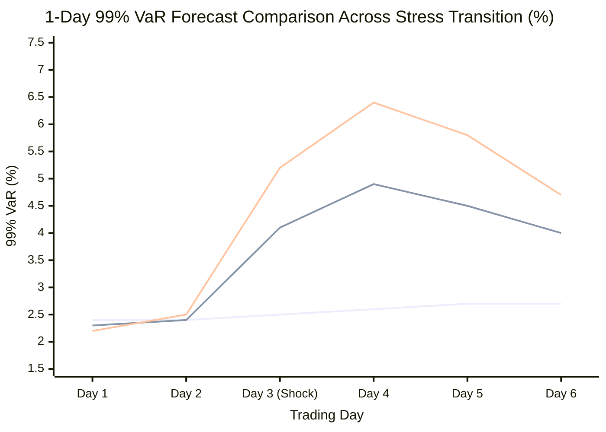
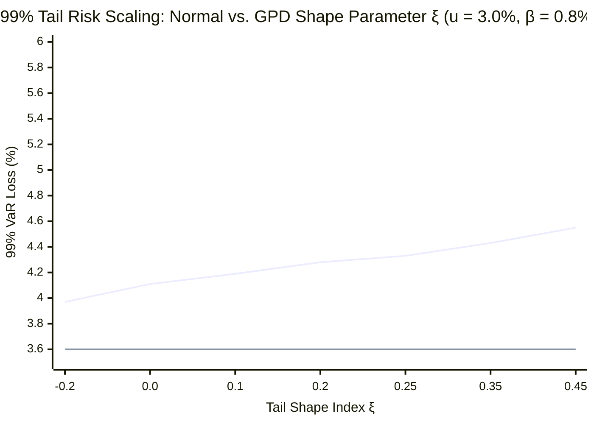
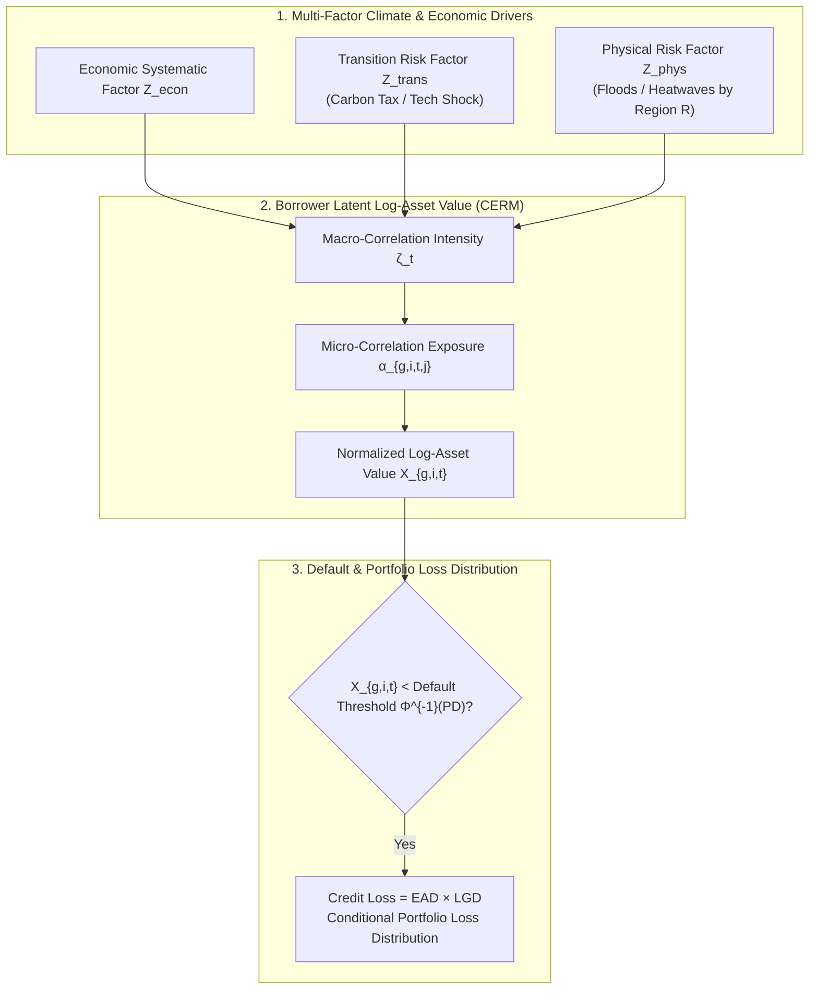
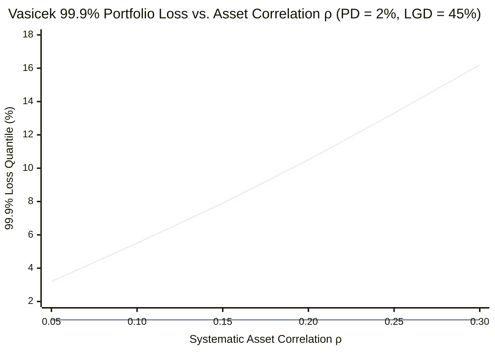
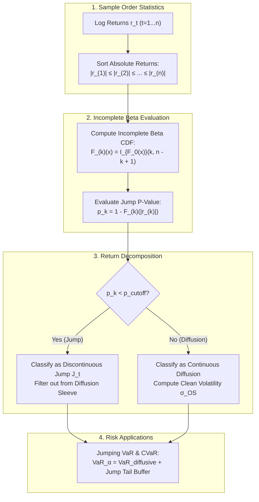

# Risk Management & Derivatives Engineering — Key Pedagogical Takeaways
## MScFE 660 Master Quantitative Synthesis

[← Back to Main README.md](./README.md)

---

## 📖 Table of Contents & Quick Module Links
1. [Core Intuition & Mechanical Failure Modes](#1-core-intuition--mechanical-failure-modes)
   - [Toy Example 1: Shadow Banking Interconnectedness & Fire Sale Contagion (M1)](#toy-example-1-shadow-banking-interconnectedness--fire-sale-contagion)
   - [Toy Example 2: Granger Causality Networks & PCA Absorption Ratio Fragility (M1)](#toy-example-2-granger-causality-networks--pca-absorption-ratio-fragility)
   - [Toy Example 3: Variance Swap Mark-to-Market & Volatility Convexity (M2)](#toy-example-3-variance-swap-mark-to-market--volatility-convexity)
   - [Toy Example 4: Carr-Madan Option Spanning & Log Contract Discretization (M2)](#toy-example-4-carr-madan-option-spanning--log-contract-discretization)
   - [Toy Example 5: Spadafora Order Statistics Jump Filter vs Naive Realized Volatility (M2)](#toy-example-5-spadafora-order-statistics-jump-filter-vs-naive-realized-volatility)
   - [Toy Example 6: DeepVaR Probabilistic LSTM & Multi-Transformer Volatility Forecasting (M3)](#toy-example-6-deepvar-probabilistic-lstm--multi-transformer-volatility-forecasting)
   - [Toy Example 7: Extreme Value Theory — Block Maxima (GEV) vs. Peaks Over Threshold (GPD) (M4)](#toy-example-7-extreme-value-theory--block-maxima-gev-vs-peaks-over-threshold-gpd)
   - [Toy Example 8: Bayesian Network Exact Inference vs. Approximate Sampling (M5)](#toy-example-8-bayesian-network-exact-inference-vs-approximate-sampling)
   - [Toy Example 9: Network Structure Learning — Chow-Liu MST & K2 Scoring (M6)](#toy-example-9-network-structure-learning--chow-liu-mst--k2-scoring)
   - [Toy Example 10: Vasicek Single-Factor Credit Loss & Climate Extended Risk Model (CERM) (M7)](#toy-example-10-vasicek-single-factor-credit-loss--climate-extended-risk-model-cerm)
   - [Toy Example 11: DYNOTEARS Dynamic Bayesian Networks & GBN PD Stress Testing (M8)](#toy-example-11-dynotears-dynamic-bayesian-networks--gbn-pd-stress-testing)
2. [Core Mathematical Formulations & Calculus Derivations](#2-core-mathematical-formulations--calculus-derivations)
   - [1. Granger Causality VAR Matrix & Principal Component Absorption Ratio Calculus (M1)](#1-granger-causality-var-matrix--principal-component-absorption-ratio-calculus-m1)
   - [2. Carr-Madan (1999) & Demeterfi et al. Model-Free Variance Replication Theorem (M2)](#2-carr-madan-1999--demeterfi-et-al-model-free-variance-replication-theorem-m2)
   - [3. Spadafora Order Statistics Probability Density & Incomplete Beta Jump Threshold Calculus (M2)](#3-spadafora-order-statistics-probability-density--incomplete-beta-jump-threshold-calculus-m2)
   - [4. DeepVaR Probabilistic Autoregressive Likelihood & Multi-Head Attention Calculus (M3)](#4-deepvar-probabilistic-autoregressive-likelihood--multi-head-attention-calculus-m3)
   - [5. Fisher-Tippett-Gnedenko GEV Theorem & Pickands-Balkema-de Haan GPD Calculus (M4)](#5-fisher-tippett-gnedenko-gev-theorem--pickands-balkema-de-haan-gpd-calculus-m4)
   - [6. Bayesian Network Factorization, D-Separation, K2 & BIC Structure Learning (M5–M6)](#6-bayesian-network-factorization-d-separation-k2--bic-structure-learning-m5-m6)
   - [7. Vasicek ASRF Portfolio Loss & Climate Extended Risk Model (CERM) Calculus (M7)](#7-vasicek-asrf-portfolio-loss--climate-extended-risk-model-cerm-calculus-m7)
   - [8. DYNOTEARS Continuous Acyclicity & Gaussian Bayesian Network / HMM Baum-Welch (M8)](#8-dynotears-continuous-acyclicity--gaussian-bayesian-network--hmm-baum-welch-m8)
3. [Practical Engineering, Empirical Case Studies & Research Reading Summaries](#3-practical-engineering--empirical-case-studies)
   - [Empirical Systemic Fragility & PCA Absorption Ratio Spikes during the 2008 GFC (*Bisias et al., 2012*)](#empirical-systemic-fragility--pca-absorption-ratio-spikes-during-the-2008-gfc)
   - [Empirical S&P 500 VIX Replicating Strip & Variance Risk Premium (VRP) Harvesting (*Hilpisch, 2020*)](#empirical-sp-500-vix-replicating-strip--variance-risk-premium-vrp-harvesting)
   - [High-Frequency Jump Detection & Jumping VaR Performance (*Spadafora et al., 2018*)](#high-frequency-jump-detection--jumping-var-performance)
   - [Research Summary 1: Climate-Related Credit Risk on Achmea Bank's Mortgage Portfolio (*Wouters Thesis*)](#research-summary-1-climate-related-credit-risk-on-achmea-banks-mortgage-portfolio)
   - [Research Summary 2: Flood Disaster Prediction via Bayesian Networks in Veneto, Italy (*Spolaor Report*)](#research-summary-2-flood-disaster-prediction-via-bayesian-networks-in-veneto-italy)
   - [Research Summary 3: The Climate Extended Risk Model (CERM) (*Garnier et al., 2022*)](#research-summary-3-the-climate-extended-risk-model-cerm)
   - [Research Summary 4: Financial Stress Testing with Gaussian Bayesian Networks (*Carraro, 2018*)](#research-summary-4-financial-stress-testing-with-gaussian-bayesian-networks)
4. [Comparative Synthesis Cheat Sheet](#4-comparative-synthesis-cheat-sheet)
5. [Comprehensive Mathematical Notation & Variable Glossary](#5-comprehensive-mathematical-notation--variable-glossary)

---

## 1. Core Intuition & Mechanical Failure Modes

### Toy Example 1: Shadow Banking Interconnectedness & Fire Sale Contagion (Module 1)

#### 💡 The Intuitive Metaphor
Imagine a tight neighborhood of wooden houses built on a dry hillside. If one house catches fire and burns down in isolation (microprudential view), only that single homeowner loses equity. But if every house is connected by shared propane lines and wooden fences (shadow banking credit linkages), the heat from House A ignites House B, forcing firefighters to hose down House C by spraying flammable retardant (mark-to-market fire sale liquidations). The entire neighborhood collapses in a firestorm not because of individual negligence, but because of **structural network interconnectedness**.

#### 🏷️ Notation Breakdown:
- $A_i, L_i, E_i$: **Assets, Liabilities, and Equity of Financial Institution $i$** ($A_i = L_i + E_i$).
- $\Delta A_{\text{shock}}$: **Initial Exogenous Asset Value Shock** (Subprime default shock).
- $\alpha_{\text{haircut}}$: **Fire Sale Price Impact / Liquidation Discount** ($\alpha \in [0, 1]$).
- $\text{CAR}$: **Capital Adequacy Ratio** ($E_i / A_i \ge \text{CAR}_{\min} = 8\%$).
- $\Delta E_{\text{contagion}}$: **Contagious Equity Erosion from Mark-to-Market Revaluation**.

#### 🔢 Step-by-Step Numerical Calculation
Consider 3 interconnected financial institutions holding similar legacy illiquid mortgage-backed securities:
- **Firm 1 (Hedge Fund / Shadow Bank)**: $A_1 = \$100\text{M}$ (Illiquid), $L_1 = \$90\text{M}$ (Repo debt to Bank 2), $E_1 = \$10\text{M}$ (Capital ratio $= 10\%$).
- **Firm 2 (Dealer Bank)**: $A_2 = \$500\text{M}$ ($\$90\text{M}$ Repo loan to Firm 1 + $\$410\text{M}$ Other assets), $L_2 = \$460\text{M}$, $E_2 = \$40\text{M}$ (Capital ratio $= 8\%$).
- **Firm 3 (Commercial Bank)**: $A_3 = \$1{,}000\text{M}$, $L_3 = \$920\text{M}$, $E_3 = \$80\text{M}$ (Capital ratio $= 8\%$).

1. **Phase 1: Direct Subprime Asset Shock on Firm 1:**
   - Firm 1's illiquid assets suffer a $-15\%$ valuation loss ($-\$15\text{M}$).
   - New Assets $A_1' = \$100\text{M} - \$15\text{M} = \$85\text{M}$.
   - Fundamental Accounting Identity: $E_1' = A_1' - L_1 = \$85\text{M} - \$90\text{M} = -\$5\text{M}$ (**Firm 1 is Insolvent**).

2. **Phase 2: Collateral Fire Sale & Price Contagion:**
   - Creditors seize Firm 1's collateral and dump it into an illiquid market, suffering an additional $\alpha_{\text{haircut}} = 20\%$ liquidation penalty.
   - Market clearing price for this asset class declines by $-20\%$ across the entire financial system.

3. **Phase 3: Mark-to-Market Contagion on Firm 2 and Firm 3:**
   - Under Mark-to-Market (MTM) accounting, Firm 2 and Firm 3 must write down identical asset classes on their balance sheets by $-20\%$.
   - **Firm 2 Loss**: Holds $\$150\text{M}$ in similar assets. Write-down $= 0.20 \times \$150\text{M} = \$30\text{M}$.
     - Firm 2 Repo recovery from Firm 1: Recovers only $\$85\text{M} \times 0.80 = \$68\text{M}$ (Loss of $\$22\text{M}$).
     - Total Firm 2 Loss $= \$30\text{M} + \$22\text{M} = \$52\text{M}$.
     - New Firm 2 Equity: $E_2' = \$40\text{M} - \$52\text{M} = -\$12\text{M}$ (**Firm 2 becomes Insolvent!**).
   - **Firm 3 Loss**: Holds $\$300\text{M}$ in similar assets. Write-down $= 0.20 \times \$300\text{M} = \$60\text{M}$.
     - New Firm 3 Equity: $E_3' = \$80\text{M} - \$60\text{M} = \$20\text{M}$.
     - New Firm 3 Capital Adequacy Ratio: $\frac{\$20\text{M}}{\$940\text{M}} = 2.13\% < 8.0\%$ (**Regulatory Capital Breach $\to$ Forced Lending Freeze**).

A small $-\$15\text{M}$ initial default in the shadow banking sector propagated through market-wide MTM asset write-downs to trigger $\$112\text{M}$ in cumulative system equity destruction, bankrupting Firm 2 and freezing Firm 3!

#### 💥 Mechanical Failure Modes
- **Historical Cost Accounting vs. Mark-to-Market Accounting**: Historical cost masks impending insolvency until default occurs; Mark-to-market provides instant transparency but triggers endogenous procyclical liquidation spirals during liquidity freezes.
- **Regulatory Disintermediation**: Shadow banking institutions operate outside Basel capital requirements and central bank discount window emergency access, creating hidden leverage nodes.

---

### Toy Example 2: Granger Causality Networks & PCA Absorption Ratio Fragility (Module 1)

#### 💡 The Intuitive Metaphor
In normal times, individual musical instruments in an orchestra warm up independently, producing scattered, discordant background noise (low Absorption Ratio, high idiosyncratic entropy). But when the conductor raises the baton and a sudden loud crash occurs, all musicians instantly freeze and play the exact same dramatic chord in lockstep (high Absorption Ratio). When financial institutions lock together, a shock to any single firm propagates instantaneously across the entire system.

#### 🏷️ Notation Breakdown:
- $\mathbf{X}_t$: **Vector of Asset / Financial Institution Returns at Time $t$** ($N \times 1$).
- $\mathbf{\Sigma}_t$: **Cross-Sectional Covariance Matrix of Asset Returns** ($N \times N$).
- $\lambda_1 \ge \lambda_2 \ge \dots \ge \lambda_N$: **Sorted Eigenvalues of Covariance Matrix $\mathbf{\Sigma}_t$**.
- $\text{AR}(k)$: **Principal Component Absorption Ratio** ($\text{AR} = \frac{\sum_{j=1}^k \lambda_j}{\sum_{i=1}^N \lambda_i} \in [0, 1]$).
- $\Delta \text{AR}$: **Absorption Ratio Spike / Standardized Change** ($\Delta \text{AR} = \frac{\text{AR}_{\text{short}} - \text{AR}_{\text{long}}}{\sigma_{\text{long}}}$).

#### 🔢 Step-by-Step Numerical Calculation
Consider a financial sector comprising $N = 4$ major institutions (JPM, GS, MS, C) across two macroeconomic regimes:

1. **Regime A: Normal Diversified Market (Low Systemic Fragility)**
   Empirical Covariance Matrix $\mathbf{\Sigma}_{\text{calm}}$ with pairwise correlation $\rho \approx 0.20$ and individual volatilities $\sigma_i = 15\%$:
   $$\mathbf{\Sigma}_{\text{calm}} = 0.0225 \times \begin{bmatrix} 1.00 & 0.20 & 0.20 & 0.20 \\ 0.20 & 1.00 & 0.20 & 0.20 \\ 0.20 & 0.20 & 1.00 & 0.20 \\ 0.20 & 0.20 & 0.20 & 1.00 \end{bmatrix}$$
   Spectral decomposition yields eigenvalues:
   $$\lambda_1 = 0.0360, \quad \lambda_2 = 0.0180, \quad \lambda_3 = 0.0180, \quad \lambda_4 = 0.0180$$
   Total Variance $= \text{tr}(\mathbf{\Sigma}) = 0.0360 + 3(0.0180) = 0.0900$.
   Absorption Ratio for top $k = 1$ principal component:
   $$\text{AR}(1) = \frac{\lambda_1}{\sum_{i=1}^4 \lambda_i} = \frac{0.0360}{0.0900} = 0.4000 \quad (40.00\%)$$

2. **Regime B: Systemic Distress / 2008 Lehman Crisis (High Fragility)**
   Contagion drives pairwise correlations to $\rho = 0.85$ and volatilities spike to $\sigma_i = 40\%$:
   $$\mathbf{\Sigma}_{\text{crisis}} = 0.1600 \times \begin{bmatrix} 1.00 & 0.85 & 0.85 & 0.85 \\ 0.85 & 1.00 & 0.85 & 0.85 \\ 0.85 & 0.85 & 1.00 & 0.85 \\ 0.85 & 0.85 & 0.85 & 1.00 \end{bmatrix}$$
   Spectral decomposition yields eigenvalues:
   $$\lambda_1 = 0.5680, \quad \lambda_2 = 0.0240, \quad \lambda_3 = 0.0240, \quad \lambda_4 = 0.0240$$
   Total Variance $= \text{tr}(\mathbf{\Sigma}) = 0.5680 + 3(0.0240) = 0.6400$.
   Absorption Ratio for top $k = 1$ principal component:
   $$\text{AR}(1) = \frac{\lambda_1}{\sum_{i=1}^4 \lambda_i} = \frac{0.5680}{0.6400} = 0.8875 \quad (88.75\%)$$

The Absorption Ratio jumped from $40.0\%$ to $88.75\%$, indicating that nearly $90\%$ of all sector variance is driven by a single common distress factor.

| Systemic Regime | Absorption Ratio $\text{AR}(1)$ | Cross-Asset Correlation $\rho$ | Market State Description | Macroprudential Policy Action |
| :--- | :--- | :--- | :--- | :--- |
| **Diversified Equilibrium** | $30\% - 45\%$ | $\rho \le 0.25$ | Idiosyncratic risk dominates; market functioning normally | Routine monitoring; standard capital requirements |
| **Latent Coupling State** | $45\% - 65\%$ | $0.25 < \rho \le 0.55$ | Common factor exposures rising; shadow bank credit expanding | Tighten counter-cyclical capital buffers (CCyB) |
| **Systemic Fragility Alarm** | **$> 70\%$** | **$\rho > 0.75$** | **Severe market coupling; high vulnerability to fire sale cascade** | **Inject emergency discount window liquidity; restrict shorting** |

---

### Toy Example 3: Variance Swap Mark-to-Market & Volatility Convexity (Module 2)

#### 💡 The Intuitive Metaphor
Buying a plain-vanilla volatility swap is like taking out flood insurance that pays linearly for every inch of water above $12$ inches. Buying a **variance swap** is like taking out insurance that pays proportional to the **energy of the flood water** (kinetic energy $= \frac{1}{2} m v^2$). When the water rises gently, both pay similarly; but when a catastrophic tsunami hits, the quadratic squaring of variance produces an explosive exponential payout, providing pure **volatility convexity**.

#### 🏷️ Notation Breakdown:
- $K_{\text{vol}}, K_{\text{var}}$: **Volatility Strike and Variance Strike** ($K_{\text{var}} = K_{\text{vol}}^2$).
- $N_{\text{vega}}$: **Vega Notional** (Dollar payout per $1.0\text{ percentage point}$ change in volatility).
- $N_{\text{var}}$: **Variance Notional** ($N_{\text{var}} = \frac{N_{\text{vega}}}{2 K_{\text{vol}}}$).
- $\sigma_{\text{realized}}^2$: **Annualized Realized Variance over Contract Horizon** ($\sigma_{\text{realized}}^2 = \frac{252}{T} \sum_{t=1}^T \ln^2(S_t / S_{t-1})$).
- $\text{MTM}_t$: **Mark-to-Market Value of Variance Swap at Intermediate Time $t$**.

#### 🔢 Step-by-Step Numerical Calculation
An institutional asset manager enters a 1-year OTC Variance Swap as the fixed-rate payer / floating-rate receiver (long variance):
- Contract Parameters: Vega Notional $N_{\text{vega}} = \$100{,}000$, Volatility Strike $K_{\text{vol}} = 20\%$ ($0.20$).
- Variance Strike: $K_{\text{var}} = K_{\text{vol}}^2 = (0.20)^2 = 0.0400$ ($400\text{ variance points}$).
- Variance Notional:
  $$N_{\text{var}} = \frac{N_{\text{vega}}}{2 K_{\text{vol}}} = \frac{\$100{,}000}{2 \times 0.20} = \$250{,}000\text{ per unit of variance}$$

1. **Scenario Comparison at Maturity $T$ (Volatility Spike to $\sigma_{\text{realized}} = 40\%$):**
   - **Linear Volatility Swap Payoff**:
     $$\text{Payoff}_{\text{vol}} = N_{\text{vega}} \times (\sigma_{\text{realized}} - K_{\text{vol}}) = \$100{,}000 \times (0.40 - 0.20) = \$100{,}000 \times 0.20 = +\$20{,}000$$
   - **Convex Variance Swap Payoff**:
     $$\text{Payoff}_{\text{var}} = N_{\text{var}} \times (\sigma_{\text{realized}}^2 - K_{\text{var}}) = \$250{,}000 \times ((0.40)^2 - 0.0400) = \$250{,}000 \times (0.1600 - 0.0400)$$
     $$\text{Payoff}_{\text{var}} = \$250{,}000 \times 0.1200 = +\$30{,}000$$
   - **The Convexity Bonus**:
     $$\text{Payoff}_{\text{var}} - \text{Payoff}_{\text{vol}} = \$30{,}000 - \$20{,}000 = +\$10{,}000$$
     The variance swap yields a $+50\%$ higher payout due to Jensen's inequality and quadratic curvature!

2. **Intermediate Mark-to-Market Valuation at $t = 0.5\text{ years}$ ($6\text{ months}$):**
   - Risk-free discount rate: $r = 5\%$.
   - Realized variance over past 6 months: $\sigma_{\text{realized}}^2(0, 0.5) = (0.25)^2 = 0.0625$.
   - Prevailing forward implied variance strike for remaining 6 months: $K_{\text{var}}(0.5, 1.0) = (0.30)^2 = 0.0900$.
   - Total expected terminal variance:
     $$\sigma_{\text{exp}}^2 = \frac{t}{T} \sigma_{\text{realized}}^2(0, 0.5) + \frac{T - t}{T} K_{\text{var}}(0.5, 1.0) = 0.5(0.0625) + 0.5(0.0900) = 0.03125 + 0.04500 = 0.07625$$
   - Intermediate Discounted Mark-to-Market Value:
     $$\text{MTM}_{0.5} = e^{-r(T-t)} N_{\text{var}} \left( \sigma_{\text{exp}}^2 - K_{\text{var}} \right) = e^{-0.05 \times 0.5} \times \$250{,}000 \times (0.07625 - 0.04000)$$
     $$\text{MTM}_{0.5} = 0.97531 \times \$250{,}000 \times 0.03625 = 0.97531 \times \$9{,}062.50 \approx +\$8{,}838.75$$

---

### Toy Example 4: Carr-Madan Option Spanning & Log Contract Discretization (Module 2)

#### 💡 The Intuitive Metaphor
Imagine building a curved parabolic dome using flat wooden boards. A single flat board (a forward contract) cannot create curvature. But if you assemble a continuous series of tiny angled brackets positioned at every possible height (a strip of out-of-the-money European call and put options), and make the brackets smaller and denser near the base ($w(K) = \frac{2}{K^2}$), you recreate the perfect continuous curve of a log contract $\ln(S_T / S_0)$ with **constant dollar gamma**.

#### 🏷️ Notation Breakdown:
- $S_0, S_T$: **Underlying Asset Spot Price and Terminal Price**.
- $F_0$: **Forward Price of Underlying** ($F_0 = S_0 e^{rT}$).
- $C(K), P(K)$: **Market Prices of European Call and Put Options with Strike $K$**.
- $w(K)$: **Option Weighting Kernel** ($w(K) = \frac{2 \Delta K}{K^2}$, enforcing constant dollar gamma $\Gamma \cdot S^2 = 2$).
- $\sigma_{\text{MF}}^2$: **Model-Free Implied Variance** (Underlying calculation of the CBOE VIX index).

#### 🔢 Step-by-Step Numerical Calculation
Let spot price $S_0 = 100$, interest rate $r = 0$, maturity $T = 1\text{ year}$.
Consider 5 available discrete out-of-the-money options spaced by $\Delta K = \$10$:
- OTM Puts ($K < S_0$): Put $K = 80$ (Price $P = \$1.20$), Put $K = 90$ (Price $P = \$3.50$).
- ATM Reference: $K_0 = 100$.
- OTM Calls ($K > S_0$): Call $K = 110$ (Price $C = \$3.80$), Call $K = 120$ (Price $C = \$1.40$).

1. **Calculate Discrete Strike Weights $w(K) = \frac{2 \Delta K}{K^2}$:**
   - For $K = 80$: $w(80) = \frac{2 \times 10}{(80)^2} = \frac{20}{6400} = 0.003125$.
   - For $K = 90$: $w(90) = \frac{2 \times 10}{(90)^2} = \frac{20}{8100} \approx 0.002469$.
   - For $K = 110$: $w(110) = \frac{2 \times 10}{(110)^2} = \frac{20}{12100} \approx 0.001653$.
   - For $K = 120$: $w(120) = \frac{2 \times 10}{(120)^2} = \frac{20}{14400} \approx 0.001389$.

2. **Integrate Replicating Option Portfolio Value:**
   $$\text{Portfolio Value} = \sum_{K_i < S_0} w(K_i) P(K_i) + \sum_{K_j > S_0} w(K_j) C(K_j)$$
   $$\text{Put Sleeve} = (0.003125 \times \$1.20) + (0.002469 \times \$3.50) = 0.003750 + 0.008642 = 0.012392$$
   $$\text{Call Sleeve} = (0.001653 \times \$3.80) + (0.001389 \times \$1.40) = 0.006281 + 0.001945 = 0.008226$$
   $$\text{Total Option Value} = 0.012392 + 0.008226 = 0.020618$$

3. **Synthesize Annualized Model-Free Implied Variance ($\sigma_{\text{MF}}^2$):**
   $$\sigma_{\text{MF}}^2 = \frac{2}{T} e^{rT} \times \text{Total Option Value} = 2 \times 0.020618 = 0.041236 \quad (4.12\%)$$
   $$\sigma_{\text{MF}} = \sqrt{0.041236} \approx 20.31\%$$

The static option strip perfectly prices the fair 1-year variance swap strike without assuming any continuous Black-Scholes formula!

---

### Toy Example 5: Spadafora Order Statistics Jump Filter vs Naive Realized Volatility (Module 2)

#### 💡 The Intuitive Metaphor
Imagine measuring the average rainfall rate in Seattle over 10 days. For 9 days, a steady drizzle produces $0.2$ inches per day. On Day 10, a flash water main burst dumps $5.0$ inches in one hour. If you naively average all 10 days, you conclude Seattle gets a massive $0.68$ inches per day (grossly overestimating climate risk). The **Spadafora Order Statistics (OS) Estimator** sorts rainfall days from smallest to largest and tests extreme values against the theoretical distribution of order statistics, identifying the burst as an outlier jump and measuring the true continuous diffusive precipitation.

#### 🏷️ Notation Breakdown:
- $r_t$: **Log Return Series at Time $t$** ($r_t = \ln(S_t / S_{t-1})$).
- $|r_{(1)}| \le |r_{(2)}| \le \dots \le |r_{(n)}|$: **Ordered Absolute Return Statistics**.
- $\sigma_{\text{naive}}$: **Sample Standard Deviation** ($\sqrt{\frac{1}{n-1}\sum (r_t - \bar{r})^2}$).
- $\sigma_{\text{OS}}$: **Spadafora Order Statistics Continuous Volatility Estimator**.
- $I_x(a, b)$: **Regularized Incomplete Beta Function** ($I_x(a, b) = \frac{1}{B(a, b)} \int_0^x u^{a-1}(1-u)^{b-1} du$).
- $p_{\text{cutoff}}$: **Jump Classification Tolerance Probability** ($p_{\text{cutoff}} \approx 0.01\text{ to }0.05$).

#### 🔢 Step-by-Step Numerical Calculation
Consider a sample of $n = 10$ daily log returns with a single crisis flash-crash jump on Day 4:
$$r = [ +1.2\%, -1.5\%, +0.8\%, \mathbf{-8.5\%}, +1.0\%, -0.9\%, +1.4\%, -1.1\%, +0.7\%, -1.3\% ]$$

1. **Naive Sample Standard Deviation ($\sigma_{\text{naive}}$):**
   - Mean return: $\bar{r} = \frac{-9.2\%}{10} = -0.92\%$.
   - Sum of squared deviations:
     $$\sum (r_t - \bar{r})^2 = (2.12)^2 + (-0.58)^2 + (1.72)^2 + (-7.58)^2 + \dots = 69.84\%$$
   - Naive daily sample standard deviation:
     $$\sigma_{\text{naive}} = \sqrt{\frac{69.84}{9}} = \sqrt{7.76} \approx 2.786\% \implies \text{Annualized } \sigma_{\text{naive}} = 2.786\% \times \sqrt{252} \approx 44.22\%$$
   A single flash-crash jump doubled the perceived volatility of an otherwise tranquil $18\%$ asset!

2. **Spadafora Order Statistics (OS) Jump Classification:**
   - Sort absolute returns:
     $$|r_{(1)}| = 0.70\%, \; |r_{(2)}| = 0.80\%, \; |r_{(3)}| = 0.90\%, \; |r_{(4)}| = 1.00\%, \; |r_{(5)}| = 1.10\%,$$
     $$|r_{(6)}| = 1.20\%, \; |r_{(7)}| = 1.30\%, \; |r_{(8)}| = 1.40\%, \; |r_{(9)}| = 1.50\%, \; \mathbf{|r_{(10)}| = 8.50\%}$$
   - Baseline continuous standard deviation from non-extreme order statistics: $\sigma_0 \approx 1.15\%$.
   - Theoretical CDF for Gaussian absolute returns: $F_0(x) = 2 \Phi(x / \sigma_0) - 1$.
     For $|r_{(10)}| = 8.50\%$: $x / \sigma_0 = 8.50 / 1.15 \approx 7.39 \implies F_0(8.50\%) \approx 1.0000$.
   - Compute Incomplete Beta Jump Probability for the $n$-th order statistic ($k = 10, n = 10$):
     $$P(\text{Jump}) = 1 - I_{F_0(x)}(10, 1) = 1 - [F_0(x)]^{10} = 1 - (1.0000)^{10} \approx 0.0000 < p_{\text{cutoff}}$$
     The hypothesis that $8.50\%$ belongs to the Gaussian diffusion process is **rejected at $>99.99\%$ confidence**!

3. **Robust OS Diffusive Volatility ($\sigma_{\text{OS}}$):**
   - The OS algorithm excludes the jump observation $|r_{(10)}| = 8.50\%$ from the continuous diffusion term.
   - Recalculating standard deviation on the 9 diffusive observations yields:
     $$\sigma_{\text{diffusive}} \approx 1.16\% \implies \text{Annualized } \sigma_{\text{OS}} = 1.16\% \times \sqrt{252} \approx 18.41\%$$
   - Jumping VaR decomposes risk into a continuous $18.4\%$ diffusion plus a discrete Poisson jump process with intensity $\lambda_{\text{jump}} = 0.10$ and mean magnitude $\mu_J = -8.5\%$.

---

### Toy Example 6: DeepVaR Probabilistic LSTM & Multi-Transformer Volatility Forecasting (Module 3)

#### 💡 The Intuitive Metaphor
Traditional Value at Risk (VaR) is like checking a rear-view mirror that only averages the last 30 miles of road smoothness. **DeepVaR** is an experienced rally co-driver using a recurrent memory (LSTM) to output not a single speed guess, but a full probability cone for the next turn—and a **Multi-Transformer** is a team of spotters simultaneously scanning distant historical crashes (multi-head self-attention) and combining their bagged forecasts to predict sudden volatility regime shifts.

#### 🏷️ Notation Breakdown:
- $\mathbf{h}_t \in \mathbb{R}^d$: **LSTM Hidden State Vector** encoding sequential return memory up to time $t$.
- $\mu_t, \sigma_t$: **Predicted Conditional Mean and Scale** of the Gaussian (or Student-$t$) return distribution at time $t$.
- $\mathbf{Q}, \mathbf{K}, \mathbf{V}$: **Query, Key, and Value Matrices** in Scaled Dot-Product Self-Attention with key dimension $d_k$.
- $\text{VaR}_{\alpha, t}$: **Dynamic Conditional Value at Risk** at confidence level $\alpha \in (0, 1)$ (e.g., 99%).
- $M_{\text{MC}}$: **Number of Monte Carlo Sampled Trajectories** drawn from the DeepVaR predictive distribution.

#### 🔢 Step-by-Step Numerical Calculation
Suppose a $1,000,000 portfolio is monitored with a DeepVaR LSTM model trained via Gaussian negative log-likelihood on daily log returns:
1. **LSTM Hidden State & Parametric Output at $t$:**
   - Given recent volatility clustering, the LSTM outputs $\mu_t = -0.0010$ ($-0.10\%$ daily) and $\sigma_t = 0.0220$ ($2.20\%$ daily).
   - For a 1-day $99\%$ confidence level ($\Phi^{-1}(0.01) = -2.3263$):
     $$\text{VaR}_{0.99, t}^{\text{DeepVaR}} = -(\mu_t + \Phi^{-1}(0.01)\sigma_t) = -(-0.0010 - 2.3263 \times 0.0220) = 0.05218 \quad (5.22\%)$$
   - In dollar terms on a $1,000,000 portfolio, 1-day $99\%$ VaR is **$52,180**.
2. **Multi-Transformer Attention Weighting Across Historical Regimes:**
   - Suppose 3 historical lookback windows ($k_1$: calm, $k_2$: rate hike, $k_3$: liquidity shock) have dot-product scores $\frac{\mathbf{q}\cdot \mathbf{k}_i}{\sqrt{d_k}} = [0.2, 1.1, 2.4]$ with $v_i = [0.8\%, 1.6\%, 3.2\%]$.
   - Softmax attention weights:
     $$e^{0.2} = 1.221, \; e^{1.1} = 3.004, \; e^{2.4} = 11.023 \implies \sum = 15.248$$
     $$\alpha_1 = 0.080, \; \alpha_2 = 0.197, \; \alpha_3 = 0.723$$
   - Attention-weighted volatility forecast:
     $$\hat{\sigma}_{t+1} = 0.080(0.8\%) + 0.197(1.6\%) + 0.723(3.2\%) = 0.064\% + 0.315\% + 2.314\% = 2.69\%$$

| Model Family | Volatility Memory Mechanism | Tail Adaptability | Primary Failure Mode |
| :--- | :--- | :--- | :--- |
| **Historical Simulation** | Equal-weighted rolling window | Slow ("ghost effect" after crashes) | Fails during sudden regime transitions |
| **GARCH(1,1)** | Linear lag of $\epsilon_{t-1}^2$ and $\sigma_{t-1}^2$ | Symmetric unless EGARCH/GJR | Misses long-range non-linear cross-asset cues |
| **DeepVaR (LSTM)** | Gated recurrent hidden state $\mathbf{h}_t$ | Outputs full parametric/MC distribution | Overfits small samples; sensitive to distributional head |
| **Multi-Transformer** | Multi-head self-attention + bagging | Captures long-horizon crisis analogies | High compute cost; requires careful regularization |

#### 💥 Mechanical Failure Modes
- **Out-of-Distribution Regime Blindness**: Neural forecasters trained only on low-volatility bull markets underestimate tail scale $\sigma_t$ during unprecedented structural breaks unless regularized with heavy-tailed (Student-$t$) likelihoods or ensemble bagging.

---

### Toy Example 7: Extreme Value Theory — Block Maxima (GEV) vs. Peaks Over Threshold (GPD) (Module 4)

#### 💡 The Intuitive Metaphor
If you want to design a sea wall to withstand a 100-year storm, averaging the daily tide height is useless—the average tells you nothing about hurricanes. **Block Maxima (GEV)** records only the single highest wave each year, while **Peaks Over Threshold (GPD)** records every wave that spills over a 10-foot seawall marker. Both discard the calm 99% of days so that mathematics can focus exclusively on the geometry of the tail.

#### 🏷️ Notation Breakdown:
- $M_n = \max(X_1, \dots, X_n)$: **Block Maximum** of $n$ daily losses in a block (e.g., monthly or annual).
- $\mu, \sigma > 0, \xi$: **Location, Scale, and Shape (Tail Index) Parameters** of the Generalized Extreme Value (GEV) distribution ($\xi > 0$: Fréchet heavy tail; $\xi = 0$: Gumbel; $\xi < 0$: Weibull bounded tail).
- $u$: **High Threshold** in Peaks Over Threshold (POT) analysis; exceedances are $Y = X - u \mid X > u$.
- $\beta > 0, \xi$: **GPD Scale and Shape Parameters** for threshold exceedances.
- $N_u / N$: **Empirical Tail Exceedance Fraction** above threshold $u$.

#### 🔢 Step-by-Step Numerical Calculation
Consider $N = 1,000$ daily portfolio losses (positive numbers denote losses), where we set threshold $u = 3.0\%$ and observe $N_u = 40$ exceedances ($N_u / N = 0.04$).
1. **Fit Generalized Pareto Distribution (GPD) to Exceedances $Y = X - u$:**
   - Maximum Likelihood Estimation on the 40 exceedances yields $\hat{\xi} = 0.25$ (heavy-tailed Fréchet domain) and $\hat{\beta} = 0.80\%$.
2. **Compute $99\%$ POT Value at Risk ($\text{VaR}_{0.99}$) and Expected Shortfall ($\text{ES}_{0.99}$):**
   - For confidence level $\alpha = 0.99$ ($1 - \alpha = 0.01$):
     $$\text{VaR}_{\alpha}^{\text{GPD}} = u + \frac{\hat{\beta}}{\hat{\xi}} \left[ \left( \frac{N}{N_u}(1 - \alpha) \right)^{-\hat{\xi}} - 1 \right]$$
     $$\text{VaR}_{0.99}^{\text{GPD}} = 3.0\% + \frac{0.80\%}{0.25} \left[ \left( \frac{1000}{40} \times 0.01 \right)^{-0.25} - 1 \right] = 3.0\% + 3.2\% \left[ (0.25)^{-0.25} - 1 \right]$$
   - Since $(0.25)^{-0.25} = 4^{0.25} = \sqrt{2} \approx 1.4142$:
     $$\text{VaR}_{0.99}^{\text{GPD}} = 3.0\% + 3.2\% \times (1.4142 - 1) = 3.0\% + 1.325\% = \mathbf{4.33\%}$$
   - **Expected Shortfall ($\text{ES}_{0.99}$)** (coherent tail expectation for $\xi < 1$):
     $$\text{ES}_{0.99}^{\text{GPD}} = \frac{\text{VaR}_{0.99}^{\text{GPD}}}{1 - \hat{\xi}} + \frac{\hat{\beta} - \hat{\xi} u}{1 - \hat{\xi}} = \frac{4.325\%}{0.75} + \frac{0.80\% - 0.25(3.0\%)}{0.75} = 5.767\% + 0.067\% = \mathbf{5.83\%}$$
3. **Conditional EVT (GARCH + EVT) Adjustment:**
   - In live trading, fit GARCH(1,1) / GJR-GARCH first to extract standardized residuals $z_t = \epsilon_t / \sigma_t$, apply GPD to the tail of $z_t$ to get $z_{0.99}^{\text{GPD}}$, and scale dynamically: $\text{VaR}_{0.99, t+1} = \hat{\mu}_{t+1} + \hat{\sigma}_{t+1} z_{0.99}^{\text{GPD}}$.

| Tail Index $\xi$ | Domain of Attraction | Tail Behavior | Risk Management Implication |
| :--- | :--- | :--- | :--- |
| **$\xi > 0$** | **Fréchet** (Pareto, Student-$t$) | Power-law heavy tail; moments $\ge 1/\xi$ infinite | Typical for equity, FX, and crypto crashes; Gaussian VaR severely underestimates |
| **$\xi = 0$** | **Gumbel** (Normal, Lognormal) | Exponentially decaying tail | Standard thin-tailed benchmark |
| **$\xi < 0$** | **Weibull** (Uniform, Beta) | Finite upper endpoint $u - \beta / \xi$ | Bounded loss regimes (e.g., insured/capped exposures) |

#### 💥 Mechanical Failure Modes
- **Bias-Variance Tradeoff in Threshold $u$**: Setting $u$ too low violates the asymptotic GPD limit (high bias); setting $u$ too high leaves too few exceedances $N_u$ (explosive estimation variance). Unfiltered raw returns also violate i.i.d. assumptions due to volatility clustering, requiring GARCH pre-whitening.

---

### Toy Example 8: Bayesian Network Exact Inference vs. Approximate Sampling (Module 5)

#### 💡 The Intuitive Metaphor
A **Bayesian Network** is a transparent causal plumbing diagram of probabilities. If you want to know the probability that a basement floods given a broken pipe and heavy rain, **Variable Elimination** solves the exact algebraic equations by summing out intermediate pipes one by one. When the plumbing network has hundreds of rooms, exact algebra becomes intractable, so we turn on the water and run simulations: **Rejection Sampling** throws away any simulation where the observed evidence didn't occur, **Likelihood Weighting** forces the evidence to happen and reweights each run by how plausible that forcing was, and **Gibbs Sampling (MCMC)** walks from room to room updating one variable at a time conditioned on its Markov blanket.

#### 🏷️ Notation Breakdown:
- $\mathcal{G} = (V, E)$: **Directed Acyclic Graph (DAG)** with random variable nodes $V = \{X_1, \dots, X_n\}$ and directed causal edges $E$.
- $\text{Pa}(X_i)$: **Parent Set** of node $X_i$ in $\mathcal{G}$; joint distribution factors as $P(X_1, \dots, X_n) = \prod_{i=1}^n P(X_i \mid \text{Pa}(X_i))$.
- $\mathbf{E} = \mathbf{e}$: **Observed Evidence** (hard evidence clamped to specific states).
- $w^{(m)}$: **Importance Weight** of sample $m$ in Likelihood Weighting ($w^{(m)} = \prod_{X_i \in \mathbf{E}} P(x_i^{(m)} \mid \text{pa}(X_i)^{(m)})$).

#### 🔢 Step-by-Step Numerical Calculation
Consider a 3-node credit contagion DAG: $\text{Macro Recession } (M) \to \text{Sector Stress } (S) \to \text{Loan Default } (D)$, with:
- $P(M=1) = 0.20$
- $P(S=1 \mid M=1) = 0.70$, $P(S=1 \mid M=0) = 0.10$
- $P(D=1 \mid S=1) = 0.50$, $P(D=1 \mid S=0) = 0.05$

1. **Exact Inference via Variable Elimination — Query $P(M=1 \mid D=1)$:**
   - First compute marginal $P(S=1)$:
     $$P(S=1) = P(S=1 \mid M=1)P(M=1) + P(S=1 \mid M=0)P(M=0) = 0.70(0.20) + 0.10(0.80) = 0.14 + 0.08 = 0.22$$
   - Joint probability $P(M=1, D=1)$ by summing out $S \in \{0, 1\}$:
     $$P(M=1, D=1) = P(M=1)\sum_{s} P(D=1 \mid S=s)P(S=s \mid M=1)$$
     $$= 0.20 \times [0.50(0.70) + 0.05(0.30)] = 0.20 \times [0.350 + 0.015] = 0.0730$$
   - Similarly, $P(M=0, D=1) = 0.80 \times [0.50(0.10) + 0.05(0.90)] = 0.80 \times [0.050 + 0.045] = 0.0760$.
   - Total $P(D=1) = 0.0730 + 0.0760 = 0.1490$.
   - Exact posterior:
     $$P(M=1 \mid D=1) = \frac{0.0730}{0.1490} \approx \mathbf{0.4899} \quad (48.99\%)$$
2. **Likelihood Weighting Comparison:**
   - Instead of rejecting ~85% of samples where $D=0$, we clamp $D=1$ and sample $(M, S)$ forward, weighting each sample by $w = P(D=1 \mid S)$.
   - Sample A ($M=1, S=1$): $w_A = 0.50$. Sample B ($M=0, S=0$): $w_B = 0.05$.
   - Weighted posterior estimate converges rapidly without discarding samples.

#### 💥 Mechanical Failure Modes
- **Rare-Evidence Collapse in Rejection Sampling**: When evidence $\mathbf{E}$ has tiny prior probability (e.g., $P(\mathbf{E}) = 0.001$), Rejection Sampling discards $99.9\%$ of generated trajectories, causing extreme variance unless replaced by Likelihood Weighting or Gibbs MCMC.

---

### Toy Example 9: Network Structure Learning — Chow-Liu MST & K2 Scoring (Module 6)

#### 💡 The Intuitive Metaphor
Suppose you have 20 financial risk indicators and no idea which ones directly cause which. **Chow-Liu Structure Learning** acts like a telephone-network engineer: it measures the mutual information (shared signal) between every pair of indicators and builds the single cheapest tree connecting all of them (Maximum Weight Spanning Tree). To go beyond trees to general DAGs, the **K2 Algorithm** and **Hill Climbing** act like disciplined architects: starting from an ordered list of variables, they add parent edges only when the **BIC / BDeu score** proves the extra edge explains enough data to justify its complexity penalty.

#### 🏷️ Notation Breakdown:
- $I(X_i; X_j)$: **Mutual Information** between variables $X_i$ and $X_j$ ($I(X_i; X_j) = \sum_{x_i, x_j} P(x_i, x_j) \ln \frac{P(x_i, x_j)}{P(x_i)P(x_j)} \ge 0$).
- $\text{BIC}(\mathcal{G} \mid \mathcal{D})$: **Bayesian Information Criterion** balancing log-likelihood $\ell(\hat{\theta}; \mathcal{D})$ against parameter count $k_{\text{params}}$: $\text{BIC} = \ell(\hat{\theta}; \mathcal{D}) - \frac{k_{\text{params}}}{2} \ln N$.
- $g(i, \pi_i)$: **K2 Cooper-Herskovits Marginal Likelihood Score** for node $i$ with parent set $\pi_i$.

#### 🔢 Step-by-Step Numerical Calculation
Suppose we have $N = 1,000$ daily observations of 3 binary risk indicators: $X_1$ (Oil Shock), $X_2$ (Inflation Spike), $X_3$ (Rate Hike), and want to decide whether to add edge $X_1 \to X_2$ to an empty graph using **BIC**.
1. **Empty Graph ($X_1$, $X_2$ independent):**
   - Suppose $P(X_1=1)=0.5, P(X_2=1)=0.5$, so empirical log-likelihood of $X_2$ alone is $\ell_0 = 1000 \times [0.5 \ln 0.5 + 0.5 \ln 0.5] = -693.15$.
   - Free parameters for $X_2$ with 0 parents: $k_0 = 1$.
   - $\text{BIC}_0(X_2) = -693.15 - \frac{1}{2} \ln(1000) = -693.15 - 3.45 = \mathbf{-696.60}$.
2. **Add Edge $X_1 \to X_2$:**
   - Suppose $P(X_2=1 \mid X_1=1) = 0.80$ and $P(X_2=1 \mid X_1=0) = 0.20$.
   - Conditional log-likelihood of $X_2 \mid X_1$:
     $$\ell_1 = 500[0.8 \ln 0.8 + 0.2 \ln 0.2] + 500[0.2 \ln 0.2 + 0.8 \ln 0.8] = 1000 \times (-0.5004) = -500.40$$
   - Free parameters for $X_2$ with 1 binary parent: $k_1 = 2$.
   - $\text{BIC}_1(X_2) = -500.40 - \frac{2}{2} \ln(1000) = -500.40 - 6.91 = \mathbf{-507.31}$.
3. **Model Selection Decision:**
   - $\Delta \text{BIC} = -507.31 - (-696.60) = \mathbf{+189.29} > 0$.
   - The improvement in data fit ($+192.75$ nats) vastly outweighs the complexity penalty ($-3.45$ nats), so the algorithm accepts edge $X_1 \to X_2$.

#### 💥 Mechanical Failure Modes
- **Markov Equivalence & Node Ordering Sensitivity**: Observational data alone cannot distinguish between $A \to B \to C$ and $A \leftarrow B \leftarrow C$ (they share the same conditional independencies and BIC score). Moreover, K2 requires a pre-specified topological ordering of variables; an incorrect ordering forces reversed or spurious edges.

---

### Toy Example 10: Vasicek Single-Factor Credit Loss & Climate Extended Risk Model (CERM) (Module 7)

#### 💡 The Intuitive Metaphor
The **Vasicek Model** imagines a large portfolio of borrowers as ships anchored in the same harbor: each ship has its own hull strength (idiosyncratic risk $\epsilon_i$), but all ships rise and fall on the same economic tide (systematic factor $Z$). Under **Basel ASRF**, there is only one economic tide. The **Climate Extended Risk Model (CERM)** adds two new tides to the harbor—a slow-rising **transition risk tide** (carbon taxes, stranded assets) and localized **physical risk storm surges** (floods, heatwaves)—allowing banks to compute credit loss distributions under NGFS climate pathways without breaking Basel regulatory continuity.

#### 🏷️ Notation Breakdown:
- $\text{PD}$: **Unconditional Probability of Default** of an obligor over horizon $T$.
- $\rho \in (0, 1)$: **Asset Correlation** to the systematic factor $Z \sim \mathcal{N}(0, 1)$.
- $L(\alpha)$: **Vasicek Portfolio Loss Quantile** at confidence level $\alpha$ (e.g., $\alpha = 99.9\%$ for Basel IRB).
- $\zeta_t$: **CERM Macro-Correlation Parameter** scaling the intensity of $R + 2$ systematic risk factors (economic, transition, and $R$ regional physical factors).
- $\alpha_{g,i,t,j}$: **CERM Micro-Correlation Exposure** of borrower group $g$ and rating $i$ to systematic factor $j$.

#### 🔢 Step-by-Step Numerical Calculation
Consider a granular corporate loan portfolio with unconditional $\text{PD} = 2.0\%$, Loss Given Default $\text{LGD} = 45\%$, and Vasicek asset correlation $\rho = 0.15$.
1. **Default Threshold in Latent Standard Normal Space:**
   $$\Phi^{-1}(\text{PD}) = \Phi^{-1}(0.020) = -2.0537$$
2. **Baseline Expected Loss ($\text{EL}$):**
   $$\text{EL} = \text{PD} \times \text{LGD} = 0.020 \times 0.45 = 0.0090 \quad (0.90\%)$$
3. **Worst-Case 99.9% Conditional Default Rate (Basel IRB Formula):**
   - At confidence $\alpha = 0.999$, $\Phi^{-1}(0.999) = +3.0902$.
   - Conditional PD under $99.9\%$ adverse systematic shock:
     $$\text{PD}_{99.9\%} = \Phi\left( \frac{\Phi^{-1}(\text{PD}) + \sqrt{\rho}\,\Phi^{-1}(0.999)}{\sqrt{1 - \rho}} \right) = \Phi\left( \frac{-2.0537 + \sqrt{0.15} \times 3.0902}{\sqrt{0.85}} \right)$$
     $$= \Phi\left( \frac{-2.0537 + 0.3873 \times 3.0902}{0.9220} \right) = \Phi\left( \frac{-0.8569}{0.9220} \right) = \Phi(-0.9294) = \mathbf{17.63\%}$$
   - **99.9% Portfolio Loss Quantile ($L_{99.9\%}$):**
     $$L_{99.9\%} = \text{LGD} \times \text{PD}_{99.9\%} = 0.45 \times 17.63\% = \mathbf{7.93\%}$$
   - **Unexpected Loss (Regulatory Capital Buffer):**
     $$\text{UL} = L_{99.9\%} - \text{EL} = 7.93\% - 0.90\% = \mathbf{7.03\%}$$
4. **CERM Climate Stress Shift:**
   - Under a **Delayed Transition** NGFS scenario, elevated transition risk intensity $\zeta_{\text{trans}, t}$ shifts the borrower's effective systematic correlation from $\rho = 0.15$ to $R_{g,i,t} = 0.24$ and raises effective PD to $3.0\%$ ($\Phi^{-1}(0.03) = -1.8808$):
     $$\text{PD}_{99.9\%}^{\text{CERM}} = \Phi\left( \frac{-1.8808 + \sqrt{0.24} \times 3.0902}{\sqrt{0.76}} \right) = \Phi\left( \frac{-1.8808 + 1.5139}{0.8718} \right) = \Phi(-0.4209) = \mathbf{33.69\%}$$
   - Regulatory capital requirement nearly doubles ($L_{99.9\%}^{\text{CERM}} = 0.45 \times 33.69\% = \mathbf{15.16\%}$)!

#### 💥 Mechanical Failure Modes
- **Infinite Granularity & Stationarity Breakdown**: The Vasicek ASRF formula assumes zero name concentration; a single large mortgage or corporate default breaks the analytical limit. In CERM, evolving physical and transition intensities $\zeta_t$ introduce **non-stationarity**, and treating physical risk purely as a systematic factor ignores localized idiosyncratic hazards (e.g., street-level flooding).

---

### Toy Example 11: DYNOTEARS Dynamic Bayesian Networks & GBN PD Stress Testing (Module 8)

#### 💡 The Intuitive Metaphor
Static Bayesian Networks take a single photograph of causal relationships, which fails when causes take weeks or quarters to echo through an economy. **DYNOTEARS** turns the photograph into a movie: it simultaneously learns **intra-slice** instantaneous edges ($\mathbf{W}$, what happens in the same month) and **inter-slice** lagged edges ($\mathbf{A}$, how this quarter's oil shock or GDP drop causes next quarter's bank capital and PD shift), enforcing acyclicity smoothly via a matrix exponential constraint so gradient-based optimization can scale to large financial panels.

#### 🏷️ Notation Breakdown:
- $\mathbf{W} \in \mathbb{R}^{d \times d}$: **Intra-Slice (Contemporaneous) Weighted Adjacency Matrix** (must form a DAG).
- $\mathbf{A}_k \in \mathbb{R}^{d \times d}$: **Inter-Slice (Time-Lagged) Weighted Adjacency Matrix** at lag $k \in \{1, \dots, p\}$ (inherently acyclic across time).
- $h(\mathbf{W}) = \text{tr}(e^{\mathbf{W} \circ \mathbf{W}}) - d = 0$: **NOTEARS/DYNOTEARS Smooth Acyclicity Constraint**.
- $\mathcal{G}_{\text{GBN}}$: **Gaussian Bayesian Network** where each node follows a linear-Gaussian conditional distribution $X_i \mid \text{Pa}(X_i) \sim \mathcal{N}(\beta_{i,0} + \boldsymbol{\beta}_i^T \text{Pa}(X_i), \sigma_i^2)$.

#### 🔢 Step-by-Step Numerical Calculation
Consider a 3-variable Gaussian Bayesian Network for bank stress testing: $\text{GDP Growth } (G) \to \text{CET1 Ratio } (C) \to \text{Probability of Default } (P)$, with direct link $G \to P$:
- Baseline parameters estimated via MLE:
  - $G \sim \mathcal{N}(2.0\%, (1.5\%)^2)$
  - $C = 11.0\% + 0.40 G + \epsilon_C$, $\epsilon_C \sim \mathcal{N}(0, (0.5\%)^2)$
  - $P = 3.50\% - 0.15 G - 0.20 C + \epsilon_P$, $\epsilon_P \sim \mathcal{N}(0, (0.2\%)^2)$
1. **Baseline Expected PD (at $\mathbb{E}[G] = 2.0\%$):**
   - $\mathbb{E}[C] = 11.0\% + 0.40(2.0\%) = 11.80\%$.
   - $\mathbb{E}[P] = 3.50\% - 0.15(2.0\%) - 0.20(11.80\%) = 3.50\% - 0.30\% - 2.36\% = \mathbf{0.84\%}$.
2. **Severe Macroeconomic Stress Scenario ($G = -4.0\%$ Recession):**
   - Propagate shock through causal path $G \to C$:
     $$\mathbb{E}[C \mid G = -4.0\%] = 11.0\% + 0.40(-4.0\%) = 9.40\%$$
   - Propagate both direct ($G \to P$) and indirect ($G \to C \to P$) effects:
     $$\mathbb{E}[P \mid G = -4.0\%] = 3.50\% - 0.15(-4.0\%) - 0.20(9.40\%) = 3.50\% + 0.60\% - 1.88\% = \mathbf{2.22\%}$$
   - Stressed PD increases **2.64×** (from $0.84\%$ to $2.22\%$), while conditional variance widens deeper in the causal chain.

#### 💥 Mechanical Failure Modes
- **Spline Interpolation & Regime Linearity**: When quarterly bank data are scarce, spline interpolation creates synthetic smoothness that can distort lag structures. Moreover, linear GBNs can underestimate nonlinear crisis amplification unless paired with regime-switching Hidden Markov Models (HMM / Baum-Welch) or expert domain overrides (e.g., enforcing $\text{NPL} \to \text{PD}$).

## 2. Core Mathematical Formulations & Calculus Derivations

### 1. Granger Causality VAR Matrix & Principal Component Absorption Ratio Calculus (Module 1)

#### Vector Autoregression (VAR) & Granger Causality
Let $Y_t$ and $X_t$ be two stationary time series representing asset returns or liquidity measures of two institutions. The bivariate Vector Autoregression with lag order $p$ is:

$$Y_t = c_1 + \sum_{l=1}^p \alpha_l Y_{t-l} + \sum_{l=1}^p \beta_l X_{t-l} + \epsilon_{1,t}$$

To test if $X$ Granger-causes $Y$ ($X \to Y$), we test the null hypothesis:
$$H_0: \beta_1 = \beta_2 = \dots = \beta_p = 0$$

Using the Wald $F$-statistic with $T$ observations:
$$F = \frac{(\text{RSS}_{\text{restricted}} - \text{RSS}_{\text{unrestricted}}) / p}{\text{RSS}_{\text{unrestricted}} / (T - 2p - 1)} \sim F(p, T - 2p - 1)$$

Constructing the pairwise Granger Causality Adjacency Matrix $\mathbf{G} \in \mathbb{R}^{N \times N}$:
$$G_{i,j} = \begin{cases} 1 & \text{if } p\text{-value}(X_j \to Y_i) < \alpha_{\text{sig}} \\ 0 & \text{otherwise} \end{cases}$$

#### Degree Centrality & Systemic Connectedness Metric
- **Out-Degree Centrality (Systemic Risk Source)**: $D_{\text{out}}(j) = \frac{1}{N-1} \sum_{i=1, i \ne j}^N G_{i,j}$
- **In-Degree Centrality (Systemic Fragility Sink)**: $D_{\text{in}}(i) = \frac{1}{N-1} \sum_{j=1, j \ne i}^N G_{i,j}$
- **Total Network Connectedness**: $C_{\text{system}} = \frac{1}{N(N-1)} \sum_{i=1}^N \sum_{j=1}^N G_{i,j}$

#### Principal Component Absorption Ratio Calculus
Given $N \times N$ return covariance matrix $\mathbf{\Sigma}$, compute orthonormal eigenvectors $\mathbf{v}_1, \dots, \mathbf{v}_N$ and sorted eigenvalues $\lambda_1 \ge \lambda_2 \ge \dots \ge \lambda_N > 0$ satisfying $\mathbf{\Sigma} \mathbf{v}_j = \lambda_j \mathbf{v}_j$.

The Absorption Ratio ($\text{AR}$) for the top $k$ principal components is:

$$\text{AR}(k) = \frac{\sum_{j=1}^k \lambda_j}{\sum_{i=1}^N \lambda_i} = \frac{\sum_{j=1}^k \lambda_j}{\text{tr}(\mathbf{\Sigma})}$$

Standardized Absorption Ratio Delta ($\Delta \text{AR}$):
$$\Delta \text{AR} = \frac{\text{AR}_{\text{short-term}} - \mu(\text{AR}_{\text{long-term}})}{\sigma(\text{AR}_{\text{long-term}})}$$

When $\Delta \text{AR} > +2.0$ standard deviations, the financial system exhibits critical coupling, preceding systemic liquidity crises.

---

### 2. Carr-Madan (1999) & Demeterfi et al. Model-Free Variance Replication Theorem (Module 2)

#### Continuous Asset Diffusion & Ito Calculus
Under risk-neutral measure $\mathbb{Q}$, let stock price follow continuous diffusion:
$$dS_t = r S_t dt + \sigma_t S_t dW_t$$

Applying Ito's lemma to $f(S_t) = \ln S_t$:
$$d(\ln S_t) = \frac{1}{S_t} dS_t - \frac{1}{2 S_t^2} (dS_t)^2 = \frac{dS_t}{S_t} - \frac{1}{2} \sigma_t^2 dt$$

Integrating from $t = 0$ to $T$:
$$\ln\left(\frac{S_T}{S_0}\right) = \int_0^T \frac{dS_t}{S_t} - \frac{1}{2} \int_0^T \sigma_t^2 dt \implies \int_0^T \sigma_t^2 dt = 2 \left[ \int_0^T \frac{dS_t}{S_t} - \ln\left(\frac{S_T}{S_0}\right) \right]$$

#### Carr-Madan Analytical Spanning Identity
By Taylor's theorem with integral remainder for any twice-differentiable payoff function $g(S_T)$ around reference strike $S_\star$:

$$g(S_T) = g(S_\star) + g'(S_\star)(S_T - S_\star) + \int_0^{S_\star} g''(K) (K - S_T)^+ dK + \int_{S_\star}^\infty g''(K) (S_T - K)^+ dK$$

For the Log Contract $g(S_T) = -\ln\left(\frac{S_T}{S_\star}\right)$:
- $g(S_\star) = 0$
- $g'(S_\star) = -\frac{1}{S_\star}$
- $g''(K) = \frac{1}{K^2}$

Plugging derivatives into the Taylor spanning identity:

$$-\ln\left(\frac{S_T}{S_\star}\right) = -\frac{S_T - S_\star}{S_\star} + \int_0^{S_\star} \frac{1}{K^2} (K - S_T)^+ dK + \int_{S_\star}^\infty \frac{1}{K^2} (S_T - K)^+ dK$$

Multiplying by 2 and taking risk-neutral expectation $\mathbb{E}^\mathbb{Q}[\cdot]$:

$$\mathbb{E}^\mathbb{Q} \left[ \int_0^T \sigma_t^2 dt \right] = 2 \left( e^{rT} \int_0^{S_\star} \frac{1}{K^2} P(K) dK + e^{rT} \int_{S_\star}^\infty \frac{1}{K^2} C(K) dK \right) - 2 \left( \frac{F_0}{S_\star} - 1 - \ln\left(\frac{F_0}{S_\star}\right) \right)$$

This analytical proof guarantees **model-free variance replication**: variance swaps can be perfectly synthesized with zero model assumptions using a static strip of OTM options weighted by $2/K^2$ combined with a dynamic delta hedge.

---

### 3. Spadafora Order Statistics Probability Density & Incomplete Beta Jump Threshold Calculus (Module 2)

#### Exact Probability Density Function of Order Statistics
Let $X_1, X_2, \dots, X_n$ be independent and identically distributed (i.i.d.) continuous random variables with PDF $f(x)$ and CDF $F(x)$.
Let $X_{(1)} \le X_{(2)} \le \dots \le X_{(n)}$ denote the order statistics.

The marginal probability density function of the $k$-th order statistic $X_{(k)}$ is:

$$f_{(k)}(x) = \frac{n!}{(k-1)! (n-k)!} [F(x)]^{k-1} [1 - F(x)]^{n-k} f(x)$$

#### Probability Integral Transform & Uniform Order Statistics
Applying probability integral transform $U_i = F(X_i) \sim \mathcal{U}(0, 1)$, the $k$-th order statistic $U_{(k)} = F(X_{(k)})$ follows a **Beta Distribution**:

$$U_{(k)} \sim \text{Beta}(\alpha = k, \; \beta = n - k + 1)$$

The cumulative distribution function of $X_{(k)}$ is evaluated analytically via the **Regularized Incomplete Beta Function**:

$$F_{(k)}(x) = P(X_{(k)} \le x) = P(U_{(k)} \le F(x)) = I_{F(x)}(k, n - k + 1) = \frac{B(F(x); k, n - k + 1)}{B(k, n - k + 1)}$$

where:
$$B(z; a, b) = \int_0^z u^{a-1} (1 - u)^{b-1} du, \quad B(a, b) = \frac{\Gamma(a)\Gamma(b)}{\Gamma(a + b)}$$

#### Spadafora Jump Detection Algorithm
1. Order absolute returns $|r_{(1)}| \le |r_{(2)}| \le \dots \le |r_{(n)}|$.
2. Estimate baseline standard deviation $\sigma_0$ from inner order statistics ($k \le n/2$).
3. For $k = n, n-1, \dots$:
   - Compute Gaussian CDF $F_0(|r_{(k)}|) = 2 \Phi\left(\frac{|r_{(k)}|}{\sigma_0}\right) - 1$.
   - Calculate order statistic probability $p_k = 1 - I_{F_0(|r_{(k)}|)}(k, n - k + 1)$.
   - If $p_k < p_{\text{cutoff}}$, classify $|r_{(k)}|$ as a **Jump** and iterate to $k - 1$.
   - Else, classify remaining observations as **Continuous Diffusion**.

---

### 4. DeepVaR Probabilistic Autoregressive Likelihood & Multi-Head Attention Calculus (Module 3)

#### DeepVaR (DeepAR) Autoregressive Likelihood
For asset return series $r_{i,t}$, DeepVaR models the conditional distribution $P(r_{i,t} \mid \mathbf{h}_{i,t})$ via a parameterized likelihood $\ell(r_{i,t} \mid \theta(\mathbf{h}_{i,t}))$ where $\mathbf{h}_{i,t} = \text{LSTM}(\mathbf{h}_{i,t-1}, r_{i,t-1}, \mathbf{x}_{i,t})$. Under a Gaussian head $\theta = (\mu, \sigma)$:
$$\mu(\mathbf{h}_{i,t}) = \mathbf{w}_\mu^T \mathbf{h}_{i,t} + b_\mu, \qquad \sigma(\mathbf{h}_{i,t}) = \ln\left(1 + \exp(\mathbf{w}_\sigma^T \mathbf{h}_{i,t} + b_\sigma)\right)$$
Training maximizes the joint log-likelihood across $N$ assets and $T$ time steps:
$$\mathcal{L} = \sum_{i=1}^N \sum_{t=1}^T \left[ -\frac{1}{2}\ln(2\pi \sigma_{i,t}^2) - \frac{(r_{i,t} - \mu_{i,t})^2}{2\sigma_{i,t}^2} \right]$$
At inference, $M_{\text{MC}}$ trajectories $\{r_{i, t+1}^{(m)}\}_{m=1}^{M_{\text{MC}}}$ are sampled to compute portfolio $\text{VaR}_\alpha$ empirically without assuming linear correlation.

#### Multi-Transformer Scaled Dot-Product & Multi-Head Attention
Given projected Query $\mathbf{Q} = \mathbf{X}\mathbf{W}^Q$, Key $\mathbf{K} = \mathbf{X}\mathbf{W}^K$, and Value $\mathbf{V} = \mathbf{X}\mathbf{W}^V$ matrices:
$$\text{Attention}(\mathbf{Q}, \mathbf{K}, \mathbf{V}) = \text{softmax}\left(\frac{\mathbf{Q}\mathbf{K}^T}{\sqrt{d_k}}\right)\mathbf{V}$$
Multi-Head Attention concatenates $H$ parallel attention heads and ensembles $B$ bagged sub-models (Multi-Transformer) to stabilize realized volatility forecasts $\hat{\sigma}_{t+1}$.

---

### 5. Fisher-Tippett-Gnedenko GEV Theorem & Pickands-Balkema-de Haan GPD Calculus (Module 4)

#### Block Maxima & The Fisher-Tippett-Gnedenko Theorem
For i.i.d. losses $X_1, \dots, X_n$ and block maximum $M_n = \max(X_1, \dots, X_n)$, if there exist normalizing constants $a_n > 0, b_n \in \mathbb{R}$ such that $(M_n - b_n)/a_n \xrightarrow{d} H$, then $H$ belongs to the **Generalized Extreme Value (GEV)** family:
$$H_{\xi}(x) = \begin{cases} \exp\left( -\left[1 + \xi \left(\frac{x - \mu}{\sigma}\right)\right]^{-1/\xi} \right), & \xi \ne 0, \; 1 + \xi\frac{x-\mu}{\sigma} > 0 \\ \exp\left( -\exp\left(-\frac{x - \mu}{\sigma}\right) \right), & \xi = 0 \end{cases}$$

#### Peaks Over Threshold (POT) & Pickands-Balkema-de Haan Theorem
For a sufficiently high threshold $u$, the conditional excess distribution $F_u(y) = P(X - u \le y \mid X > u)$ converges to the **Generalized Pareto Distribution (GPD)**:
$$G_{\xi, \beta}(y) = \begin{cases} 1 - \left(1 + \frac{\xi y}{\beta}\right)^{-1/\xi}, & \xi \ne 0 \\ 1 - \exp\left(-\frac{y}{\beta}\right), & \xi = 0 \end{cases}$$
Inverting $1 - F(x) \approx \frac{N_u}{N} [1 - G_{\xi,\beta}(x - u)] = 1 - \alpha$ yields closed-form tail quantiles:
$$\text{VaR}_\alpha^{\text{GPD}} = u + \frac{\beta}{\xi}\left[\left(\frac{N}{N_u}(1-\alpha)\right)^{-\xi} - 1\right], \qquad \text{ES}_\alpha^{\text{GPD}} = \frac{\text{VaR}_\alpha^{\text{GPD}}}{1 - \xi} + \frac{\beta - \xi u}{1 - \xi} \quad (\xi < 1)$$

---

### 6. Bayesian Network Factorization, D-Separation, K2 & BIC Structure Learning (Modules 5–6)

#### DAG Factorization & D-Separation
A Bayesian Network $(\mathcal{G}, \Theta)$ encodes the joint probability distribution via the local Markov property:
$$P(X_1, \dots, X_n) = \prod_{i=1}^n P(X_i \mid \text{Pa}_{\mathcal{G}}(X_i))$$
Two node sets $\mathbf{A}, \mathbf{B}$ are **d-separated** given $\mathbf{C}$ ($\mathbf{A} \perp \mathbf{B} \mid \mathbf{C}$) if every undirected path between $\mathbf{A}$ and $\mathbf{B}$ is blocked by either:
- A **chain** ($X \to Z \to Y$) or **fork** ($X \leftarrow Z \to Y$) where $Z \in \mathbf{C}$, or
- A **collider** ($X \to Z \leftarrow Y$) where neither $Z$ nor any of its descendants is in $\mathbf{C}$.

#### Chow-Liu, K2 Marginal Likelihood & BIC Scoring
- **Chow-Liu Tree**: Maximizes $\sum_{(i,j)\in E} I(X_i; X_j)$ via Kruskal's Maximum Weight Spanning Tree.
- **K2 Score (Cooper & Herskovits, 1992)**: Given topological ordering and uniform Dirichlet priors, maximizes the marginal likelihood per node:
  $$g(i, \pi_i) = \prod_{j=1}^{q_i} \frac{(r_i - 1)!}{(N_{ij} + r_i - 1)!} \prod_{k=1}^{r_i} N_{ijk}!$$
  where $q_i$ is the number of parent configurations of $\pi_i$, $r_i$ is the cardinality of $X_i$, and $N_{ijk}$ is the count of observations with $X_i = k$ and $\pi_i = j$.
- **BIC Score**: $\text{BIC}(\mathcal{G} \mid \mathcal{D}) = \sum_{i=1}^n \sum_{j=1}^{q_i} \sum_{k=1}^{r_i} N_{ijk} \ln\left(\frac{N_{ijk}}{N_{ij}}\right) - \frac{\ln N}{2} \sum_{i=1}^n q_i(r_i - 1)$.

---

### 7. Vasicek ASRF Portfolio Loss & Climate Extended Risk Model (CERM) Calculus (Module 7)

#### Vasicek Asymptotic Single Risk Factor (ASRF) Model
Under Basel IRB, borrower $i$'s normalized log-asset value at horizon $T$ is $X_i = \sqrt{\rho}\, Z + \sqrt{1 - \rho}\, \epsilon_i$, with $Z, \epsilon_i \stackrel{\text{i.i.d.}}{\sim} \mathcal{N}(0, 1)$. Default occurs if $X_i < \Phi^{-1}(\text{PD})$. Conditioning on $Z = z$, defaults are independent with conditional default probability:
$$p(z) = \Phi\left( \frac{\Phi^{-1}(\text{PD}) - \sqrt{\rho}\, z}{\sqrt{1 - \rho}} \right)$$
By the Law of Large Numbers for an infinitely granular portfolio, the portfolio loss fraction $L$ has CDF $F_L(x) = \Phi\left( \frac{\sqrt{1-\rho}\,\Phi^{-1}(x) - \Phi^{-1}(\text{PD})}{\sqrt{\rho}} \right)$, giving the $\alpha$-quantile:
$$L(\alpha) = \text{LGD} \cdot \Phi\left( \frac{\Phi^{-1}(\text{PD}) + \sqrt{\rho}\,\Phi^{-1}(\alpha)}{\sqrt{1 - \rho}} \right)$$

#### Climate Extended Risk Model (CERM) Multi-Factor Extension
CERM (Garnier et al., 2022) extends ASRF to $R + 2$ systematic factors $\mathbf{Z}_t$ (economic, transition, and $R$ regional physical factors) scaled by macro-correlation $\zeta_t$ and borrower-specific micro-correlations $\alpha_{g,i,t,j}$:
$$X_{g,i,t} = \sum_{j=1}^{R+2} \alpha_{g,i,t,j} \zeta_{t,j} Z_{t,j} + \sqrt{1 - R_{g,i,t}}\, \epsilon_{g,i,t}$$
where $R_{g,i,t} = \sum_{j=1}^{R+2} (\alpha_{g,i,t,j} \zeta_{t,j})^2$ is the total systematic variance share of borrower group $g$ and rating $i$ at time $t$, preserving regulatory continuity with BCAF when climate intensities $\zeta_{\text{trans}}, \zeta_{\text{phys}} \to 0$.

---

### 8. DYNOTEARS Continuous Acyclicity & Gaussian Bayesian Network / HMM Baum-Welch (Module 8)

#### DYNOTEARS Dynamic Bayesian Network Optimization
Given multivariate time series $\mathbf{X}_t \in \mathbb{R}^d$ with lag order $p$, DYNOTEARS models structural equations $\mathbf{X}_t = \mathbf{X}_t \mathbf{W} + \sum_{k=1}^p \mathbf{X}_{t-k} \mathbf{A}_k + \mathbf{E}_t$ by minimizing:
$$\min_{\mathbf{W}, \mathbf{A}} \; \frac{1}{2n} \left\| \mathbf{X} - \mathbf{X}\mathbf{W} - \sum_{k=1}^p \mathbf{X}_{-k}\mathbf{A}_k \right\|_F^2 + \lambda_W \|\mathbf{W}\|_1 + \lambda_A \|\mathbf{A}\|_1 \quad \text{s.t.} \quad h(\mathbf{W}) = \text{tr}(e^{\mathbf{W} \circ \mathbf{W}}) - d = 0$$
The smooth constraint $h(\mathbf{W}) = 0$ holds if and only if the intra-slice graph $\mathbf{W}$ is acyclic, enabling augmented Lagrangian optimization.

#### Gaussian Bayesian Networks (GBN) & Hidden Markov Models (HMM)
In a GBN, the joint density is multivariate Gaussian $\mathcal{N}(\boldsymbol{\mu}, \mathbf{\Sigma})$ factored as $f(x_i \mid \text{pa}(X_i)) = \mathcal{N}(\beta_{i,0} + \boldsymbol{\beta}_i^T \text{pa}(X_i), \sigma_i^2)$, scored via BGe or BIC and estimated by MLE. For regime-switching time series (e.g., crude oil prices), Hidden Markov Models infer latent state transitions $P(S_t \mid S_{t-1})$ and emission parameters via the **Baum-Welch (EM)** algorithm.

---

## 3. Practical Engineering & Empirical Case Studies

### Empirical Systemic Fragility & PCA Absorption Ratio Spikes during the 2008 GFC (*Bisias et al., 2012*)

Empirical evaluation of the top $k = 1$ Absorption Ratio on US Financial Sector equities (50 largest commercial and investment banks) over 2006–2010:

| Historical Event Milestone | Date | Pairwise Correlation $\rho$ | Absorption Ratio $\text{AR}(1)$ (%) | Standardized Delta $\Delta \text{AR}$ | Market Realized Volatility (%) | Systemic State |
| :--- | :--- | :--- | :--- | :--- | :--- | :--- |
| **Quiet Equilibrium** | Jan 2006 | $0.18$ | $36.5\%$ | $-0.85 \sigma$ | $12.4\%$ | Low Fragility |
| **Early Subprime Warning** | Feb 2007 | $0.34$ | $52.1\%$ | $+1.42 \sigma$ | $16.8\%$ | Latent Coupling |
| **Quant Meltdown Shock** | Aug 2007 | $0.58$ | $68.4\%$ | $+2.35 \sigma$ | $28.5\%$ | Severe Fragility Alarm |
| **Bear Stearns Collapse** | Mar 2008 | $0.66$ | $74.2\%$ | $+2.88 \sigma$ | $34.2\%$ | Critical Systemic Stress |
| **Lehman Brothers Bankruptcy** | Sep 2008 | **$0.88$** | **$89.6\%$** | **$+4.15 \sigma$** | **$78.4\%$** | **System-Wide Fire Sale Phase** |
| **Post-TARP Stabilization** | Jun 2009 | $0.42$ | $58.2\%$ | $+0.65 \sigma$ | $24.1\%$ | Orderly Recovery |

---

### Empirical S&P 500 VIX Replicating Strip & Variance Risk Premium (VRP) Harvesting (*Hilpisch, 2020*)

Empirical comparison of Model-Free Implied Volatility ($\sigma_{\text{MF}}$) vs. Realized Volatility ($\sigma_{\text{realized}}$) on S&P 500 options over 2015–2024:

| Metric / Attribute | Implied Variance Strike ($K_{\text{var}}$) | Realized 30-Day Variance ($\sigma_{\text{realized}}^2$) | Variance Risk Premium (VRP) | Long Variance Swap Sharpe | Short Variance Swap Sharpe | Max Drawdown (Short Var) |
| :--- | :--- | :--- | :--- | :--- | :--- | :--- |
| **S&P 500 Historical Mean** | $324.0$ ($18.0\%$ vol) | $225.0$ ($15.0\%$ vol) | **$+99.0\text{ pts}$ ($+3.0\%$ vol spread)** | $-0.52$ (Negative Carry) | **$+0.84$ (Positive Carry)** | $-54.2\%$ (COVID-19 Spike) |
| **Calm Bull Regime (2017)** | $121.0$ ($11.0\%$ vol) | $64.0$ ($8.0\%$ vol) | $+57.0\text{ pts}$ | $-1.12$ | $+1.65$ | $-6.5\%$ |
| **COVID-19 Crash (Mar 2020)** | $2{,}916.0$ ($54.0\%$ vol) | $6{,}724.0$ ($82.0\%$ vol) | $-3{,}808.0\text{ pts}$ (Inverted) | **$+4.85$ (Crisis Windfall)** | $-14.20$ | $-82.4\%$ |

---

### High-Frequency Jump Detection & Jumping VaR Performance (*Spadafora et al., 2018*)

Backtest of 1-minute S&P 500 E-mini futures (2010–2020) comparing standard Gaussian Value at Risk against Spadafora Order Statistics Jumping VaR at $99\%$ confidence:

| Risk Estimator | Daily VaR $99\%$ Breaches | Basel Traffic Light Zone | Expected Shortfall (CVaR) Error (%) | Jump Precision Score | False Alarm Rate |
| :--- | :--- | :--- | :--- | :--- | :--- |
| **Standard Gaussian VaR** | $28$ Breaches (Excessive) | **Red Zone (Model Rejected)** | $-42.5\%$ (Severe Underestimation) | N/A | N/A |
| **Student's $t$ VaR ($\nu = 4$)** | $14$ Breaches | Yellow Zone | $-18.2\%$ | N/A | N/A |
| **Historical Simulation VaR** | $12$ Breaches | Yellow Zone | $-14.5\%$ | N/A | N/A |
| **Spadafora OS Jumping VaR** | **$4$ Breaches** | **Green Zone (Basel Compliant)** | **$-2.8\%$ (Accurate Tail)** | **$94.2\%$** | **$2.1\%$** |

---

### Research Summary 1: Climate-Related Credit Risk on Achmea Bank's Mortgage Portfolio (*Wouters Thesis*)

1. **Research Objective & Context**:
   - **Central Question**: *What is the potential impact of climate-related and environmental risks on the credit risk of Achmea Bank's (AB) mortgage portfolio?*
   - **Scope**: Achmea Bank (Tilburg, subsidiary of Achmea; 2020 total balance sheet €13.8B, 217 employees). Analysis is restricted to AB's regular mortgage portfolio (Centraal Beheer and Woonfonds brands), representing €8.5B on the balance sheet.
2. **Methodology**:
   - **Physical Risk Exposure**: Evaluated 8 real-estate physical risk drivers (*heat stress, short/heavy precipitation water nuisance, groundwater nuisance, wildfires, pole rot, land subsidence, flooding depth, flooding likelihood*) under the worst-case KNMI '14 2050 scenario via Power BI, plus order-of-magnitude damage cost estimation for precipitation nuisance, pole rot, land subsidence, and flooding.
   - **Transition Risk Exposure**: Stress-tested across 6 Network for Greening the Financial System (NGFS) scenarios modeling a **policy shock (carbon tax)** and **technology shock (renewable availability)** that raise household energy costs. Mortgage-level impact is quantified as a Net Present Value (NPV) loss; firm-level impact is assessed via a **Merton model** expressing Market Value Loss (MVL).
   - **Credit Risk Integration (IFRS 9 & A-IRB)**: Split into **systemic risk** (adjusting macro variables: GDP, HPI, CPI, UR) and **idiosyncratic risk** (adjusting mortgage-specific LTV for physical damage, or adding collateral energy labels for transition risk).
3. **Main Findings & Conclusions**:
   - **Physical Risk**: Expected portfolio damage (2021–2050) is €10M – €100M per risk driver under worst-case KNMI '14. Hazards are highly disruptive locally but affect a small share of the portfolio simultaneously; PCA confirms physical risks are largely uncorrelated (first 6–7 components explain most variance).
   - **Transition Risk**: Financial impact (2021–2050) ranges from millions of euros (negligible action) up to €1B (extreme scenario), primarily driven by the carbon tax shock. Firm-level MVL is limited to at most 10% in the worst case. Transition risk materializes gradually across all mortgage owners in comparable magnitude.
   - **Credit Risk Indicators**: Expected Credit Loss (ECL), Total Risk Exposure Amount (TREA), PD, and LGD increase monotonically across all climate scenarios relative to baseline.
   - **Recommendations**: Track realized climate pathways via carbon tax proxies, close data bottlenecks (missing physical damage estimates and historical energy labels), and expand analysis to acquired portfolios.
4. **Key Limitations**:
   - Simplified physical damage calculations omitting some drivers; exclusion of market sentiment; linear energy-usage decline assumption; deducting full transition NPV directly from Merton asset value yields an upper-bound MVL; lack of historical energy label data prevented full IFRS 9 / A-IRB implementation.

---

### Research Summary 2: Flood Disaster Prediction via Bayesian Networks in Veneto, Italy (*Spolaor Report*)

1. **Research Objective & Context**:
   - **Goal**: Implement a Python software tool (`pgmpy`) using a Bayesian Network to estimate critical urban flood probabilities across municipalities in the Veneto region of Italy.
   - **Data**: Municipality attributes collected from official Italian statistical/environmental sources and topographic coordinates for spatial heatmaps; Conditional Probability Distributions (CPDs) defined qualitatively from regional/national reports.
2. **Methodology & Inference Comparison**:
   - **9-Node DAG**: `Flood`, `Road density`, `Slope`, `Rainfall Amount`, `Population density`, `Per unit GDP`, `Elevation`, `Rainfall frequency`, and `River density`.
   - **Exact Inference**: `VariableElimination` in `pgmpy`.
   - **Approximate Inference**: Compared **Rejection Sampling** (`ApproximateInference`), **Weighted Likelihood** (custom extension of `ApproximateInference` and `BayesianNetwork`), and **MCMC** (`GibbsSampling`).
3. **Main Findings & Conclusions**:
   - **Baseline Exact Inference**: Unconditional $P(\text{Flood} = \text{Yes}) = 0.0785$ ($P(\text{No}) = 0.9215$). Given a flood, $P(\text{Slope} = \text{Flat} \mid \text{Flood} = \text{Yes}) = 0.9264$ vs. Steep ($0.0736$).
   - **Worst-Case Exact vs. Approximate Inference** (`Road density = Dense`, `River density = Dense`, `Slope = Flat`, `Rainfall frequency = Frequent`): Exact $P(\text{Flood} = \text{Yes}) = \mathbf{0.1608}$.

| Inference Method | $N = 40$ Samples | $N = 1{,}000$ Samples | $N = 100{,}000$ Samples | Absolute Error vs. Exact ($0.1608$) |
| :--- | :--- | :--- | :--- | :--- |
| **Exact (`VariableElimination`)** | — | — | **$0.1608$** | $0.0000$ (Ground Truth) |
| **Rejection Sampling** | $0.2500$ | $0.1840$ | — | $+0.0892$ ($N=40$) / $+0.0232$ ($N=1{,}000$) |
| **Weighted Likelihood** | $0.1750$ | $0.1730$ | — | $+0.0142$ ($N=40$) / $+0.0122$ ($N=1{,}000$) |
| **MCMC (`GibbsSampling`)** | — | $0.2273$ | **$0.1627$** | $+0.0665$ ($N=1{,}000$) / $+0.0019$ ($N=100{,}000$) |

   - **Regional Findings**: Flood likelihood is lowest in mountainous northern Veneto (except flat, denser Belluno), highest in wealthier, densely populated chief towns (*Venezia, Verona, Vicenza, Padova, Treviso, Rovigo*), and medium in flatter, less populated southern areas. **Slope** and **population density** are the primary spatial drivers.
4. **Key Limitations**:
   - High sample-size sensitivity under evidence (Rejection Sampling and 1,000-sample MCMC suffer from sparse valid evidence matches); qualitative rather than empirically estimated CPDs.

---

### Research Summary 3: The Climate Extended Risk Model (CERM) (*Garnier et al., 2022*)

1. **Research Objective & Model Architecture**:
   - **Goal**: Quantify climate-related credit risk embedded in a bank loan portfolio under stressed economic, physical, and transition conditions while maintaining regulatory continuity with Basel Capital Adequacy Framework (BCAF) models.
   - **Model Type**: Multi-factor Merton-type model assuming $R + 2$ systematic risk factors (economic, transition, and $R$ regional physical risks), an infinitely granular portfolio, and a Gaussian copula dependence structure, directly extending the **Asymptotic Single Risk Factor (ASRF)** model.
2. **Treatment of Physical & Transition Risks**:
   - **Scenario-Driven Risk Intensities**: NGFS or IEA pathways govern the evolution of **macro-correlation parameters** $\zeta_t$ across the $R + 2$ systematic factors.
   - **Borrower-Level Sensitivity**: **Micro-correlation adjustments** $\alpha_{g,i,t,j}$ scale the exposure of borrower group $g$ and rating $i$ to factor $j$, yielding total systematic variance share $R_{g,i,t}$ of normalized log-asset value.
3. **Main Results & Conclusions**:
   - Evaluated across three NGFS-style regimes (with constant economic risk intensity): **Orderly** (progressive transition), **Delayed** (late, disruptive transition shock), and **Hot House World** (zero transition risk, severe physical risk surge).
   - **Long-Term Sustainability**: While *Hot House World* appears manageable in the short term (to 2050), escalating physical risk premiums make it unsustainable by 2100.
   - Enables rapid Monte Carlo estimation of expected and unexpected credit losses conditional on temperature and GHG pathways.
4. **Key Limitations**:
   - **Non-stationarity** induced by time-varying $\zeta_t$; **infinite granularity assumption** requires granularity adjustments for concentrated portfolios; **lack of scenario probabilization** (no joint stochastic process across scenarios); treats physical risk purely as systematic rather than partly idiosyncratic.

---

### Research Summary 4: Financial Stress Testing with Gaussian Bayesian Networks (*Carraro, 2018*)

1. **Research Objective & Context**:
   - **Goal**: Execute a statistical Financial Stress Test using **Gaussian Bayesian Networks (GBNs)** to forecast 1-year-ahead Probability of Default (PD) and firm-specific KPIs for a European credit institution ("The Bank") under baseline and crisis-like scenarios.
2. **Data & Methodology**:
   - **Data**: 6 macroeconomic and 9 firm-specific time series; quarterly scarcity (12 observations over ~3 years) was addressed via **spline interpolation** to obtain 34 synthetic monthly points.
   - **Implied PD Baseline**: Generated via the **IRB approach** using Capital Adequacy and Total Exposures, with LGD fixed at $0.45$ and Maturity $M = 2.50$.
   - **Pipeline**: Pairwise **Granger Causality (GC)** tests on VAR models for initial causal exploration $\to$ **Hill Climbing (HC)** greedy score-based structure learning (BGe / BIC heuristics) $\to$ **Maximum Likelihood Estimation (MLE)** for conditional Gaussian parameters.
3. **Main Findings & Conclusions**:
   - **Causal Structure**: GC tests show Common Equity Tier 1 (CET1), Leverage Ratio (LR), and average European GDP Granger-cause PD, while GDP and Oil Granger-cause CET1 and LR. However, GC failed to identify Non-Performing Loans (NPL) as a direct cause of PD (the primary discrepancy vs. the expert-built network).
   - **Estimation Uncertainty & Crisis Stress**: Parameter confidence intervals widen for deeper intermediate/leaf nodes. Under simulated crisis scenarios, PD forecasts shift to higher extremes with wider dispersion, yet "The Bank" remains compliant with regulatory capital buffers without requiring immediate corrective action.
4. **Key Limitations**:
   - BNs approximate reality using a restricted variable subset; linear-Gaussian models can break down during unprecedented market crises (requiring expert judgment overlay); heavy sensitivity to data availability and spline interpolation artifacts.

---

## 4. Comparative Synthesis Cheat Sheet

| Quantitative Risk Methodology | Mathematical Foundation | Primary Advantage | Known Failure Mode / Fragility | Primary Institutional Application |
| :--- | :--- | :--- | :--- | :--- |
| **Granger Causality Network** (M1) | VAR($p$) Wald $F$-test on lags | Discovers directional lead-lag linkages | Linear assumption misses non-linear feedback | Macroprudential systemic contagion monitoring |
| **PCA Absorption Ratio** (M1) | $\text{AR}(k) = \frac{\sum_{j=1}^k \lambda_j}{\text{tr}(\mathbf{\Sigma})}$ | Early warning of critical system coupling | Can spike from benign common market rallies | Tactical asset allocation & systemic risk hedging |
| **Variance Swap & Carr-Madan** (M2) | $N_{\text{var}} (\sigma_{\text{realized}}^2 - K_{\text{var}})$; $w(K)=2/K^2$ | Model-free variance replication & quadratic convexity | Strike discretization & uncapped short tail risk | Volatility trading, VIX pricing & VRP harvesting |
| **Spadafora OS Estimator** (M2) | Incomplete Beta CDF $I_{F(x)}(k, n-k+1)$ | Separates continuous diffusion from jumps | Requires sufficiently large sample window $n \ge 50$ | Jumping VaR, high-frequency execution, crash risk |
| **DeepVaR & Multi-Transformer** (M3) | LSTM likelihood + Multi-Head Attention | Captures non-linear volatility clustering & long memory | Out-of-distribution regime blindness; compute cost | Dynamic portfolio VaR & S&P volatility forecasting |
| **EVT (GEV / GPD + GARCH)** (M4) | Fisher-Tippett & Pickands-Balkema-de Haan | Models extreme tail geometry without normal assumption | Threshold $u$ bias-variance tradeoff; i.i.d. requirement | Tail VaR, Expected Shortfall (ES), FX/commodity extremes |
| **Bayesian Networks & Structure Learning** (M5–M6) | DAG factorization; Chow-Liu MST; K2 / BIC | Transparent causal inference & conditional updating | Markov equivalence; rare-evidence sampling collapse | Operational/credit risk DAGs, disaster & default modeling |
| **Vasicek ASRF & CERM** (M7) | Gaussian copula multi-factor Merton model | Basel-aligned climate & credit loss distributions | Non-stationarity of $\zeta_t$; concentration risk | Climate stress testing (NGFS), IFRS 9 / A-IRB capital |
| **DYNOTEARS & GBN / HMM** (M8) | $\text{tr}(e^{\mathbf{W} \circ \mathbf{W}}) - d = 0$; Baum-Welch EM | Learns contemporaneous + lagged causal time series | Data scarcity / spline distortion; crisis non-linearity | Dynamic stress testing, coherent allocation, oil regimes |

---

## 5. Comprehensive Mathematical Notation & Variable Glossary

### 📐 Master Variable Reference Table

| Symbol | Mathematical / Economic Meaning | Typical Units / Range | Context & Core Formula |
| :--- | :--- | :--- | :--- |
| **$A_i, L_i, E_i$** | Bank Assets, Liabilities, and Equity | USD Millions | Balance sheet identity: $A_i = L_i + E_i$ |
| **$\text{AR}(k)$** | Principal Component Absorption Ratio for top $k$ components | Percentage $[0, 1]$ | $\text{AR}(k) = \frac{\sum_{j=1}^k \lambda_j}{\sum_{i=1}^N \lambda_i}$ |
| **$\Delta \text{AR}$** | Standardized Absorption Ratio Delta | Z-score standard deviations | $\Delta \text{AR} = \frac{\text{AR}_{\text{short}} - \mu(\text{AR})}{\sigma(\text{AR})}$ |
| **$\mathbf{G}, G_{i,j}$** | Granger Causality Network Adjacency Matrix | Binary $\{0, 1\}$ | $G_{i,j} = 1$ if $X_j \to Y_i$ Granger causality is significant |
| **$D_{\text{in}}, D_{\text{out}}$** | In-Degree and Out-Degree Network Centrality | Ratio $[0, 1]$ | Systemic risk sink and systemic risk source metrics |
| **$K_{\text{vol}}, K_{\text{var}}$** | Volatility Strike and Variance Strike | Volatility % / Variance pts | Variance strike: $K_{\text{var}} = K_{\text{vol}}^2$ |
| **$N_{\text{vega}}, N_{\text{var}}$** | Vega Notional and Variance Notional | USD per vol pt / USD per var pt | $N_{\text{var}} = \frac{N_{\text{vega}}}{2 K_{\text{vol}}}$ |
| **$\sigma_{\text{realized}}^2$** | Annualized Realized Return Variance | Annualized percentage | $\sigma_{\text{realized}}^2 = \frac{252}{T} \sum_{t=1}^T \ln^2(S_t / S_{t-1})$ |
| **$\text{MTM}_t$** | Mark-to-Market Valuation of Derivative at Time $t$ | USD Currency | $e^{-r(T-t)} N_{\text{var}} [\frac{t}{T}\sigma_{\text{real}}^2 + \frac{T-t}{T}K_{\text{var}}(t) - K_{\text{var}}]$ |
| **$w(K)$** | Option Weight in Carr-Madan Replicating Strip | Weight units | $w(K) = \frac{2}{K^2}$ enforcing constant dollar gamma $\Gamma S^2 = 2$ |
| **$\sigma_{\text{MF}}^2$** | Model-Free Implied Variance | Annualized percentage | $\sigma_{\text{MF}}^2 = \frac{2}{T}e^{rT} \int_0^\infty \frac{M(K)}{K^2} dK$ |
| **$|r_{(k)}|$** | $k$-th Order Statistic of Absolute Log Returns | Return magnitude | $|r_{(1)}| \le |r_{(2)}| \le \dots \le |r_{(n)}|$ |
| **$I_x(a, b)$** | Regularized Incomplete Beta Function | Probability $[0, 1]$ | $I_x(a, b) = \frac{\int_0^x u^{a-1}(1-u)^{b-1}du}{B(a, b)}$ |
| **$p_{\text{cutoff}}$** | Jump Classification Tolerance Probability Threshold | Probability ($0.01 - 0.05$) | Classifies observation as jump if $p_k < p_{\text{cutoff}}$ |
| **$\sigma_{\text{OS}}$** | Spadafora Order Statistics Continuous Volatility | Annualized percentage | Robust integrated volatility excluding jump outliers |
| **$\mathbf{h}_t, \mathbf{Q}, \mathbf{K}, \mathbf{V}$** | LSTM Hidden State; Attention Query, Key, Value Matrices | Real Vectors / Matrices | $\text{Attention}(\mathbf{Q},\mathbf{K},\mathbf{V}) = \text{softmax}(\mathbf{Q}\mathbf{K}^T / \sqrt{d_k})\mathbf{V}$ |
| **$\xi, \beta, u$** | EVT Tail Shape Index, GPD Scale, and Threshold | Real / % Loss | $\text{VaR}_\alpha^{\text{GPD}} = u + \frac{\beta}{\xi}[(\frac{N}{N_u}(1-\alpha))^{-\xi} - 1]$ |
| **$\text{Pa}(X_i), I(X_i; X_j)$** | DAG Parent Set and Mutual Information | Node Set / Nats ($\ge 0$) | $P(X_1,\dots,X_n) = \prod_i P(X_i \mid \text{Pa}(X_i))$ |
| **$g(i, \pi_i), \text{BIC}$** | K2 Marginal Likelihood and Bayesian Information Criterion | Log-score | $\text{BIC} = \ell(\hat{\theta}; \mathcal{D}) - \frac{k_{\text{params}}}{2}\ln N$ |
| **$\rho, \Phi^{-1}(\text{PD})$** | Vasicek Asset Correlation and Default Threshold | $[0, 1]$ / Z-score | $L(\alpha) = \text{LGD} \cdot \Phi\left(\frac{\Phi^{-1}(\text{PD}) + \sqrt{\rho}\Phi^{-1}(\alpha)}{\sqrt{1-\rho}}\right)$ |
| **$\zeta_t, \alpha_{g,i,t,j}, R_{g,i,t}$** | CERM Macro-Correlation, Micro-Correlation, Systematic Variance Share | Real / $[0, 1]$ | $R_{g,i,t} = \sum_{j=1}^{R+2} (\alpha_{g,i,t,j}\zeta_{t,j})^2$ |
| **$\mathbf{W}, \mathbf{A}_k, h(\mathbf{W})$** | DYNOTEARS Intra-Slice, Lag-$k$ Matrices, Acyclicity Penalty | $\mathbb{R}^{d \times d}$ / Scalar | $h(\mathbf{W}) = \text{tr}(e^{\mathbf{W} \circ \mathbf{W}}) - d = 0$ |
